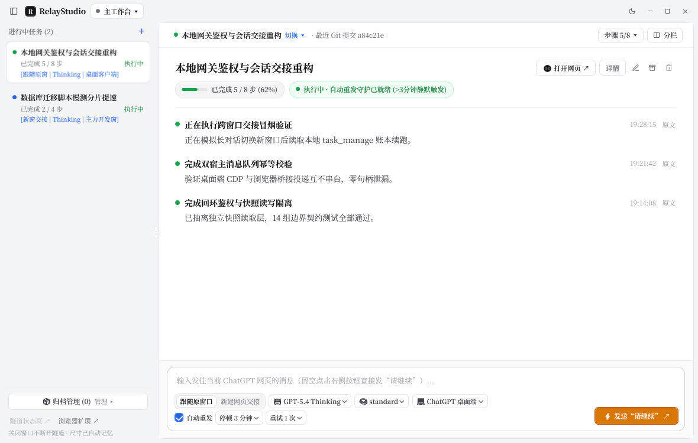
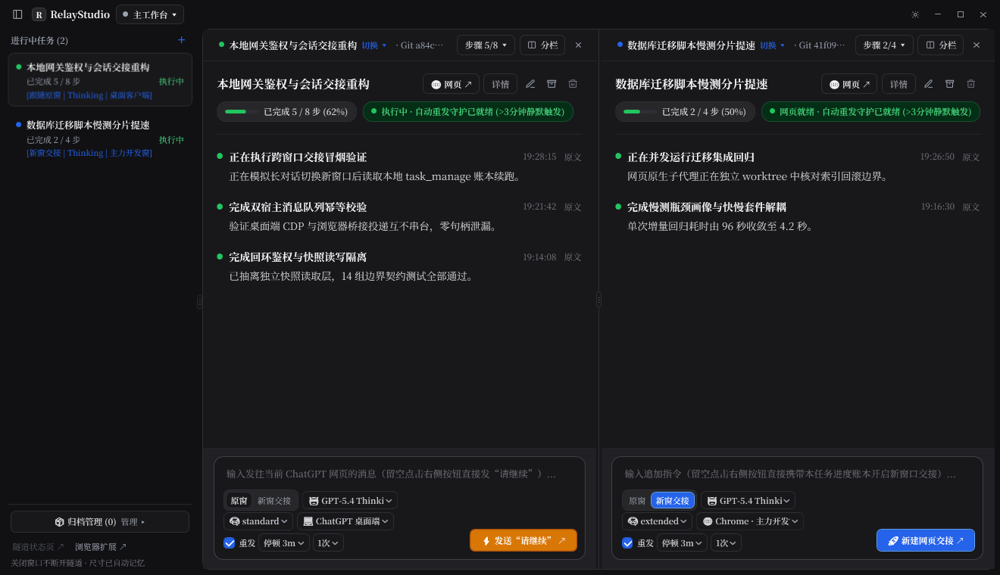
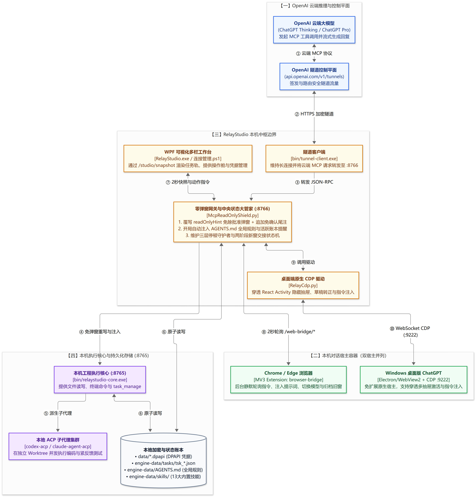
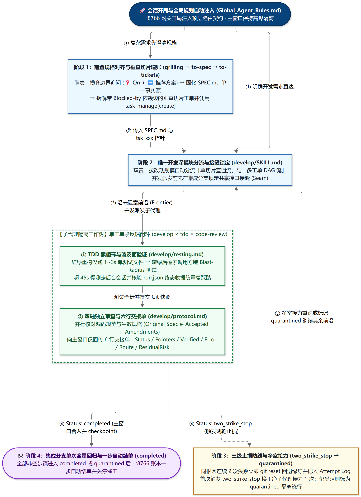
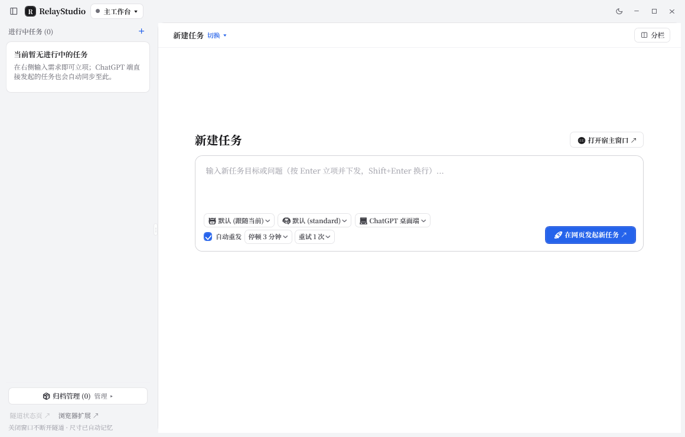
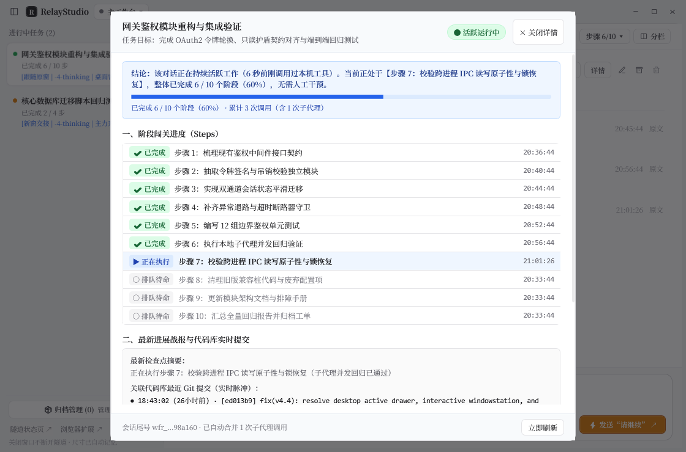
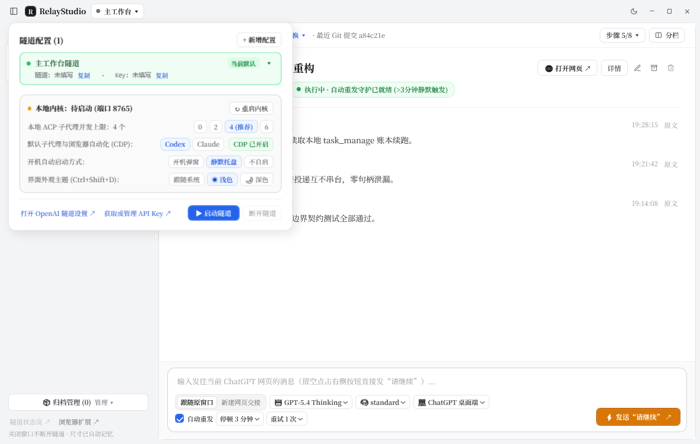

<div align="center">

# RelayStudio

**面向 ChatGPT · Gemini · Claude 桌面端与网页端的本地长程开发接力工作台**

[](https://github.com/yuan88964/RelayStudio/releases/latest)
[](#快速开始quickstart)
[](docs/architecture.md)
[](LICENSE)
[](https://linux.do/)

[设计背景](#设计背景与核心机制) · [长程工作流](#规格驱动的长程开发工作流) · [双宿主接入](#双宿主工作模式) · [快速开始](#快速开始quickstart) · [从源码构建](#从源码构建build-from-source) · [工程指南](docs/long-horizon-workflow.md) · [系统架构](docs/architecture.md) · [友链](#友链与致谢)

</div>

---



<p align="center">
  
</p>

**RelayStudio** 是运行在 Windows 本地的智能体任务接力与会话守护工作台。它将本机仅监听回环地址的 **`:8766` 免弹窗 MCP 网关（内置 OAuth 2.1 自动授权与 Cloudflare / Tailscale Funnel 双隧道支持）**、**单步自动结单账本（`tsk_*.json`）**、**多平台双宿主桥接层（ChatGPT 桌面端 CDP + 支持 ChatGPT / Gemini / Claude 的浏览器 MV3 扩展）** 以及 **16 个内置工程与图解深模块技能包（`builtin-skills/`）** 整合在同一套多栏工作区中，用来解决云端思考模型（如 `ChatGPT Thinking / Pro`、`Gemini 2.5 Pro`、`Claude Opus / Sonnet`）在跨数小时开发任务中面临的权限弹窗中断、回合停顿、单窗口上下文衰减与局部死循环问题。

---

## 设计背景与核心机制

直接在网页或客户端中挂载常规 MCP 工具运行长周期工程任务时，通常会遇到四类结构性阻碍：写操作频繁触发人工确认弹窗、模型完成局部修改后习惯性停下等待确认、单会话长上下文积累试错噪声后推理质量下降，以及慢速测试跨越网页端 60～120 秒流式超时后引发盲目重复执行。

RelayStudio 将**会话窗口视为随时可替换的临时执行器，将本地磁盘上的规格书（`SPEC.md`）、Git 提交历史与任务账本（`tsk_*.json`）作为唯一持久状态**，通过以下核心机制构成闭环：

<p align="center">
  
</p>

| 模块维度 | 常规 MCP 挂载模式 | RelayStudio 工作台机制（v1.3.0） |
| :--- | :--- | :--- |
| **本地网关与双隧道免确认执行** | 写文件与执行命令频繁触发确认弹窗；不同平台连接器要求 OAuth 2.1 认证或独立暴露隧道 | **单回环网关（`127.0.0.1:8766`）+ 双隧道与内置 OAuth 2.1**：支持 OpenAI Cloudflare 隧道与 Tailscale Funnel 固定域名双通道，内置零配置 OAuth 2.1（PKCE + 动态客户端注册）与 `readOnlyHint: true` 重写，集中收敛内置工具与 `engine-data/mcp` 扩展；仅在当前任务开启自动重发时动态注入免确认连跑尾注 |
| **原生单步任务账本**<br>（Spec v4.6） | 缺少持久化步骤状态，或受制于繁琐的多步复盘结单校验 | **`:8766` 原生 `task_manage` 引擎**：精简为 `create / update / checkpoint / list / get / block / resume` 7 个动作，支持 `pending`、`in_progress`（含 `two_strike_stop` 净室接力中间态）、`completed`、`quarantined`；所有步骤进入终态后一步自动结单并关停催工 |
| **解耦式停顿守护与五维自愈**<br>（Spec v4.7） | 超时后需人工输入“继续”、后台标签页遭 Chrome 5 分钟休眠断流，或因盲目定时重发打断慢测试与深度思考 | **独立停顿时长 × 重试上限 + 五维生命体征自愈**：支持按任务配置停顿阈值与重试上限；内置 DOM 报错雷达与后台保活信号、全工具在途冻结计时，并在任务卡片直观展示「网关 · 宿主 · 页面 · 模型 · 步进」五维状态，遇流式断流或连接异常自动先原窗唤醒再升级接力 |
| **跨窗口交接与档位继承** | 上下文膨胀后需手动整理进度重开会话，易丢失当前模型与思考力度 | **两阶段账本交接与旧窗归档**：自动提取本地 `tsk_*.json` 进度与规格指针拉起新会话；默认 `inherit` 模式在原窗唤醒时不触碰模型设置，升级新窗交接时自动快照并还原原窗口的模型与思考强度，随后对旧窗口执行停止生成与归档 |
| **多栏工作区与三态主题** | 命令行滚动原始 JSON 日志，多任务并行时难以直观追踪进度与提交 | **Edge WebView2 硬件加速 4 分栏工作台 + SSE 实时推送**：复用 Windows 10/11 内置 Edge WebView2 合成渲染管线与 `:8766` SSE 增量推送（托盘隐藏自动挂起零 GPU 占用，亦保留 `--legacy` 传统界面回退）；内置 `跟随系统 / 浅色 / 深色` 三态主题记忆（支持顶栏 `☀/🌙` 一键切换、`Ctrl+Shift+D` 快捷键，右键恢复跟随系统） |
| **规则与深模块技能路由** | 每次开新窗需重复粘贴开发规范，网页端无法直接复用本地 `SKILL.md` | **开局自动注入 `AGENTS.md` + 内置 16 项工程与图解技能**：启动时自动挂载 `builtin-skills/` 至 `engine-data/`（支持 NTFS 软链接/硬链接直连本地 Obsidian 知识库，本机零重复挂载），按需加载技能正文，平时不额外占用上下文 |

---

## 规格驱动的长程开发工作流

除底层连接与守护外，RelayStudio 在 [`builtin-skills/`](builtin-skills) 中随附了默认全局规则 [`AGENTS.md`](builtin-skills/AGENTS.md) 与 16 个工程及图解技能包，支持从需求澄清到集成回归的分阶段自动化推进（完整流程见 [`docs/long-horizon-workflow.md`](docs/long-horizon-workflow.md)）：

<p align="center">
  
</p>

1. **前置规格对齐（`grilling` → `to-spec` → `to-tickets`）**
   在编码前先通过结构化追问澄清边界条件，将模块接口契约、测试接缝与修订账本固化至仓库 `SPEC.md`，再拆解为带前置依赖边（`Blocked by`）的垂直切片工单，并映射为本地 `task_manage` 步骤账本。
2. **主从上下文隔离与并发实施（`develop` × `tdd` × `code-review`）**
   唯一开发入口 `develop` 按改动规模自动分流单切片流与多工单 DAG 流；主会话仅持有工单图的可推进前沿（Frontier）与文件路径指针，实施工作可并发委派给宿主原生云端子代理或本地 ACP 子代理（Codex / Claude），完成测试与双轴审查后仅回传六行交接单（`Status / Pointers / Verified / Error / Route / ResidualRisk`）。
3. **两轮止损回滚与局部隔离（`two_strike_stop` → `quarantined`）**
   同一根因连续 2 次修复未果时，立即执行 `git reset` 回退至最近绿灯提交并写入 `Attempt Log` 避坑记录，以 `two_strike_stop` 触发限次净室接力；升级接力仍阻塞或触及规格边界时，将该步骤标为 `quarantined` 隔离绕行，主会话继续推进其余无阻塞工单并在收尾时自动完成账本结算。
4. **分层测试与慢测防踩踏（`develop/testing.md`）**
   编码期仅运行单测试文件，转绿后运行变更波及面（Blast Radius）测试，集成分支收尾时执行单次全量回归；遇到网页端流式超时先核对本地 `run.json` 持久化收据与单实例锁防止重复拉起，并可按需启用耗时倒序多进程并发、`copytree` 只读母版与 `manifest.json` 外部切片提速。

---

## 双宿主工作模式

每个任务分栏底部的操作舱均可独立绑定目标宿主，支持桌面客户端与多浏览器账号并行运行：

| 接入模式 | 适用场景 | 运行机制 | 前置要求 |
| :--- | :--- | :--- | :--- |
| **Windows 桌面客户端模式**<br>（`ChatGPT 桌面端`，默认） | 偏好原生桌面应用、不希望安装浏览器扩展 | 通过本机回环 CDP（`127.0.0.1:9222`）直连官方桌面客户端，自动扫描多抽屉容器（`<Activity>`）并将临时草稿号平滑转正为云端会话 UUID | 安装 Microsoft Store 官方 **ChatGPT 桌面版** |
| **浏览器扩展网桥模式**<br>（`Chrome / Edge · Profile`） | 多平台（ChatGPT / Gemini / Claude）与多账号并行开发、习惯在后台标签页静默运行任务 | 通过仓库内置 `browser-bridge` MV3 扩展按 2 秒心跳聚合同步标签页状态，自动识别平台模型档位并在后台静默完成提示词投递与旧会话归档，不抢占前台焦点 | 在 Chrome 或 Edge 开发者模式加载 `browser-bridge` 目录 |

<p align="center">
  
  
</p>

---

## 快速开始（Quickstart）

### 1. 环境要求与发行包准备

- **操作系统**：Windows 10 / 11 x64（内置 Windows PowerShell 5.1 与 .NET Framework 4.8）。
- **基础依赖**：
  - **Python 3.11+**（必需，用于运行本地 `:8766` 桥接中枢 `McpReadOnlyShield.py`，仅依赖标准库）。
  - **Node.js 20+**（可选，仅在本地调用 `@agentclientprotocol/codex-acp` 或 `@agentclientprotocol/claude-agent-acp` 子代理时需要）。
- **下载解压（提供「完整内置版」与「纯净路由版」双版本，无需本地编译）**：
  前往 [**GitHub Releases (v1.3.0 Latest)**](https://github.com/yuan88964/RelayStudio/releases/latest) 按需选择其一下载解压即可双击 `RelayStudio.exe` 运行（附带 [`SHA256SUMS.txt`](https://github.com/yuan88964/RelayStudio/releases/download/v1.3.0/SHA256SUMS.txt) 校验单）：
  1. **完整内置版（推荐开箱即用）**：[**`RelayStudio-v1.3.0-win-x64-portable.zip`**](https://github.com/yuan88964/RelayStudio/releases/download/v1.3.0/RelayStudio-v1.3.0-win-x64-portable.zip) — 已内含编译好的 `RelayStudio.exe`、`bin/*.exe`、浏览器扩展，以及预挂载至 `engine-data/` 的默认全局规则 [`AGENTS.md`](builtin-skills/AGENTS.md) 与 16 项工程及图解技能包（[`builtin-skills/`](builtin-skills)）。
  2. **纯净路由版 + 外部 Obsidian 知识库软路由（推荐多 Agent 共用与深度定制）**：[**`RelayStudio-v1.3.0-win-x64-pure-portable.zip`**](https://github.com/yuan88964/RelayStudio/releases/download/v1.3.0/RelayStudio-v1.3.0-win-x64-pure-portable.zip) — **不内置任何预设全局规则与技能**（纯粹作为 `:8766` 免弹窗网关与多平台停顿守护底座）。你可以搭配配套开源的 Obsidian 规则与深模块技能仓库 **[`yuan88964/AgentVault`](https://github.com/yuan88964/AgentVault)**，运行其中的 `Setup-ObsidianRelay.ps1` 一键将该仓库（或合并进你现有的本地 Obsidian 库）通过 NTFS 软/硬链接挂载至 RelayStudio 的 `data/settings.json`，实现“在 Obsidian 改一处规则或技能，RelayStudio 与本机 Codex / Claude 同步生效”。

### 2. 配置公网 MCP 隧道（二选一）与外观主题

1. 双击运行根目录下的 **`RelayStudio.exe`**（或通过 PowerShell 执行 `Launch-ConnectionManager.ps1`）。
2. 点击左上角顶栏的 **`● 主工作台 ▾`** 按钮，展开连接与内核配置面板：



3. **选择任一公网隧道方式暴露本机 `:8766` 网关**（`:8766` 已内置零配置 OAuth 2.1 + PKCE + 动态客户端注册，无需额外部署鉴权服务）：
   - **方式 A：Tailscale Funnel 固定域名隧道（推荐，通用于 Claude / Gemini / ChatGPT）**：安装并登录 [Tailscale](https://tailscale.com/)，在面板中切换至 Tailscale 隧道页签一键开启（或执行 `tailscale funnel --bg 8766`），即可获得形如 `https://<设备名>.<tailnet>.ts.net/mcp` 的永久免费 HTTPS MCP 地址。
   - **方式 B：OpenAI 官方 Cloudflare 隧道**：前往 [OpenAI Tunnels 设置页](https://platform.openai.com/settings/organization/tunnels) 获取隧道标识（`tun_xxx`），并在 [OpenAI API Keys](https://platform.openai.com/api-keys) 生成密钥，填入面板点击 **「保存」** 与 **「▶ 启动隧道」**（密钥经 Windows DPAPI 加密存储于本机 `data/*.dpapi`）。
4. 你可以在同一面板或右上角 `☀/🌙` 按钮（`Ctrl+Shift+D`）随时切换 **跟随系统 / 浅色 / 深色** 主题。

### 3. 关联对话宿主与连接器

- **使用 Chrome / Edge 浏览器（支持 ChatGPT · Gemini · Claude）**：打开 `chrome://extensions` 或 `edge://extensions` 开启「开发者模式」，点击「加载已解压的扩展程序」并选择解压目录内的 **`browser-bridge`** 文件夹（或下载独立扩展包 [`relaystudio-browser-bridge-v1.3.0.zip`](https://github.com/yuan88964/RelayStudio/releases/download/v1.3.0/relaystudio-browser-bridge-v1.3.0.zip) 解压加载），随后刷新 [`chatgpt.com`](https://chatgpt.com/)、[`gemini.google.com`](https://gemini.google.com/) 或 [`claude.ai`](https://claude.ai/) 页面即可在宿主下拉列表中看到对应平台与浏览器配置。
- **使用 ChatGPT 桌面端（Windows 官方客户端）**：无需额外插件，首次点击「打开宿主窗口」或发起任务时，RelayStudio 会通过桌面包身份自动携带调试端口拉起客户端。
- **在网页端启用 MCP 连接器**：在 ChatGPT（Settings → Connectors）、Claude（Settings → Integrations → Add custom integration）或 Gemini 中填入你的公网隧道 `/mcp` 地址完成一键 OAuth 2.1 绑定，并在会话输入框工具菜单中勾选启用。

### 4. 启动长程任务

在右侧发射台输入任务目标（例如：`读取仓库 SPEC.md，按 develop 建立工单账本并推进实施`），按需选择宿主、模型档位及底部自动重发策略（默认 `停顿 3 分钟` · `重试 1 次`），按 `Enter` 或点击 **「🚀 在网页发起新任务 ↗」** 即可建立本地 `tsk_xxx` 账本并进入自动接力流程。

---

## 从源码构建（Build from Source）

为保持 Git 仓库 100% 纯文本源码可审阅（不向版本库提交编译产物 `.exe`），如果你选择直接 `git clone` 本源码仓而非下载预打包便携包，可按以下三步在本地完整构建并复现发行包：

```powershell
# 1. 克隆纯源码仓库
git clone https://github.com/yuan88964/RelayStudio.git
cd RelayStudio

# 2. 构建 WebView2 前端静态工作台资源（ui-src -> ui，便携包用户无需此步）
Push-Location .\ui-src; npm install; npm run build; Pop-Location

# 3. 准备 WebView2 互操作组件（bin\webview2\*.dll）并调用系统自带 .NET Framework csc.exe 编译 RelayStudio.exe
powershell -ExecutionPolicy Bypass -File .\scripts\build-launcher.ps1

# 4. 准备上游开源运行时二进制至 .\bin\ 目录（开源组件，无需闭源依赖）：
#    - bin\tunnel-client.exe : 下载官方开源 cloudflare/cloudflared (cloudflared-windows-amd64.exe) 重命名放入
#    - bin\relaystudio-core.exe : 由 Apache-2.0 开源仓库 uvwt/agentdock 执行 cargo build --release 编译放入

# （可选）一键生成与官方一致的便携发行包与 SHA256SUMS.txt
powershell -ExecutionPolicy Bypass -File .\scripts\build-release.ps1 -Version "1.3.0"
```

---

## 文档导航

| 文档路径 | 说明 |
| :--- | :--- |
| **[`docs/long-horizon-workflow.md`](docs/long-horizon-workflow.md)** | 长程开发工作流手册：`AGENTS.md + MCP + Skill` 协同机制、单步 `task_manage` 终态契约、两轮止损隔离与慢测提速方案 |
| **[`docs/architecture.md`](docs/architecture.md)** | 系统架构与模块契约：C2 容器边界图、跨窗口交接时序图、各深模块职责与 `data/settings.json` 软路由字段说明 |
| **[`docs/troubleshooting.md`](docs/troubleshooting.md)** | 故障排查手册：端口与回环健康自检、桌面端 CDP 重连、编码规范检查与离线隔离回归测试命令 |
| **[`GLOSSARY.md`](GLOSSARY.md)** | 领域术语表：会话绑定簿、两阶段交接过户、多抽屉转正、全工具在途门禁等统一术语定义 |
| **[`SPEC.md`](SPEC.md) & [`docs/specs/`](docs/specs/)** | 系统演进规格书与架构决策记录（ADR），涵盖至 Spec v4.7 五维生命体征与通用异常自愈协议 |

---

## 友链与致谢

本项目积极参与并认可 **[LINUX DO 社区](https://linux.do)**（友链：https://linux.do ）。感谢社区佬友在 AI 工程化实践、MCP 工具链与长程智能体工作流上的持续讨论与经验分享。

- **社区友链**：[LINUX DO - 新的理想型社区 (https://linux.do)](https://linux.do)
- **[`uvwt/agentdock`](https://github.com/uvwt/agentdock)（Apache-2.0）**：上游本地执行内核与云端隧道桥接底座参考并基于该项目（Apache License 2.0）演进构建，特此致谢。
- **[`mattpocock/skills`](https://github.com/mattpocock/skills)**：启发了 `grilling`、`to-spec`、`to-tickets`、`tdd` 等规格化软件开发技能结构。
- **[Model Context Protocol (MCP)](https://modelcontextprotocol.io/)** & **[Agent Client Protocol (ACP)](https://agentclientprotocol.com/)**：提供跨宿主工具通信与本地子代理协作协议标准。

本仓库自身代码与文档采用 [MIT License](LICENSE) 开源；欢迎通过 Issue 或 Pull Request 参与改进（详见 [`CONTRIBUTING.md`](CONTRIBUTING.md)）。
