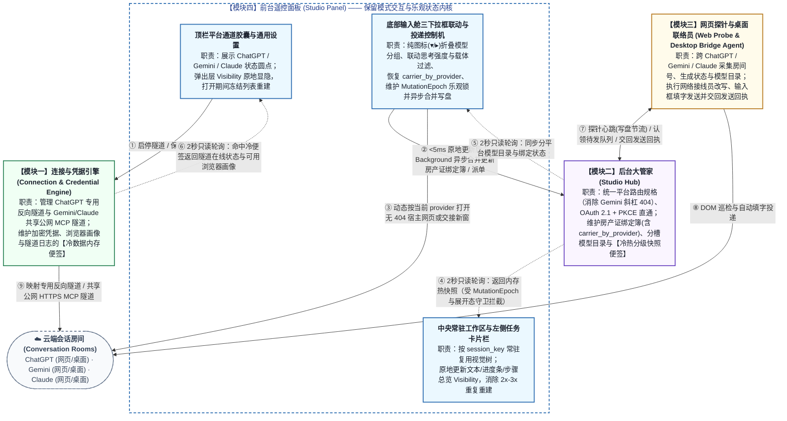
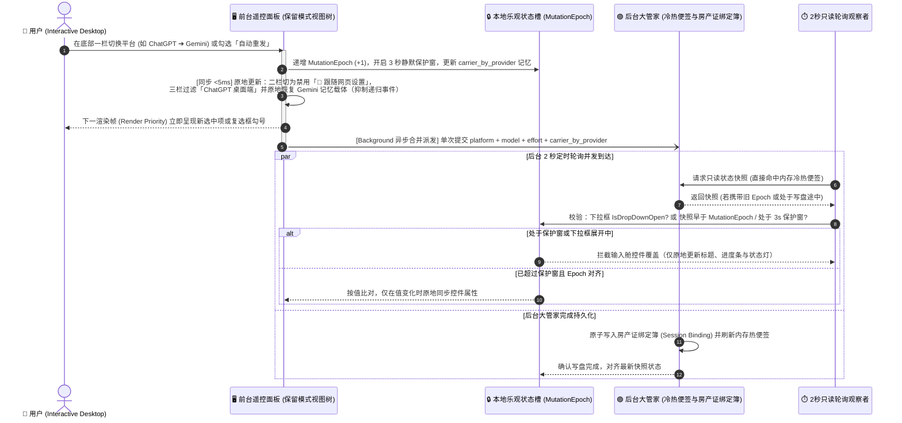

# RelayStudio 多平台（ChatGPT / Gemini / Claude）全链路通道、保留模式前端交互架构与冷热便签同步规格书（Spec）

- **Status**: `ready-for-agent`
- **Date**: 2026-11-06

---

## Problem Statement

### 1. 现状系统版图与职责分工（Current Architecture Overview）

`RelayStudio` 是连接本地开发工作台与云端 **会话房间（Conversation Room）** 的全链路会话监督、排队投递与自动交接守护系统，由四大核心模块协同运作：

1. **连接与凭据引擎（Connection & Credential Engine）**：负责管理三大云端平台（`ChatGPT`、`Gemini`、`Claude`）的通道连接配置、加密凭据存储、本地内核进程生命周期，以及 **专用反向隧道（OpenAI Private Tunnel）** 与共享 **公网 MCP 隧道（Public HTTPS MCP Tunnel）** 的守护与状态探测。
2. **后台大管家（Studio Hub）**：一方面作为本地 MCP 网关，内置免弹窗只读护盾、OAuth 2.1 动态客户端注册与 PKCE 授权免密直通层、以及原生任务进度账本；另一方面作为会话调度中枢，统一维护 **任务卡片（Task Card）**、**待发队列（Dispatch Queue）**、**房产证绑定簿（Session Binding）** 与 **退役名单（Retired Conversations）**。
3. **网页探针（Web Probe）与桌面联络员（Desktop Bridge Agent）**：驻留在三大平台浏览器网页与 ChatGPT 桌面客户端中，通过 **网络接线员（Stream Hook）** 与 **页面巡视员（DOM Inspector）** 周期性向 **后台大管家** 汇报当前 **会话房间** 标识、分平台可用模型目录与流式生成状态，并从 **待发队列** 认领消息填入输入框发送后交回 **发送回执（Delivery Receipt）**。
4. **前台遥控面板（Studio Panel）**：用户直接操作的桌面图形界面，顶栏设有 **平台通道胶囊（Platform Channel Capsule）** 与管理 **本地 CLI 智能体（Local CLI Agent）** 的「通用设置」，左侧设有 **任务卡片** 导航栏与 **新建任务发射台（New Task Launchpad）** 入口，中央设有双分栏工作区，底部设有任务输入舱（含「平台与模型下拉框」「思考强度下拉框」「目标载体下拉框」）与投递控制栏（**跟随原窗口（Follow Window Mode）**、**新建网页交接（New Window Handover Mode）**、自动重发与超时规则）。

### 2. 现状六大核心痛点与底层架构成因对照表（Root-Cause Attribution）

| 问题维度 | 用户可观测现象 | 责任模块 | 底层架构成因（为什么现状会出问题） | 目标行为契约（应改为什么行为） |
| :--- | :--- | :--- | :--- | :--- |
| **1. 平台通道命名割裂与非原生 MCP 平台混入** | 顶栏 **平台通道胶囊**、胶囊弹出卡片与底部模型列表混用公司名 `OpenAI` 与产品名 `ChatGPT`，与同级的产品名 `Gemini`、`Claude` 语义层级不一致；且早期配置混入无原生 MCP 的 `DeepSeek` 与 `OpenCode`。 | **连接与凭据引擎** + **前台遥控面板** + **后台大管家** | 1. 界面通道展示层未将面向用户的对话平台名称（`ChatGPT`）与底层外部官方协议契约（`OpenAI API Key`、官方平台域名、**商店容器通行证（Store Package Identity）** `OpenAI.Codex`）解耦；<br>2. 早期设计将非原生 MCP 平台混入顶栏胶囊，且 `Gemini` / `Claude` 分栏错误展示无用的 API Key 表单而非共享 **公网 MCP 隧道** 挂载卡片。 | 1. 顶栏平台收敛为 **`ChatGPT`、`Gemini`、`Claude`** 三大原生 MCP 平台；所有面向用户的界面通道标签与内部平台通道标识统一为 `ChatGPT` / `chatgpt`（在边界处自动兼容转换历史 `openai` 记录），同时严格保留外部官方协议要求的 `OpenAI` 专有标识；<br>2. `Gemini` 与 `Claude` 分栏统一展示共享 **公网 MCP 隧道** 的在线状态与挂载网址。 |
| **2. Google Gemini 交接网址路径斜杠导致 404** | 当任务或 **新建任务发射台** 选用 `Gemini` 并触发 **新建网页交接** 或点击在网页发起新任务时，浏览器打开的地址返回 Google 404 错误页，**网页探针** 无法注入认领消息。 | **后台大管家** + **前台遥控面板** | 拼接新建会话交接网址时，无条件在基础路径末尾补齐了 `/` 再拼接查询参数（生成了 `/app/?relay_handover=1...`），而 Google Gemini 网页路由严格要求 `/app?relay_handover=1...`，多出的斜杠直接触发服务端 404。 | 建立统一的多平台网址拼接契约：在追加交接查询参数前自动剥离非根路径末尾的多余斜杠，确保 `Gemini` 精确生成无尾部斜杠的合法交接网址，并与前端唤醒/交接按钮联动。 |
| **3. 底部三下拉框缺少跨平台原子联动、分组折叠与分平台载体记忆** | 1. 三个平台的 `默认 (跟随网页)` 挤在下拉框最顶部，未归入各自平台标题下；<br>2. 模型列表无法按平台折叠，且 `Gemini` / `Claude` 标题圆点未反映 **公网 MCP 隧道** 状态；<br>3. 切到 `Gemini` / `Claude` 时，第二栏「思考强度」未自动锁定为 `跟随网页设置`，第三栏「目标载体」仍暴露不兼容的 `ChatGPT 桌面端`；<br>4. 切换平台时不记忆各平台上次选用的浏览器配置载体。 | **前台遥控面板** + **后台大管家** | 1. 底部三个下拉框各自独立响应事件，缺乏以「当前选中平台（`provider`）」为核心的原子状态联动机；<br>2. **房产证绑定簿**（含 **新建任务发射台** 状态槽）仅存储单一载体字段，未按平台维护载体记忆字典（`carrier_by_provider`）；<br>3. 平台切换时连续触发多次独立同步写盘请求。 | 在 **前台遥控面板** 建立三下拉框原子联动状态机：各平台默认项归入对应平台分组标题下；点击平台标题通过纯箭头图标（展开 `▾` / 折叠 `▸`，无任何多余文字）原地折叠/展开；切换平台时原地联动更新「思考强度」与「目标载体」候选集、自动恢复该平台记忆的载体，并合并为单次后台异步写盘。 |
| **4. 立即模式全量拆树重建引发界面闪烁、弹窗失焦与交互卡顿** | 1. 勾选「自动重发」复选框后，勾号要停顿近 1 秒才显示；<br>2. 展开「步骤总览」或切换左侧 **任务卡片** 时界面闪烁、重复重建 2～3 次；<br>3. 顶栏弹出卡片打开时遇到 2 秒定时刷新会丢失列表选中态。 | **前台遥控面板** | 1. 采用「立即模式（Immediate Mode）」刷新：每 2 秒定时轮询、1 秒倒计时或点击复选框时，直接清空工作区容器（`Children.Clear()`）并重新实例化数十个界面控件；<br>2. 勾选「自动重发」在界面主线程同步等待 **后台大管家** 完成磁盘读写与完整快照重算后，才让渲染管线绘制勾号。 | 将 **前台遥控面板** 升级为 **保留模式原地更新（Retained-Mode In-Place Update）与渲染优先级让渡架构**：主工作区控件树常驻复用，2 秒轮询与 1 秒倒计时仅原地修改文本、进度条宽度与显隐属性（`Visibility`）；所有用户交互在 `<5ms` 内原地更新界面并让渡渲染帧，持久化操作下放后台优先级异步执行。 |
| **5. 2 秒定时轮询与用户正在操作的输入舱控件发生「状态回滚竞态」** | 在 **新建任务发射台** 或 **任务卡片** 底部切换平台、模型或载体时，若恰逢后台 2 秒轮询返回旧快照，下拉框会被强行刷回旧选项；且读取同步函数内部夹带了反向写盘调用。 | **前台遥控面板** | 1. **新建任务发射台** 缺少独立的本地乐观状态槽；<br>2. 缺少乐观状态代数锁（`MutationEpoch`）与下拉框展开态守卫（`IsDropDownOpen`），后台旧快照无条件覆盖用户刚修改的控件；<br>3. 界面读取同步函数违反读写分离原则，在刷新界面时反向调用了 **后台大管家** 写接口。 | 建立 **乐观状态机（Optimistic UI）与严格读写分离契约**：为 **新建任务发射台** 与每张 **任务卡片** 维护带代数锁（`MutationEpoch`）与 3 秒静默保护窗的本地状态槽；任何过期轮询快照或下拉框展开期间的后台刷新严禁覆盖输入舱控件；界面刷新函数纯化为 100% 只读观察者。 |
| **6. 冷热数据混同全量扫描导致每 2 秒高昂磁盘与进程 I/O 内耗** | 每 2 秒界面刷新与每 3 秒后台守护循环都在重复解密凭据文件、全量重读浏览器配置文件、从头扫描整份隧道日志、重复解析未变化的任务 JSON 文件，并高频读取注册表主题。 | **连接与凭据引擎** + **后台大管家** + **前台遥控面板** | 未区分极少变化的「冷数据（静态配置、浏览器画像目录、未变任务文件、系统主题）」与高频变化的「热数据（活跃生成状态、倒计时、最新里程碑）」，导致每次轮询都走最慢的全量磁盘扫描路径。 | 建立 **冷热分级便签（Cold/Hot Tiered Slates）与按修改时间缓存契约**：冷数据按文件 `(mtime, size)` 或 TTL 缓存于内存便签中，仅在文件实际变化时增量重读；隧道日志采用尾部定长增量读取；2 秒面板轮询与 3 秒守护循环共享同一份内存计算快照。 |

---

## Solution

围绕 **「三大原生 MCP 平台全链路打通 + 前台保留模式响应式交互内核 + 后台冷热分级便签同步」** 的全局设计，将系统收敛为四大深模块协同方案：

1. **连接与凭据引擎（Connection & Credential Engine）**：
   - 将平台通道集合收敛为 **`ChatGPT`、`Gemini`、`Claude`** 三项，统一使用 `chatgpt` 作为内部通道标识（读取配置时自动将历史 `openai` 归一化为 `chatgpt`，净化移除历史 `DeepSeek` / `OpenCode` 记录），同时严格保留 `OpenAI API Key`、官方平台设置链接、加密密钥文件名及 **商店容器通行证** `OpenAI.Codex` 等外部官方契约名称；
   - 为 `Gemini` 与 `Claude` 提供共享的 **公网 MCP 隧道** 生命周期管理（支持免配置快速模式与固定域名模式），并对凭据解密、浏览器配置目录探测与隧道日志读取全面引入 **冷数据内存便签缓存**。
2. **后台大管家（Studio Hub）**：
   - 建立统一的多平台路由与无斜杠交接网址拼接契约（消除 `Gemini` `/app/?relay_handover=1` 404 错误），支持公网 MCP 免弹窗只读护盾与 OAuth 2.1 + PKCE 自动授权直通；
   - 在 **房产证绑定簿**（含 **新建任务发射台** 专属槽位 `__new_task__`）中按平台分槽存储可用模型目录（`models_by_provider`），并新增 **分平台载体记忆字典（`carrier_by_provider`）**；
   - 建立按文件 `(mtime_ns, size)` 索引的 **任务卡片内存便签缓存**、增量隧道状态便签与高频探针心跳写盘节流机制，使 2 秒面板查询与 3 秒守护循环直接命中内存便签。
3. **网页探针（Web Probe）与桌面联络员（Desktop Bridge Agent）**：
   - 浏览器扩展同时覆盖 `ChatGPT`、`Gemini` 与 `Claude` 网页端，通过统一的跨站点适配接缝执行 **会话房间** 号提取、生成状态巡检、输入框填字发送与分平台模型采集，并在上报与交回 **发送回执** 时携带归一化后的平台标识（`chatgpt` / `gemini` / `claude`）。
4. **前台遥控面板（Studio Panel）—— 保留模式原地渲染、乐观状态机与多平台前端交互联动内核**：
   - **将前三项方案的前端呈现全部纳入统一的交互状态机**：顶栏 **平台通道胶囊** 与底部输入舱统一呈现 `ChatGPT`、`Gemini`、`Claude`；底部第一栏「平台与模型下拉框」将各平台 `默认 (跟随网页)` 归入各自平台标题下，支持点击标题通过纯图标（`▾` / `▸`）原地折叠/展开，且 `Gemini` 与 `Claude` 严格采用纯 `默认 (跟随网页)` 方案（不做脆弱的网页 DOM 模拟点击切模型）；切换平台时原地原子联动第二栏「思考强度」（`ChatGPT` 启用四档思考强度，`Gemini` / `Claude` 自动切换为禁用态 `🧠 跟随网页设置`）与第三栏「目标载体」（`Gemini` / `Claude` 自动过滤 `ChatGPT 桌面端` 并原地恢复 `carrier_by_provider` 中该平台上次记忆的浏览器载体），且驱动所有「打开网页 / 打开宿主窗口 / 新建网页交接」按钮动态路由至对应平台的无 404 网址；
   - **保留模式原地更新与渲染优先级让渡**：主工作区分栏、左侧 **任务卡片** 列表与顶栏胶囊保持视觉树常驻，通过切换 `Visibility`（`Visible` / `Collapsed`）与原地属性赋值替代全量删树重建；勾选「自动重发」、切换投递模式或操作三下拉框时在 `<5ms` 内原地更新界面并立即渲染，后台异步合并写盘；
   - **乐观状态代数锁（`MutationEpoch`）与严格读写分离**：用户操作立即递增本地 `MutationEpoch` 并开启 3 秒保护窗，拦截后台过期轮询快照的回滚覆盖；界面刷新函数 strictly 只读，绝不反向触发写操作。

---

## User Stories

1. As a RelayStudio 用户, I want 顶栏 **平台通道胶囊**、胶囊弹出卡片、添加平台面板与底部输入舱统一将对话平台显示为 `ChatGPT`、`Gemini`、`Claude`（不再混用公司名 `OpenAI` 与产品名 `ChatGPT`，也不再出现 `DeepSeek` 与 `OpenCode`）, so that 三个同级云端对话平台的视觉命名清晰一致。
2. As a RelayStudio 用户, I want 涉及外部官方协议契约的位置（包括 `OpenAI API Key` 字段说明、`打开 OpenAI 隧道设置 ↗` 官方链接、加密密钥文件名及 **商店容器通行证** `OpenAI.Codex`）继续保留官方 `OpenAI` 标识，且历史保存的 `openai` 配置在升级后自动无缝识别为 `ChatGPT`, so that 命名统一不会破坏任何外部鉴权协议或丢失已有配置。
3. As a RelayStudio 用户, I want 点开顶栏 `Gemini` 或 `Claude` 分栏时直接看到共享 **公网 MCP 隧道** 的在线状态与公网 HTTPS MCP 挂载网址，支持一键复制挂载网址、一键启停隧道、以及一键打开 Gemini「已关联的应用」或 Claude「Connectors」设置页, so that 我无需配置无用的 API Key 即可快速将本机 **后台大管家** 挂载到云端对话房间。
4. As a RelayStudio 用户, I want Gemini 网页版或桌面端、Claude 网页版或桌面端在通过 **公网 MCP 隧道** 连入本机 **后台大管家** 时，能够自动完成 OAuth 2.1 动态客户端注册与 PKCE 授权直通并免弹窗拉取和调用全部本地工具, so that 云端会话房间在思考过程中可以无阻塞地读写本地代码与更新任务账本。
5. As a RelayStudio 用户, I want 当任务或 **新建任务发射台** 绑定在 `Gemini` 并触发 **新建网页交接** 或点击「🚀 在网页发起新任务 ↗」时，生成的交接网址精确采用无多余斜杠的合法格式（`https://gemini.google.com/app?relay_handover=1...`）, so that 浏览器不会因路径斜杠问题落入 Google 404 错误页。
6. As a RelayStudio 用户, I want 底部第一栏「平台与模型下拉框」将每个平台的 `默认 (跟随网页)` 选项直接归入各自平台分组标题的正下方，且 `Gemini` 与 `Claude` 分组标题的状态圆点实时反映共享 **公网 MCP 隧道** 的连接状态, so that 各平台选项层级一目了然且状态与顶栏 **平台通道胶囊** 完全一致。
7. As a RelayStudio 用户, I want 点击底部第一栏中的任意平台分组标题（`ChatGPT`、`Gemini`、`Claude`）时，能够在不关闭下拉菜单的前提下原地折叠或展开该平台下的模型选项，且折叠/展开状态仅通过标题左侧的纯箭头图标（展开 `▾`、折叠 `▸`）表达，绝不附加 `(已折叠)` 等任何文字说明, so that 我能干净利落地收起不常用的长模型列表。
8. As a RelayStudio 用户, I want `Gemini` 与 `Claude` 分组下保持纯粹的 `🤖 Gemini · 默认 (跟随网页)` 与 `🤖 Claude · 默认 (跟随网页)` 选项（不执行脆弱的网页 DOM 模拟点击切模型），而 `ChatGPT` 分组下继续支持通过 **网络接线员** 协议改写切换具体模型, so that 多平台模型选择既稳定可靠又符合各平台真实控制边界。
9. As a RelayStudio 用户, I want 在底部第一栏选中某个平台下的选项时，第二栏「思考强度下拉框」原地自动联动（选中 `ChatGPT` 时启用四档思考强度；选中 `Gemini` 或 `Claude` 时自动切换为禁用态 `🧠 跟随网页设置`）, so that 界面不会展示对当前平台无效的思考档位控件。
10. As a RelayStudio 用户, I want 在底部第一栏选中 `Gemini` 或 `Claude` 时，第三栏「目标载体下拉框」自动隐藏不兼容的 `ChatGPT 桌面端`（仅展示可用浏览器配置），而在切回 `ChatGPT` 时重新展示 `ChatGPT 桌面端` 与全部浏览器配置, so that 我不会误将 Gemini 或 Claude 任务投递给仅支持 ChatGPT 的桌面客户端。
11. As a RelayStudio 用户, I want 系统按平台分别记住我上次选用的运行载体（`carrier_by_provider`，例如 `ChatGPT` 记住 `ChatGPT 桌面端`、`Gemini` 记住 `Google Chrome · Default`），当我在底部第一栏来回切换平台时，第三栏自动原地恢复该平台对应的记忆载体并合并为单次后台保存, so that 我跨平台派单时无需每次手动重选载体。
12. As a RelayStudio 用户, I want 在 **新建任务发射台** 或已有 **任务卡片** 中切换平台后，点击「🌐 打开网页 ↗」「🌐 打开宿主窗口 ↗」「🚀 在网页发起新任务 ↗」或「🚀 新建网页交接 ↗」时，统一按当前选中的平台打开对应的 ChatGPT、Gemini 或 Claude 网页, so that 所有前端唤醒与交接入口都与底部选中的平台严格同步。
13. As a RelayStudio 用户, I want 勾选或取消「自动重发」复选框、切换 **跟随原窗口 / 新建网页交接** 档位、或选择底部三个下拉框时，界面勾号与选中状态在下一帧（`<5ms`）立即呈现，不再等待后台磁盘写盘完成后才绘制, so that 所有高频开关与下拉交互都具备零延迟的跟手体验。
14. As a RelayStudio 用户, I want 在操作底部三个下拉框或复选框时，即便后台每 2 秒的定时轮询恰好返回旧快照，我刚选中的平台、模型或载体也绝不会被后台轮询冲掉回滚, so that 界面状态始终以我的最新操作为准。
15. As a RelayStudio 用户, I want 主工作区在每 2 秒后台状态轮询、每 1 秒倒计时跳字以及点击展开/收起「步骤总览」卡片时，保持现有视觉树常驻并仅原地更新文字、进度条宽度与显隐状态（`Visibility`），不再整屏清空重画, so that 界面彻底消除周期性闪烁、滚动条跳动与弹窗失焦问题。
16. As a RelayStudio 用户, I want 点击左侧列表切换 **任务卡片** 或从归档恢复任务时，工作区只执行唯一一次视图同步，且顶栏弹出卡片打开期间不被 2 秒轮询清空列表选中态, so that 导航切换干脆利落、弹出卡片配置过程稳定不中断。
17. As a RelayStudio 用户, I want **连接与凭据引擎** 与 **后台大管家** 将静态配置、浏览器画像、未修改的任务文件与隧道日志状态缓存在内存冷便签中，仅在文件实际发生变化时增量读取, so that 后台常驻轮询不再每 2～3 秒引发全量磁盘扫描与 CPU 峰值内耗。

---

## Implementation Decisions

### 1. 全局架构设计：双平面数据流与四大深模块协同（Global Architectural Design）

为彻底解决「跨平台路由割裂」与「立即模式全量重绘 + 全量磁盘扫描内耗」，系统在全局架构上确立 **「控制与乐观派单平面（写路径）」** 与 **「冷热分级便签与保留模式原地观测平面（读路径）」** 严格读写分离的双平面模型。前三个专项方案（平台命名统一、Gemini 交接网址防 404、底部三下拉框联动与载体记忆）在落地后，其前端呈现与状态流转全部内聚于 **模块四（前台遥控面板）** 的保留模式交互内核中，并与其余三个后台/探针模块通过标准契约协同。

#### 1.1 宏观容器与双平面协同架构图（C4 Container & Dual-Plane View）



#### 1.2 前台乐观交互、三下拉框原子联动与轮询防回滚时序图（Runtime Sequence View）



---

### 2. 四大模块行为契约与可替换接缝（Module Behavioral Contracts）

#### 模块一：连接与凭据引擎模块（Connection & Credential Engine）

1. **平台集合收敛、通道命名统一（`ChatGPT`）与外部官方协议守卫**：
   - 允许加入 **平台通道胶囊** 的云端平台集合固定为 **`ChatGPT`、`Gemini`、`Claude`** 三项；内部平台通道枚举统一采用小写标识 `chatgpt`、`gemini`、`claude`。
   - **边界兼容与历史净化契约**：在读取配置文件或外部传入的平台标识时，统一在模块入口处将历史遗留的 `openai` 自动转换为 `chatgpt`，并自动过滤清理已废弃的 `DeepSeek` 与 `OpenCode` 记录；当请求添加三大平台以外的平台时直接拒绝并给出提示。
   - **外部官方协议标识守卫（严禁误改的四个边界）**：
     1. **专用反向隧道** 鉴权密钥的表单字段说明保留官方名称 `OpenAI API Key (仅用于拉起本地 MCP 隧道)`；
     2. 官方控制台外链按钮保留 `打开 OpenAI 隧道设置 ↗`（指向官方开发者平台）；
     3. 本地加密密钥文件的命名格式保留既有前缀契约，确保升级后无需用户重新输入密钥；
     4. 桌面客户端启动依赖的 Windows **商店容器通行证（Store Package Identity）** 严格保留系统注册名 `OpenAI.Codex`。
2. **公网 MCP 隧道（Public HTTPS MCP Tunnel）共享生命周期与双模持久化契约**：
   - 为 `Gemini` 与 `Claude` 提供共享的本机 **公网 MCP 隧道** 启动、停止与状态探测能力，将本机 **后台大管家** 的 MCP 服务映射为公网 HTTPS 挂载网址（自动补齐 `/mcp` 路径后缀）；
   - 同时支持 **Tailscale Funnel 永久固定域名模式**（识别 `*.ts.net` 固定域名或自动通过本机已登录的 Tailscale 提取 `https://<机器名>.<尾缀>.ts.net/mcp` 并挂载后台服务）、**Cloudflare 固定域名模式**（使用自定义固定 HTTPS 域名 + Cloudflare 隧道凭证）与 **Cloudflare 免配置快速模式**（生成临时 `*.trycloudflare.com` 域名兜底）；
   - 当面板启动时，若顶栏已启用 `Gemini` 或 `Claude` 且配置了固定域名（或本机 Tailscale 已登录就绪），后台启动线程自动拉起本地护盾与公网 MCP 隧道，无需用户每次开机手动点击启动按钮；
   - `Gemini` 与 `Claude` 分栏共用同一条本机 **公网 MCP 隧道**；对 `Gemini` 或 `Claude` 配置的任何保存、切换或启停操作，绝不修改或重启 `ChatGPT` 的 **专用反向隧道**。
3. **连接与凭据引擎冷数据内存便签缓存契约（Cold Slate Caching）**：
   - **凭据与连接画像内存便签**：按配置文件与凭据目录的最后修改时间（`mtime`）在内存便签中缓存已解密的连接画像；2 秒定时轮询期间若文件未发生修改，直接返回内存便签，消除每 2 秒重复读取磁盘与解密的开销。
   - **可用浏览器画像内存便签**：将本地配置文件读取与各浏览器（Chrome / Edge / Brave 等）的用户画像目录扫描统一纳入带修改时间与 TTL 守卫的内存便签中；仅当浏览器状态文件修改时间变化或用户主动刷新时才重新扫描磁盘。
   - **隧道日志尾部定长增量便签**：查询 **专用反向隧道** 或 **公网 MCP 隧道** 的运行状态与公网域名时，按隧道进程号与日志文件长度缓存解析结果；仅当日志文件长度增长时，从文件尾部定长读取最新片段（最后 8KB）提取连接状态与网址，禁止每次轮询从头全量读取整份日志文件。

---

#### 模块二：后台大管家模块（Studio Hub）

1. **多平台路由、无 404 交接网址拼接与公网 MCP 免弹窗直通契约**：
   - **多平台路由规格表**：内部维护统一的平台路由规格接缝，覆盖 `chatgpt`、`gemini`、`claude` 三大平台（同时在入口处将历史 `openai` 键自动归一化为 `chatgpt`）。
   - **消除尾部斜杠 404 的交接网址拼接契约**：当生成 **新建网页交接** 网址或发起新任务网址（带 `relay_handover=1`、任务标识与平台标识参数）时，若平台基础网址包含非根路径（如 `Gemini` 的 `/app` 或 `Claude` 的 `/new`），**必须在拼接查询问号 `?` 前剥离路径末尾的多余斜杠 `/`**，确保 `Gemini` 精确生成 `https://gemini.google.com/app?relay_handover=1...`，彻底根除 `/app/?relay_handover=1...` 导致的 Google 404 错误。
   - **跨域白名单与 OAuth 2.1 + PKCE 自动直通契约**：跨域响应头自动放行三大平台官方网页域名；当 `Gemini` 或 `Claude` 云端服务器通过 **公网 MCP 隧道** 发起 OAuth 2.1 授权发现、动态客户端注册（DCR）、PKCE 授权码换取令牌或访问 `/mcp` 入口时，自动完成无状态令牌签发并返回经免弹窗只读护盾处理后的标准工具列表与执行结果。
2. **分平台模型目录（`models_by_provider`）与分平台载体记忆（`carrier_by_provider`）契约**：
   - **分槽模型目录**：在桥接状态中按归一化后的平台标识（`chatgpt`、`gemini`、`claude`）独立维护可用模型目录槽位，收到 **网页探针** 上报时按所属平台归入对应槽位，互不覆盖。
   - **分平台载体记忆字典（`carrier_by_provider`）**：在 **房产证绑定簿（Session Binding）** 的每条记录（涵盖所有已有 **任务卡片** 以及代表 **新建任务发射台** 的专属槽位 `__new_task__`）中，除保存当前生效的 `provider` 与 `browser_profile` 外，新增持久化字典 `carrier_by_provider`：
     ```json
     {
       "provider": "gemini",
       "browser_profile": "Chrome:Default",
       "carrier_by_provider": {
         "chatgpt": "Desktop:ChatGPT",
         "gemini": "Chrome:Default",
         "claude": "Edge:Default"
       }
     }
     ```
     *（注：上述结构为编码状态持久化决策的最小 Schema 形状）*
   - **载体写入与回退守卫**：每当更新某个任务或 **新建任务发射台** 的平台与载体时，同步将该载体写入对应 `provider` 的 `carrier_by_provider[provider]` 槽位；当 `provider` 为 `gemini` 或 `claude` 时，若传入或历史记忆的载体为 `Desktop:ChatGPT`（`ChatGPT 桌面端`），服务端守卫自动将其回退归一化为当前首选的可用浏览器配置载体。
3. **后台大管家冷热分级便签与写盘节流契约（Hub Cold/Hot Slates）**：
   - **任务卡片按 `(mtime_ns, size)` 内存便签缓存**：遍历任务目录构建状态快照时，按每个任务文件的 `(修改时间纳秒, 文件字节大小)` 缓存已解析的任务对象与摘要；未发生修改的任务文件直接复用内存对象，消除每 2 秒面板查询与每 3 秒守护循环对全部任务文件的重复 JSON 反序列化。
   - **共享热快照便签与增量日志扫描**：将隧道连接日志的解析状态维护为基于文件偏移量（Offset）的增量内存便签；2 秒面板轮询与 3 秒后台催工守护循环共享同一份带短 TTL（1 秒）的计算快照。
   - **高频探针心跳写盘节流**：当收到 **网页探针** 每 1～2 秒上报的标签页心跳与模型目录时，先在内存热便签中实时更新活跃时间戳；仅当 **会话房间** 号、生成状态、模型目录集合发生实质变化，或距离上次落盘已超过节流阈值（如 10 秒）时，才执行磁盘写入。

---

#### 模块三：网页探针与桌面联络员模块（Web Probe & Desktop Bridge Agent）

1. **多站点自识别与平台标识归一化契约**：
   - 浏览器扩展同时作用于 `ChatGPT`、`Gemini` 与 `Claude` 官方对话网页；启动时按当前页面域名自动匹配站点适配器，并在轮询、认领消息、上报模型与交回 **发送回执（Delivery Receipt）** 时统一携带归一化平台标识（`chatgpt`、`gemini`、`claude`）。
2. **跨站点统一采集、投递与控制边界契约**：
   - 三大站点适配器向通用轮询内核暴露一致的四项能力：**会话房间** 号提取、流式生成与停止按钮巡检、输入框填字与提交发送、以及可用模型采集；
   - **网络接线员（Stream Hook）协议改写边界**：在 `ChatGPT` 网页端与桌面端中，继续通过 **网络接线员** 在发送请求体中精确注入用户在面板选定的模型标识与思考强度档位；在 `Gemini` 与 `Claude` 网页端中，遵循「不做脆弱 DOM 模拟点击切模型」的稳定性决策，保持使用网页当前选定的模型与思考设置（即 `默认 (跟随网页)`），确保自动填字投递与 **发送回执** 100% 稳定可靠。

---

#### 模块四：前台遥控面板模块（Studio Panel）—— 保留模式原地渲染、乐观状态机与多平台前端交互联动内核

前三个专项方案（平台通道命名统一为 `ChatGPT`、Google Gemini 无斜杠交接网址路由、底部三下拉框联动与分平台载体记忆）在落地后，均作为前端交互逻辑在 **前台遥控面板** 中向用户呈现。因此，模块四将这些多平台前端交互规则与 **保留模式原地更新（Retained-Mode In-Place Update）**、**渲染优先级让渡（Render Priority Yielding）**、**乐观状态代数锁（`MutationEpoch`）** 融为统一的界面架构：

1. **多平台前端呈现之一：顶栏平台通道胶囊（`ChatGPT` / `Gemini` / `Claude`）与弹出卡片保留模式管理**：
   - **视觉命名与状态灯统一**：顶栏 **平台通道胶囊**、胶囊弹出卡片与添加平台面板统一展示 `ChatGPT`、`Gemini`、`Claude`；`ChatGPT` 状态圆点反映 **专用反向隧道** 状态，`Gemini` 与 `Claude` 状态圆点反映共享 **公网 MCP 隧道** 状态。
   - **弹出层 `Visibility` 原地切换与展开态冻结**：点击顶栏胶囊或「通用设置」时，仅通过切换弹出卡片的显隐属性（`Visible` / `Collapsed`）展示或收起；2 秒后台定时刷新期间，仅原地更新顶栏胶囊上的状态圆点颜色，**当任意顶栏弹出卡片处于展开状态（`Visible`）时，严禁清空或重建弹出卡片内部的列表项**，仅在用户实际完成增删改查或切换连接时才局部刷新列表。
2. **多平台前端呈现之二：底部输入舱三下拉框原子联动、纯图标折叠与分平台载体记忆状态机**：
   - **第一栏「平台与模型下拉框」分组归位、不可选纯净分组标题与纯图标原地折叠**：
     - 按照顶栏已启用的平台顺序渲染纯净的不可选平台分组标题（`▾ ChatGPT`、`▾ Gemini`、`▾ Claude`），分组标题仅作为简要分组标签与折叠开关，不重复展示连接状态圆点或凭据名（连接状态统一由顶栏 **平台通道胶囊** 展示），且拦截鼠标按下/抬起与选中变更事件，确保分组标题绝不会被选入收起后的下拉框内；
     - 每个平台的默认跟随机项（`🤖 ChatGPT · 默认 (跟随网页)`、`🤖 Gemini · 默认 (跟随网页)`、`🤖 Claude · 默认 (跟随网页)`）直接归入各自平台分组标题的正下方並携带平台名前缀，不再集中堆叠在下拉框最顶部，且在下拉框收起时一眼可辨当前选中的平台；
     - **`Gemini` 与 `Claude` 选项收敛**：`Gemini` 与 `Claude` 分组下严格仅展示各自的 `🤖 Gemini · 默认 (跟随网页)` / `🤖 Claude · 默认 (跟随网页)` 选项，不渲染无法通过网络协议改写生效的网页端额外模型项；`ChatGPT` 分组下继续展示 `🤖 ChatGPT · 默认 (跟随网页)` 及当前采集到的可选模型列表；
     - **纯图标（`▾` / `▸`）原地折叠交互**：在下拉菜单展开状态下点击任意平台分组标题时，拦截下拉框选中与关闭事件，直接将该分组下属子项的显隐属性在 `Visible` 与 `Collapsed` 之间原地切换，并将标题前缀箭头在 `▾`（展开）与 `▸`（折叠）之间切换；**严格仅通过箭头图标表达折叠状态，绝不显示 `(已折叠)` 等任何附加文字**。
   - **第二栏「思考强度下拉框」跨平台原地联动**：
     - 当第一栏选中的选项归属 `ChatGPT` 时，原地启用第二栏并展示四档思考强度选项；
     - 当第一栏选中的选项归属 `Gemini` 或 `Claude` 时，原地将第二栏切换为禁用态（`IsEnabled = false`）并显示唯一说明项 `🧠 跟随网页设置`。
   - **第三栏「目标载体下拉框」跨平台过滤与 `carrier_by_provider` 原地记忆恢复**：
     - 当第一栏选中 `ChatGPT` 时，第三栏候选集包含 `ChatGPT 桌面端`（`Desktop:ChatGPT`）与全部可用浏览器配置；
     - 当第一栏选中 `Gemini` 或 `Claude` 时，第三栏原地过滤移除不兼容的 `ChatGPT 桌面端`，仅保留可用浏览器配置；
     - **分平台载体记忆切换闭环**：用户在第三栏手动选择某个载体时，同步更新当前视图槽位中 `carrier_by_provider[current_provider]` 的记忆值；当用户在第一栏将平台从 A 切换到 B 时，状态机在抑制递归变更事件（`SuppressEvents`）的前提下，自动从 `carrier_by_provider[B]` 读取平台 B 上次记忆的载体（若平台 B 为 `Gemini` / `Claude` 且无历史记忆或记忆值无效，则自动选用首个可用浏览器配置），原地更新第三栏选中项。
3. **多平台前端呈现之三：唤醒与交接动作按钮的动态平台路由联动**：
   - 在已有 **任务卡片** 或 **新建任务发射台** 中，点击「🌐 打开网页 ↗」「🌐 打开宿主窗口 ↗」「🚀 在网页发起新任务 ↗」或「🚀 新建网页交接 ↗」时，前端交互层统一读取当前分栏激活的 `provider`（`chatgpt` / `gemini` / `claude`）与目标浏览器配置载体，调用 **后台大管家** 的多平台无 404 网址契约打开对应平台的目标页面（例如选中 `Gemini` 时准确在目标浏览器配置中打开无尾部斜杠的 `https://gemini.google.com/app?relay_handover=1...`）。
4. **主工作区与任务导航栏的保留模式原地更新（Retained-Mode In-Place Mutation）**：
   - **工作区分栏视觉树常驻**：中央主工作区的单分栏或双分栏容器按每个分栏当前绑定的会话键（`session_key` 或 `__new_task__`）缓存已构建的视觉树引用字典（涵盖标题文本块、平台徽章、进度条、步骤计数、状态胶囊、倒计时文本、「步骤总览」浮层容器、里程碑列表容器、底部三下拉框、投递模式单选按钮与「自动重发」复选框）；
   - **2 秒轮询与 1 秒倒计时零拆树更新**：只要分栏绑定的会话键未发生改变，2 秒后台轮询与 1 秒倒计时严禁调用 `Children.Clear()` 销毁重建分栏，仅对值发生变化的文本、颜色、进度条宽度属性执行原地赋值，并对新增的里程碑条目执行增量追加；
   - **「步骤总览」浮层 `Visibility` 原地显隐**：点击「步骤总览」按钮或右上角关闭按钮时，直接将该分栏内已挂载的「步骤总览」卡片容器在 `Visible` 与 `Collapsed` 之间原地切换，彻底消除展开/收起摘要时的整栏重绘闪烁；
   - **左侧任务卡片列表原地刷新与单次切换守卫**：2 秒轮询期间对左侧 **任务卡片** 列表按任务编号原地更新进度与状态徽章，仅当任务集合的编号序列发生增删时才重建卡片容器；点击左侧 **任务卡片** 或从归档恢复任务时，通过事件抑制守卫确保只触发唯一一次分栏视图同步，消除历史上的 2～3 次重复重建。
5. **渲染优先级让渡（Render Priority Yielding）与后台异步合并持久化**：
   - 当用户执行高频交互（勾选/取消「自动重发」、修改停工超时/重试次数、切换 **跟随原窗口 / 新建网页交接**、或在底部三下拉框切换平台/模型/思考强度/目标载体）时，事件处理器在主线程仅执行内存状态更新与目标控件原地属性修改（耗时 `<5ms`），立即归还控制权让渲染管线在下一帧绘制视觉反馈（如复选框勾号或下拉框新选项）；
   - 原本阻塞主线程的 **房产证绑定簿** 持久化请求与快照同步，统一封装为单次合并的异步工作项下放至后台低优先级队列（`Background`）执行，彻底根除点击「自动重发」或切换平台时的界面假死感。
6. **乐观状态代数锁（`MutationEpoch`）与严格读写分离契约**：
   - **全覆盖乐观状态槽**：为每张 **任务卡片** 以及 **新建任务发射台**（`__new_task__` 专属槽位）维护统一的本地乐观状态结构：
     ```json
     {
       "session_key": "__new_task__",
       "mutation_epoch": 12,
       "last_mutated_at_ms": 1793950000123,
       "provider": "gemini",
       "model_id": "__follow_web__",
       "reasoning_effort": "follow_web",
       "browser_profile": "Chrome:Default",
       "carrier_by_provider": {
         "chatgpt": "Desktop:ChatGPT",
         "gemini": "Chrome:Default",
         "claude": "Edge:Default"
       },
       "delivery_mode": "follow_window",
       "auto_resend_enabled": true
     }
     ```
     *（注：上述结构为编码前端乐观状态与代数锁决策的最小状态形状）*
   - **三重防回滚守卫**：当 2 秒定时轮询返回后台快照并准备同步分栏底部输入舱控件时，必须通过三重守卫校验：
     1. 若该分栏底部任意一个下拉框当前处于展开状态（`IsDropDownOpen == true`），跳过该下拉框的后台同步；
     2. 若当前时间距离该分栏的 `last_mutated_at_ms` 未满 3 秒静默保护窗，或后台快照代数早于本地 `mutation_epoch`，严禁后台快照覆盖用户刚修改的平台、模型、思考强度、目标载体、投递模式与「自动重发」勾选状态；
     3. 仅当超过保护窗且后台值与当前控件值确实不同时，才在抑制事件的前提下原地同步控件值。
   - **严格读写分离**：所有界面刷新与状态同步函数（涵盖工作区刷新、三下拉框同步、顶栏胶囊刷新）必须保持 100% 纯只读观察者契约，在读取渲染过程中严禁反向调用 **后台大管家** 或 **连接与凭据引擎** 的任何写盘接口；同时将操作系统注册表深浅色主题探测节流至 10 秒缓存便签。

---

## Testing Decisions

### 1. 好测试的判定标准
- 测试仅通过各模块的对外 **接口契约** 与用户可观测行为验证功能正确性（如平台标识归一化、无斜杠交接网址生成、分平台载体记忆流转、三下拉框联动与折叠状态、乐观状态锁防回滚、保留模式原地更新不重建视觉树、冷数据缓存命中），不绑定模块内部私有变量名或具体行号。
- 严格复用仓库现有的最高层测试接缝，在既有测试套件基础上扩展契约断言。

### 2. 复用的最高层测试接缝（Four High-Level Seams）
1. **接缝 ①：连接与凭据引擎契约接缝**：
   - 验证平台通道集合收敛为 `ChatGPT`（`chatgpt`）、`Gemini`（`gemini`）、`Claude`（`claude`），读取历史 `openai` 配置时自动归一化为 `chatgpt` 并净化 `DeepSeek` / `OpenCode`；
   - 验证外部官方协议字段（`OpenAI API Key` 说明、官方隧道设置链接、加密密钥文件名与 **商店容器通行证** `OpenAI.Codex`）保持不变；
   - 验证 **公网 MCP 隧道** 启停、状态共享以及凭据/浏览器画像/隧道日志的冷数据内存便签缓存行为。
2. **接缝 ②：后台大管家多平台路由、载体记忆与冷热便签契约接缝**：
   - 验证当任务或 **新建任务发射台** 绑定在 `gemini` 时，生成的交接网址精确为 `https://gemini.google.com/app?relay_handover=1...`（问号前绝无多余 `/`）；
   - 验证 `Gemini` / `Claude` 云端通过 **公网 MCP 隧道** 发起的 OAuth 2.1 动态客户端注册、PKCE 令牌交换与 `/mcp` 工具调用全链路免弹窗直通；
   - 验证 **房产证绑定簿**（含 `__new_task__` 槽位）正确持久化并恢复分平台载体记忆字典 `carrier_by_provider`，且在 `gemini` / `claude` 下自动过滤回退不兼容的 `Desktop:ChatGPT` 载体；
   - 验证任务文件按 `(mtime_ns, size)` 的内存便签缓存与探针心跳写盘节流行为。
3. **接缝 ③：网页探针跨站点适配契约接缝**：
   - 验证 **网页探针** 在模拟的 ChatGPT、Gemini、Claude 页面中准确识别归一化平台标识（`chatgpt` / `gemini` / `claude`）、提取 **会话房间** 号、巡检流式状态、完成填字发送并交回正确的 **发送回执**。
4. **接缝 ④：前台遥控面板多平台交互联动、乐观状态机与保留模式渲染契约接缝**：
   - 验证底部第一栏将各平台 `默认 (跟随网页)` 归入对应平台标题下、点击分组标题仅通过 `▾` / `▸` 纯图标原地折叠/展开（无 `(已折叠)` 文字）、且 `Gemini` / `Claude` 仅展示 `默认 (跟随网页)`；
   - 验证切换第一栏平台时，第二栏「思考强度」（`ChatGPT` 四档启用 vs `Gemini` / `Claude` 禁用 `🧠 跟随网页设置`）与第三栏「目标载体」（过滤 `ChatGPT 桌面端` 并按 `carrier_by_provider` 原地恢复对应平台记忆载体）原子联动，且合并为单次异步持久化；
   - 验证勾选「自动重发」或切换下拉框时本地立即递增 `MutationEpoch` 并在保护窗内有效拦截后台旧轮询快照回滚，且界面同步函数不触发任何反向写调用；
   - 验证 2 秒轮询、1 秒倒计时与展开/收起「步骤总览」期间复用常驻视觉树（容器引用保持同一实例，不触发全量清空重建）。

### 3. 既有测试兼容性要求
- 改造完成后，仓库既有的全部自动化测试套件（涵盖连接管理、思考强度联动、外观主题、后台大管家会话调度与网页探针回执）均须保持通过。

---

## Out of Scope

1. **DeepSeek 网页端与 OpenCode 的接入**：顶栏 **平台通道胶囊** 与底部输入舱不再纳入无原生 MCP 的 `DeepSeek` 与不常用的 `OpenCode`。
2. **Gemini 与 Claude 网页端的 DOM 模拟点击切换模型**：为避免第三方网页改版引发菜单闪烁、焦点丢失或投递失败，`Gemini` 与 `Claude` 严格采用 `默认 (跟随网页)` 策略，不在浏览器内注入模拟点击打开模型菜单的脚本。
3. **Gemini Windows 桌面客户端的内部调试端口改造**：严格遵守安全边界不对其做客户端破解；自动化网页派单与换窗交接统一通过浏览器中的 Gemini 网页端完成。

---

## Accepted Amendments & Internal Adaptations

| ID | Location / Ticket | Original Spec | Actual / Amended | Rationale (Zero Existing Assertions Weakened) |
| :--- | :--- | :--- | :--- | :--- |
| **AMD-01** | 全局架构与四大模块 | 早期版本仅规定三大平台公网 MCP 隧道与跨站点探针，平台名称仍作 `OpenAI`，且未覆盖底部三下拉框联动与前端保留模式刷新机制。 | 1. 面向用户的平台通道名与内部标识统一为 `ChatGPT` / `chatgpt`（严守四处外部官方 `OpenAI` 协议契约）；<br>2. 明确剥离 Gemini 交接网址 `?` 前的多余 `/` 防止 404；<br>3. 将平台命名、无 404 路由与底部三下拉框联动（纯 `▾`/`▸` 折叠、`carrier_by_provider` 分平台载体记忆）全面纳入模块四（前台遥控面板保留模式原地渲染、乐观状态机与冷热便签同步架构）统一设计。 | 消除跨平台切换与高频交互中的 404 错误、界面闪烁、勾号延迟与轮询回滚竞态，且不弱化任何既有测试断言。 |
| **AMD-02** | 模块一（连接与凭据引擎） | 平台通道标识归一化与冷便签接口适配 | 在连接与凭据引擎公开接口层统一将历史 `OpenAI` / `openai` 入参与配置归一化为标准标识 `chatgpt`（展示名 `ChatGPT`），并为已解密连接画像、可用浏览器画像及公网隧道日志尾部定长读取（最后 8KB）建立内存冷便签。 | 保持外部调用契约向下兼容，且不弱化任何既有测试断言。 |
| **AMD-03** | 模块二与模块三（后台大管家与网页探针） | 跨平台交接网址断言同步与冷热分级便签落地 | 同步更新多平台交接网址契约断言，验证 Gemini 新建网页交接网址精确以无尾部斜杠的查询参数开头（不含多余斜杠），并在后台大管家落地任务档案按修改时间/大小的内存便签与高频探针心跳写盘节流。 | 直接检验修复后的非根路径无 404 网址契约，且不弱化任何既有测试断言。 |
| **AMD-04** | 模块四（前台遥控面板） | 保留模式进度条引用对齐与 Gemini/Claude 默认跟随机选项断言同步 | 1. 在常驻分栏流视图容器上暴露步骤进度条引用，供 2 秒保留模式轮询原地更新宽度；<br>2. 在连接与凭据引擎补齐无斜杠落地页/交接网址格式化、分平台载体字典参数及 10 秒系统主题缓存；<br>3. 同步更新底部模型下拉框断言，验证 `Gemini` 与 `Claude` 分组严格仅展示各自的 `默认 (跟随网页)` 选项、标题纯箭头（`▾`/`▸`）原地折叠、载体记忆恢复及 3 秒乐观代数锁防回滚。 | 对齐方案 A（不做网页 DOM 模拟点击切模型）与保留模式原地更新契约，且不弱化任何既有测试断言。 |
| **AMD-05** | 模块四（前台遥控面板底部第一栏分组标题与默认项） | 分组标题原包含状态圆点与凭据名，且在鼠标抬起时可能被选入收起后的下拉框 | 1. 三大平台统一保持“上层不可选分组标签 + 下层可选模型项”的相同两层结构；<br>2. 分组标签收敛为纯净的 `▾ ChatGPT`、`▾ Gemini`、`▾ Claude`（连接状态统一由顶栏 **平台通道胶囊** 展示），同时拦截鼠标按下/抬起与选中回退，确保分组标签仅负责展开/折叠而绝不可被选入收起态框内；<br>3. 多平台模式下各分组下方的默认项统一带平台名前缀（`🤖 ChatGPT · 默认 (跟随网页)`、`🤖 Gemini · 默认 (跟随网页)`、`🤖 Claude · 默认 (跟随网页)`），并分离模型列表签名使切换平台时不清空重建模型下拉框项。 | 降低认知成本，消除分组标题被误选入框内的交互歧义，且不弱化任何既有测试断言。 |
| **AMD-06** | 模块一与模块四（公网 MCP 隧道双模持久化与随面板自动恢复） | 无 Token 的固定域名原走 `cloudflared --hostname`，且公网隧道需每次开机手动点击启动 | 1. 在不改动任何前端界面按钮与说明文字的前提下，支持 Tailscale Funnel 永久固定域名（`*.ts.net` 自动发现与后台持久化挂载）与无 Token 固定 HTTPS 域名，同时完整保留 Cloudflare 固定/临时隧道接入能力；<br>2. 在面板启动的后台异步初始化线程中自动检测并恢复 `Gemini` / `Claude` 的公网 MCP 隧道，实现关机重启后免重建 MCP、免手动重连。 | 解决每次关机重启需在 Gemini 网页端重建 MCP 的痛点，且不弱化任何既有测试断言。 |
| **AMD-07** | 模块一与模块四（三大平台气泡面板显示与多隧道切换全面归一化） | `Gemini` / `Claude` 气泡面板原存在专属分支（显示 `待配置密钥`、无 Key 复制、按钮显示 `复制 MCP 网址` / `断开共享隧道`、点击启动自动覆写剪贴板且不切换生效卡片与顶栏胶囊） | 1. 彻底移除 `待配置密钥`，三大平台卡片第一行统一展示 `当前生效` / `当前默认` / `已选中` 状态，第二行统一展示 `隧道: <值> 复制 · Key: <值> 复制`（未填时留空 `""`）；<br>2. 展开编辑框统一字段名为 `配置名称`、`隧道`、`Key`，并在空值时显示斜体灰字动态水印、输入文字后自动隐藏；<br>3. 底部按钮全平台统一为 `▶ 启动此隧道` / `▶ 启动隧道` / `↻ 重新连接` 与四字 `断开隧道`；点击启动时同步切换当前平台生效配置（联动更新绿色生效卡片与顶栏胶囊 `🟢 Gemini · <新配置名> ▾`），重启对应公网隧道并在通知中播报隧道类型，不再自动覆盖剪贴板。 | 消除多平台气泡面板分支割裂与按钮截断，实现与 ChatGPT 完全一致的多隧道切换体验。 |

---

## Further Notes

- 仓库内 PowerShell 脚本文件在修改后需保持原有的 `UTF-8 with BOM` 编码与 `CRLF` 换行格式，确保 Windows PowerShell 环境正常解析中文字符。
