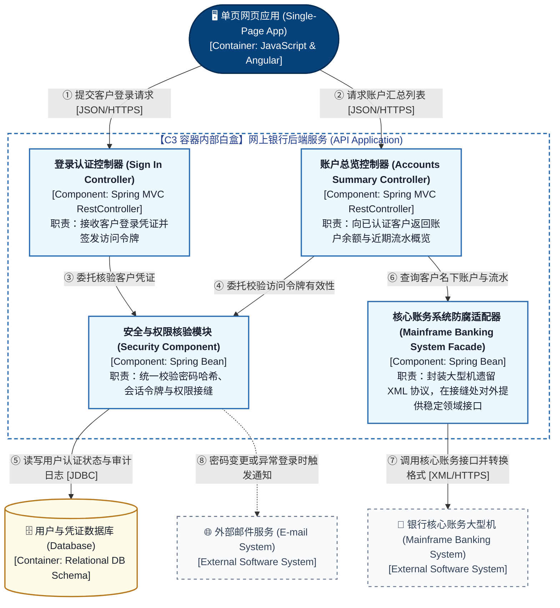
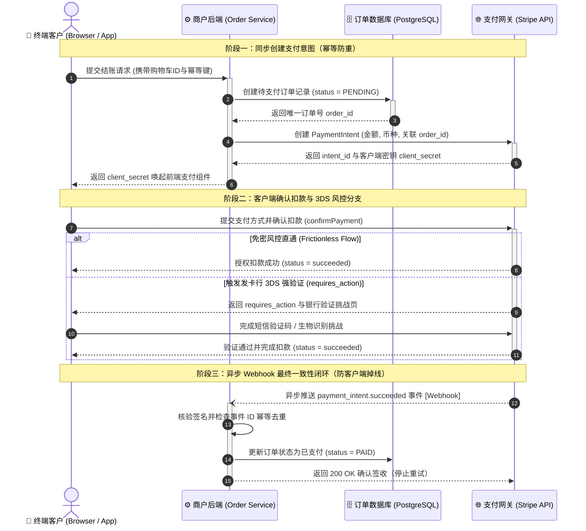
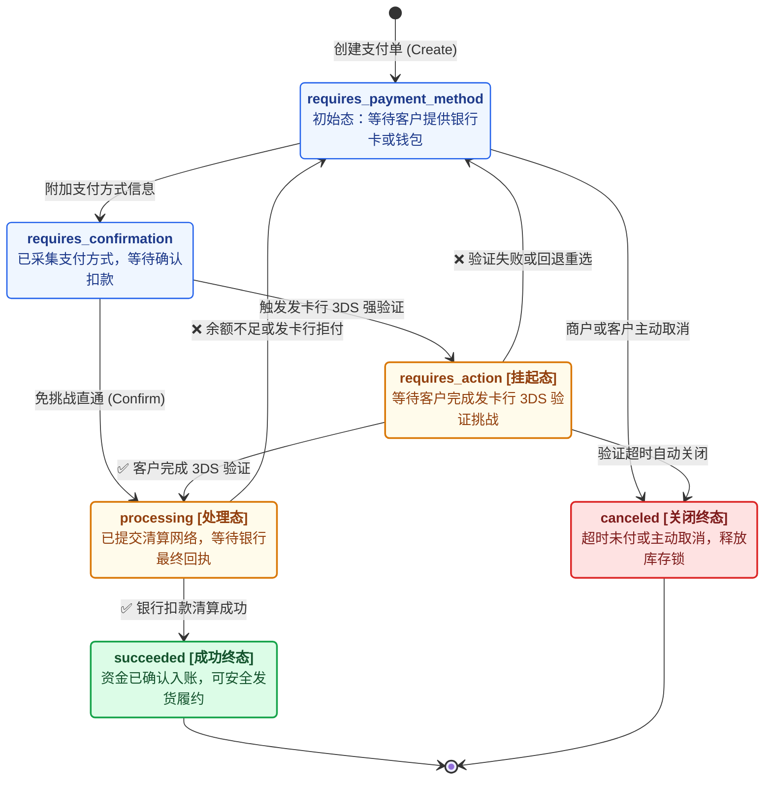
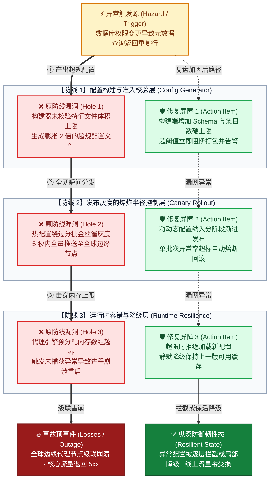
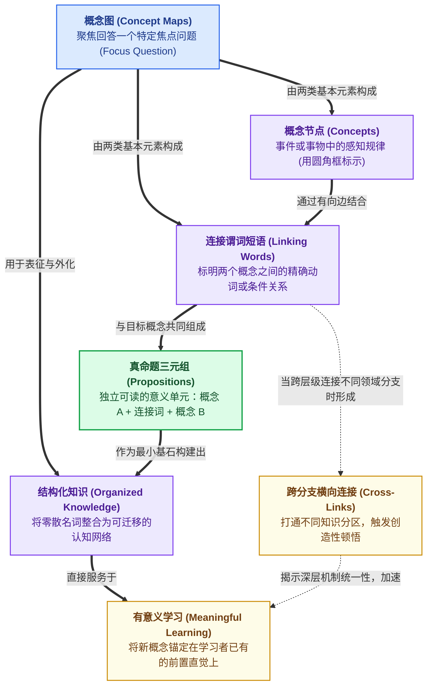

# Mermaid Diagramming Deep Module (`mermaid-diagrams`)

Shared visual subroutine (`Role C`) and directly callable diagramming skill for form selection, scale & layout discipline, single-track delivery (`.md` or `.png`), and six canonical Mermaid templates (invoked directly or as an embedded subroutine by [Global_Agent_Rules.md](../../Global_Agent_Rules.md), [`develop`](../develop/SKILL.md), [`improve-codebase-architecture`](../improve-codebase-architecture/SKILL.md), [`math-teaching`](../math-teaching/SKILL.md), and [`pr`](../pr/SKILL.md)).

## 0. Three-State Interface Contract (`Standard / Normalize / Bailout`)

1. **`Standard` (handle directly)**: When the target structure involves cross-module **seams** (`Seam`), multi-branch control flow, state lifecycles, multi-layer fault barriers, or conceptual/mathematical equivalence transformations within **5–15 core nodes**, select the matching template in §3–§4 and deliver via §2.
2. **`Normalize` (normalize $M \to 1$ at entry, then handle)**:
   - For linear sequences ($\le 5$ steps) or parallel comparisons ($\ge 3$ dimensions), normalize into a **list** or **comparison table** per §1;
   - For topologies exceeding **15 core nodes** or mixing abstraction layers, split into **"1 macro overview + 1 whitebox zoom-in"** ($\le 15$ nodes each) per §2.2;
   - When branching, return loops, long labels, or edge crossings hurt readability, consult the bundled layout references ([algorithm selection](references/algorithm-selection.md), [layout families](references/layered-tree-force-and-radial-layouts.md), [routing and quality](references/routing-overlap-and-quality.md)) to establish a 4-check layout plan (`TB`/`LR` direction, grouping, port routing) before rendering.
3. **`Bailout` (abort main path and emit `Error` + `Route`)**:
   - When asked to draw before/after C4 architecture views for an unexamined codebase that requires deep-module seam discovery first → emit `Error: codebase seams not yet audited` and `Route: use module-design: audit module seams and deepen candidates before drawing C4 views`;
   - When the batch renderer `scripts/render-batch.mjs` fails due to a missing Headless Chrome binary or runtime dependency → emit `Error: <reason>` and `Route: need headless-chrome: fall back to standalone .md Mermaid delivery`.

---

## 1. Form Selection: Match Structure to List, Table, or Diagram

Match the visual form to the intrinsic structure of the information:

| Information Structure | Target Scenario | Canonical Form | Selection Criterion |
| :--- | :--- | :--- | :--- |
| **1. Linear sequential steps or single-dimension points** ($\le 5$ sequential steps, single linear chain) | Operational steps & instructions | **Ordered or unordered list** | When each item performs one action in a single linear chain, use a list for fast scanning and command copying. |
| **2. Multi-item parallel comparison or attribution** ($\ge 3$ peer items or $\ge 3$ comparable dimensions, root-cause matrices, before/after diffs) | Structured comparison & lookup | **Comparison table** or **LaTeX aligned array** | When peer items share $\ge 3$ attributes (e.g., symptom / trigger / breached seam / fix), horizontal table scanning beats node-link boxes; use LaTeX `\begin{array}` for dual-track math alignments. |
| **3. Cross-module seams (`Seam`), multi-branch flows, state loops, or equivalence transforms** | Mechanism comprehension & complex debugging | **Standalone `.md` diagram** or **high-res `.png`** | Draw when cross-container/cross-module seams, conditional branches, async callbacks, multi-layer fault barriers, or dual-path equivalence transforms benefit from spatial topology. |

---

## 2. Delivery Mode & Scale Discipline

### 1. Single-Track File Delivery (Standalone `.md` Link by Default, or `2x .png` on Demand)
- **Default delivery — Standalone `.md` diagram file**: During everyday chat, architecture analysis, or debugging explanations, write the Mermaid code block and brief legend into a standalone `.md` file in the active session folder, and place only the clickable link (`[Diagram Title](file:///...md)`) at the end of the relevant sentence in the chat response.
- **On-demand delivery — High-res `2x .png` image (when the user requests images or when archiving into persistent Obsidian notes)**: Write the Mermaid source to a temporary `.mmd` file, run `node "scripts/render-batch.mjs"` ([Batch Rendering](references/rendering.md)), and link or embed only the resulting `.png` (`[Diagram Title](file:///...png)` in chat, or `` inside Obsidian notes).
- **Language separation (`Context-as-Sample`)**: Keep this skill's rules in compact English; render user-facing node and edge labels inside diagrams in plain, accurate Chinese per [Global_Agent_Rules.md](../../Global_Agent_Rules.md) unless requested otherwise.

### 2. Three Scale & Layout Invariants
1. **Node & `subgraph` budget**:
   - Keep each diagram within **5–15 core nodes** and at most **1 level of `subgraph` nesting** (open at most 1 container whitebox per diagram).
   - Above 15 nodes, split into **"1 macro overview + 1 whitebox zoom-in"**.
   - Use **0 `subgraph` boxes** in Novak concept maps and mathematical commutative diagrams; distinguish roles via semantic pastel fills and stroke weights.
2. **Reading direction**:
   - Default to top-to-bottom (`TB`) for layered architectures, cross-actor sequences, state lifecycles, and Swiss Cheese defense slices; use left-to-right (`LR`) for short pipelines or shallow trees (see [layout families](references/layered-tree-force-and-radial-layouts.md)).
3. **Native Mermaid diagram types & active-verb edges**:
   - Select the native Mermaid diagram type that matches the domain (`flowchart`, `sequenceDiagram`, `stateDiagram-v2`, `classDiagram`, `erDiagram`).
   - Put an active verb or guard condition on every directed edge, flatten cross-rank edges that cause Dagre rank gaps ([routing and quality](references/routing-overlap-and-quality.md)), and omit `font-weight:bold` from `style SubgraphID` so SVG header labels render cleanly without right-edge clipping.

---

## 3. Six Canonical Scenarios & Template Routing Table

| Reader's Core Question | Canonical Diagram Paradigm & Template | What Each Node Must State | What Each Edge Must State |
| :--- | :--- | :--- | :--- |
| **1. What independent runtime containers and external systems exist, and how do they interact? (Macro Seams)** | **C4 Level 1/2 (System Context / Container View)** (See [C4 Diagrams](references/c4-diagrams.md) · [Cloud Topology](references/architecture-diagrams.md)) | Actor / runtime container / database + `[Type]` + one-line external responsibility | Caller action + transport protocol |
| **2. Which deep modules live inside a container, and what seams/contracts do they expose? (Whitebox Zoom-in)** | **C4 Level 3 (Component / Deep Module Contract View)** (Template 1 below · [Domain Contracts](references/class-diagrams.md) · [ER & Data Ledgers](references/erd-diagrams.md)) | Internal deep module name + owned state + public interface contract | Inter-module call rule, payload contract, and bailout path |
| **3. How does a request or workflow execute chronologically across actors? (Runtime View)** | **Stripe-Style Numbered Cross-Actor Sequence** (Template 2 below · [Sequence Diagrams](references/sequence-diagrams.md)) | 3–5 participant swimlanes (Client / Backend / Core Module / External Gateway) | Numbered steps (`①②③`) + solid sync calls / dashed async callbacks; `alt/else` for happy path vs. bailout |
| **4. How does a domain object transition across states, suspensions, and terminal outcomes? (Lifecycle)** | **Business State Lifecycle (`stateDiagram-v2`)** (Template 3 below) | State name + one-line invariant (color-coded for initial, waiting, success, and terminal states) | Triggering domain event or guard condition |
| **5. Why did a cascading failure occur, and which barrier intercepts it at each defense layer? (Postmortem)** | **SRE Swiss Cheese Fault & Defense Barrier** (Template 4 below) | Hazard trigger, breached `❌ Hole` per slice, added `🛡️ Remediation Barrier` per slice, and terminal outcome | Thick red `==>` for fault penetration path; dashed/green edges for barrier interception and graceful degradation |
| **6. How does a theoretical concept or mathematical transformation work step by step? (Cognition & Math)** | **Novak Concept Map** or **Mathematical Commutative Diagram** (Templates 5 & 6 below) | Box-free (`0 subgraph`): macro concept or space name + micro intuition or formula | `[Node A] + linking verb phrase + [Node B]` forms a complete proposition; math arrows state operators and domain guards |

---

## 4. Six Canonical Reference Templates (Context-as-Sample Exemplars)

### Template 1: C4 Level 3 Component & Deep Module Contract (Simon Brown's Classic *Big Bank plc* Pattern)
> **Standard**: Simon Brown C4 Component View & arc42 Section 5 Blackbox/Whitebox Rule (see [C4 Diagrams](references/c4-diagrams.md) for C1/C2 templates).

---

### Template 2: Stripe-Style Numbered Cross-Actor Sequence (*PaymentIntent* & Webhook Pattern)
> **Standard**: Stripe PaymentIntents & Webhooks Runtime View & arc42 Section 6.

---

### Template 3: Stripe-Style Business State Lifecycle (`stateDiagram-v2` Native State Machine)
> **Standard**: Stripe PaymentIntents Lifecycle Specification. Uses native `stateDiagram-v2` to orthogonally separate state transitions from cross-actor network calls.

---

### Template 4: James Reason / Cloudflare SRE Swiss Cheese Fault & Defense Barrier
> **Standard**: James Reason Swiss Cheese Model & Google SRE / Cloudflare Cascading Failure Postmortem Pattern (each defensive layer slice contains both the breached hole and the remediation barrier).

---

### Template 5: Novak × Tufte Box-Free Concept Network (IHMC Classic Concept Map Pattern)
> **Standard**: Joseph Novak & Cañas (IHMC) — Theory Underlying Concept Maps. Zero `subgraph` boxes; every `[Node A] + Linking Phrase + [Node B]` reads as a complete proposition.

---

### Template 6: Classic Mathematical Commutative Diagram (Isomorphism / Change-of-Domain Pattern)
> **Standard**: First Isomorphism Theorem & Commutative Diagrams. Illustrates why transforming into an auxiliary space ($\varphi$) and inverting ($\varphi^{-1}$) equals the direct mapping ($f = \varphi^{-1} \circ D \circ \varphi$).

---

## 5. Disclosed References, Completion Gate & Subroutine Return Contract (Recency Peak)

- **Disclosed Type References (Load on Demand)**: [Flowcharts](references/flowcharts.md) · [Sequence Diagrams](references/sequence-diagrams.md) · [C4 Diagrams](references/c4-diagrams.md) · [Domain & Deep-Module Contracts](references/class-diagrams.md) · [ER & Data Ledgers](references/erd-diagrams.md) · [Cloud Topology](references/architecture-diagrams.md) · [Styling & De-Boxing](references/advanced-features.md) · [Batch Rendering (`render-batch.mjs`)](references/rendering.md)
- **Bundled Layout & Routing References**: [Algorithm Selection](references/algorithm-selection.md) · [Layout Families (`TB`/`LR`, Tree, Force, Radial)](references/layered-tree-force-and-radial-layouts.md) · [Routing, Overlap & Quality](references/routing-overlap-and-quality.md) · [Diagram_Skill_Validation.md](../../../参考资料/Diagram_Skills_Research/Diagram_Skill_Validation.md)

### Completion Gate & Subroutine Return Contract
Before delivering any diagram or returning to a calling host skill, verify all 3 checks:
1. **Scale & Visual Hygiene**: `5–15` core nodes, `<= 1` `subgraph` level (`0` in Novak/Commutative views), active-verb edges, and `style SubgraphID` free of `font-weight:bold`.
2. **Single-Track Artifact Delivery**: Deliver either a standalone `.md` file link (`[Diagram Title](file:///...md)`) or a `2x .png` image link/embed via `render-batch.mjs` — keep chat responses free of duplicate inline Mermaid code fences.
3. **Immediate Subroutine Return Rule**: When invoked as a visual subroutine by [Global_Agent_Rules.md](../../Global_Agent_Rules.md), [`develop`](../develop/SKILL.md), [`improve-codebase-architecture`](../improve-codebase-architecture/SKILL.md), [`math-teaching`](../math-teaching/SKILL.md), or [`pr`](../pr/SKILL.md), emit the `[Diagram Title](file:///...)` link and immediately resume the calling container's active phase inline.
