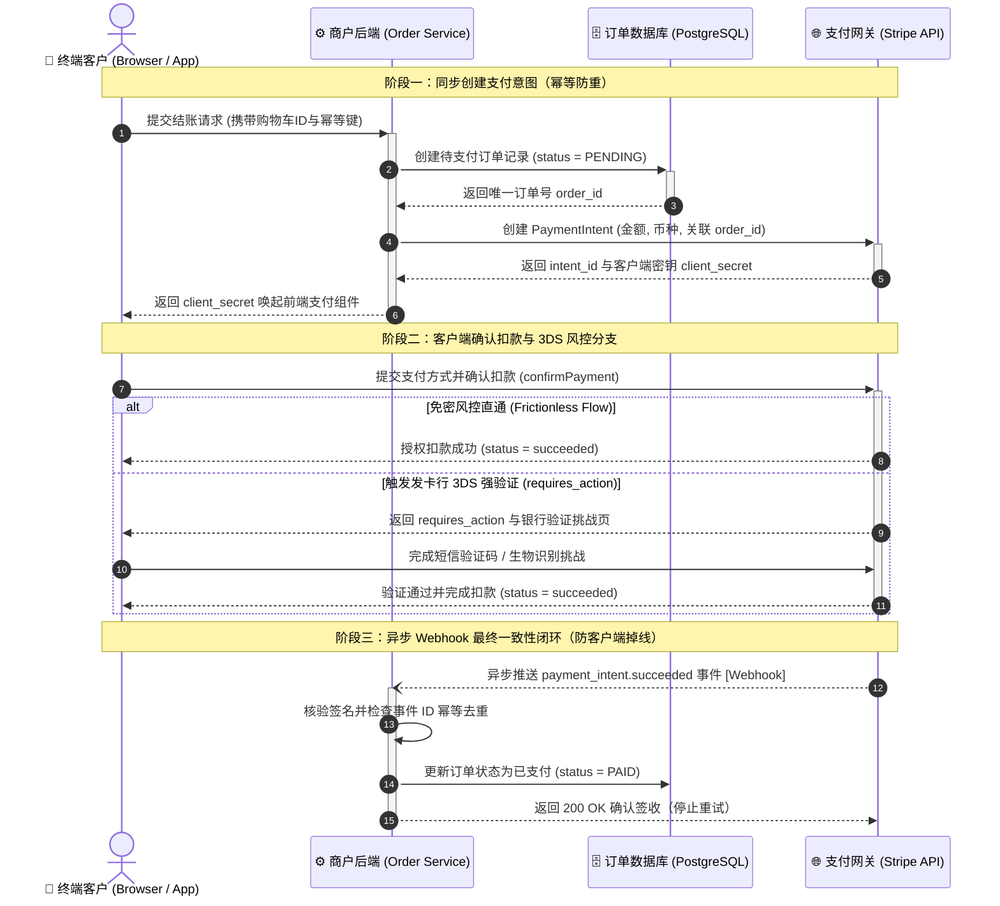
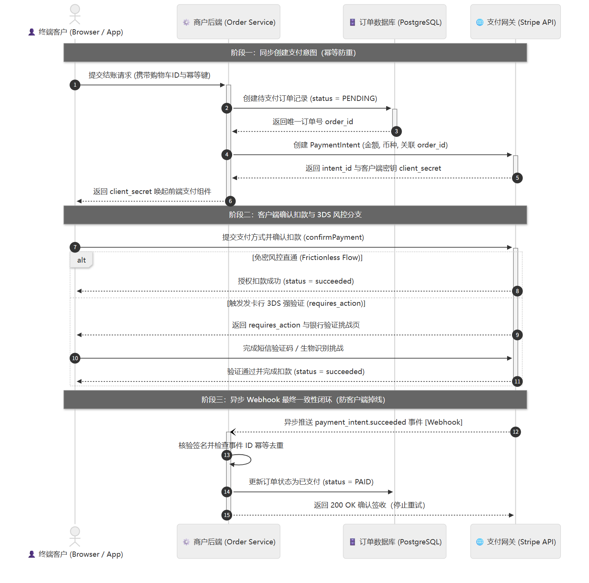
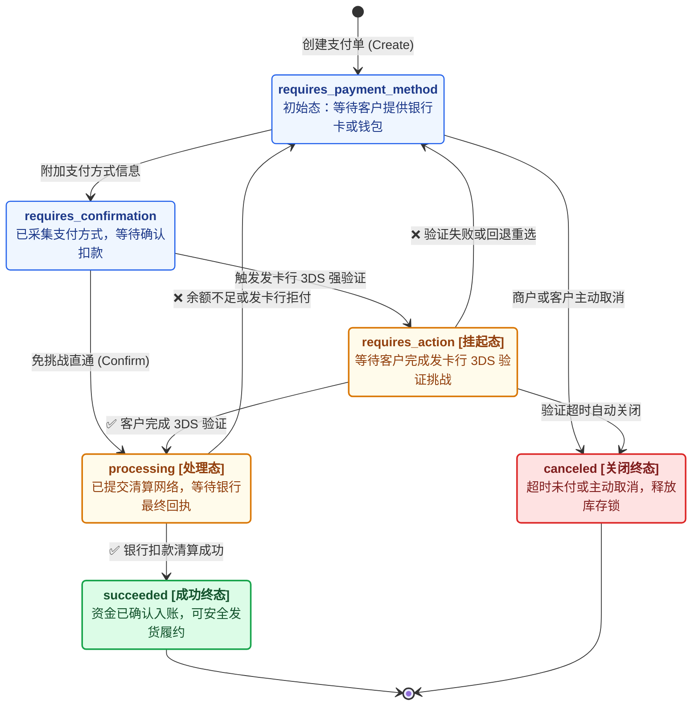
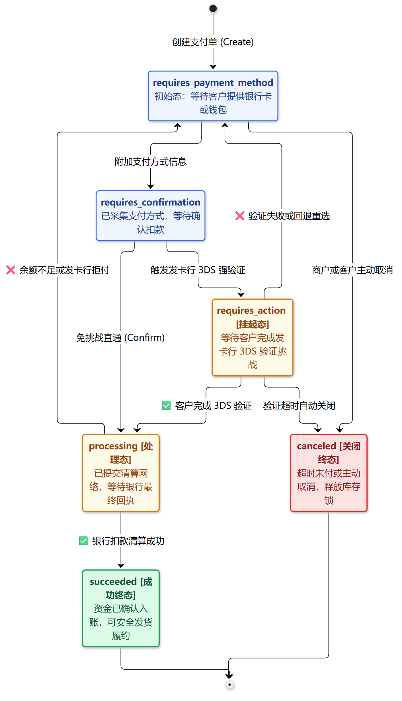
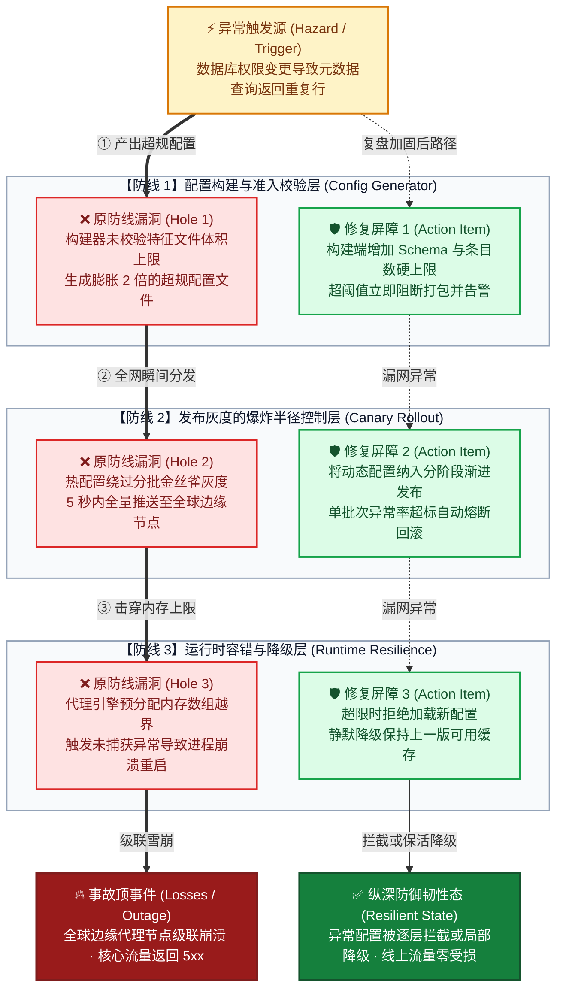
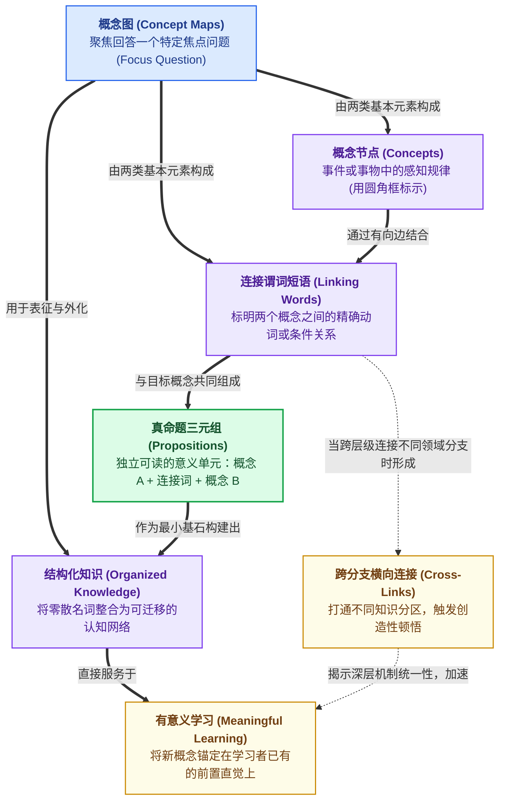
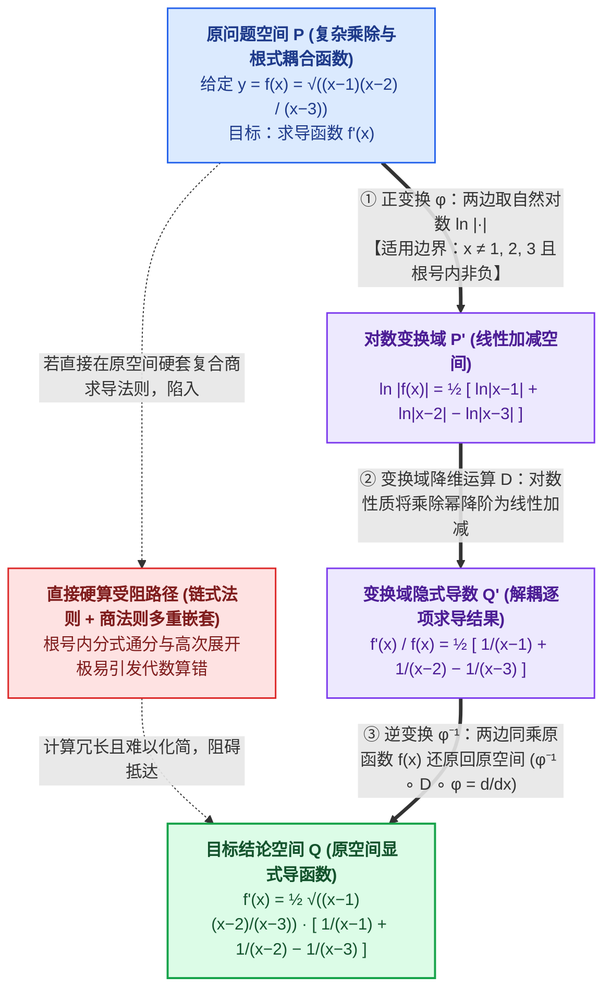
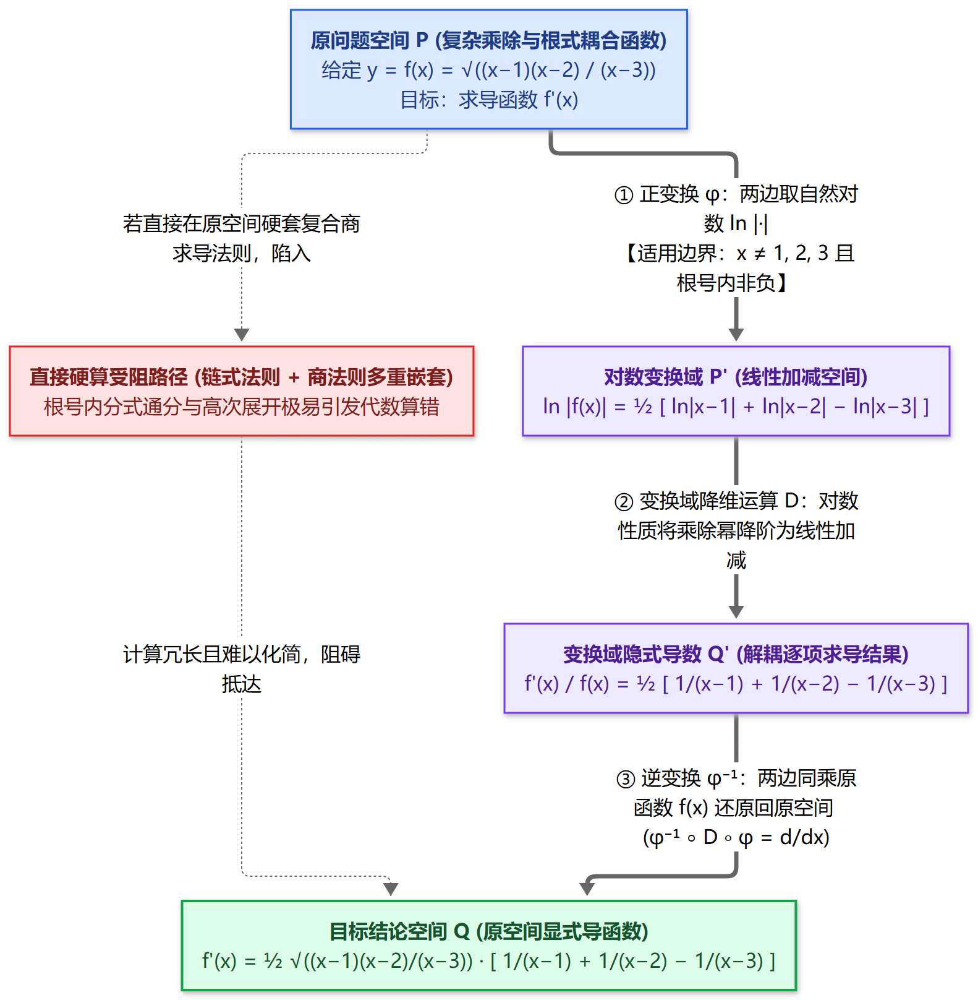

# Mermaid 图解表达深模块（判定、规模契约与六大标准模板）

本模块统一维护全库的**画图判定、版面规模、交付形式与六大标准 Mermaid 代码模板**（长期表达目标见 [全局协作规则](../../AGENTS.md)）。

## 0. 模块职责、输入归一化与异常转接契约

1. **典型情景（直接处理）**：涉及跨模块边界、多分支流转、状态生命周期、多道故障屏障或概念/数学等价变换时，直接按下方规模与模板绘制图解。
2. **非典型情景（先归一化再处理）**：
   - 若信息仅是 $\le 5$ 步单线操作或 $\ge 3$ 项并列维度对比，先归一化为**列表**或**对比表格**，不强行画图；
   - 若单图核心节点超过 15 个或跨多层抽象，先拆分为**“1 张宏观总览图 + 1 张局部放大图”**再绘制；
   - 若分支回路复杂、连线交叉或标签拥挤，先调用子零件 [node-link-and-diagram-layout](../node-link-and-diagram-layout/SKILL.md) 整理排列方向与分组，再落图。
3. **异常或越界情景（输出停工说明 `Error` 与转接建议 `Route`）**：
   - 需要先做代码库深模块扫描与候选方案对拷 → 输出 `Route: use improve-codebase-architecture: scan codebase seams before drawing before/after C4 diagrams`；
   - 批量渲染脚本 `scripts/render-batch.mjs` 因本机缺少 Headless Chrome 或依赖失败 → 输出 `Error: <原因>` 与 `Route: need headless-chrome-or-mmdc: fall back to standalone .md Mermaid delivery`。

---

## 一、什么时候不画图，什么时候画图

按信息的自身结构选择合适的呈现方式：

| 信息结构特征 | 适用场景 | 推荐呈现方式 | 判断依据 |
| :--- | :--- | :--- | :--- |
| **1. 单线顺序步骤或单维度要点** （$\le 5$ 步顺序操作、无分支、无回环） | 操作步骤与说明 | **有序或无序列表** | 每个条目只包含 1 个动作且按单线推进时，直接用列表，便于扫读与复制命令。 |
| **2. 多对象并列对比或归因清单** （$\ge 3$ 个同类对象或 $\ge 3$ 个可比维度、故障归因、改造前后对照） | 结构化查阅与对比 | **对比表格** 或 **LaTeX 对齐阵列** | 并列条目共享 3 个及以上可比属性（如：现象 / 触发条件 / 失守点 / 修复动作）时，表格横向扫读效率高于连线图；数学双轨序列对齐使用 LaTeX `\begin{array}`。 |
| **3. 跨模块边界、多分支流转、状态回环或等价变换** | 机制理解与复杂排障 | **独立图解文档或高清图片** （默认独立 `.md`） | 存在跨容器/跨模块接口边界、多分支条件判据、异步回调闭环、多道防线穿透或双路径等价变换，纯文字需要反复写“若 A 则跳回 X”时才画图。 |

---

## 二、交付形式与版面规模原则

### 1. 交付形式（`.md` 简要图与 `.png` 大图二选一）
- **默认交付：独立 `.md` 简要图文档**：日常对话、架构分析或排障解释需要画图时，在当前会话目录创建一份独立的 `.md` 图解文档（集中放入 Mermaid 代码块与必要图例），在对话正文对应句尾内嵌 `[图解名称](file:///...md)` 直链（例如 `整体流转见 [系统架构图解](file:///...md)。`）。此时不额外调用渲染脚本生成 `.png`。
- **按需交付：高清 `.png` 大图（用户要求导出图片或写入笔记长期归档时启用）**：当用户要求导出图片，或需要将定稿图嵌入 Obsidian 笔记长期归档时，将 Mermaid 源码写入临时 `.mmd` 并调用 `node "scripts/render-batch.mjs"` 批量导出 2x `.png`（见 [批量渲染说明](references/rendering.md)），在句尾内嵌 `[图名](file:///...png)` 交付（写入 Obsidian 笔记归档时用 ``），不再重复创建装相同 Mermaid 代码块的展示用 `.md` 文档。

### 2. 版面与规模三原则
1. **控制单图节点数量**：
   - 单张图核心节点控制在 **5～15 个**，架构图 `subgraph` 边界框最多嵌套 **1 层**（一张图只打开 1 个容器白盒展示内部组件）。
   - 超出 15 个节点时，拆分为**“1 张宏观总览图 + 1 张局部放大图”**，放入同一个独立 `.md` 图解文档上下对照。
   - 概念图与数学交换图不加 `subgraph` 外框，用语义浅底色与实/虚线粗细区分角色。
2. **阅读方向顺应结构自然延展**：
   - 分层架构、跨角色时序、状态生命周期与多道防御切片默认采用从上到下（`TB`）；短链路或层级树采用从左到右（`LR`）。
3. **选用匹配的原生图型**：
   - 按场景选用 Mermaid 原生图型（`flowchart`、`sequenceDiagram`、`stateDiagram-v2`、`classDiagram`、`erDiagram`）。
   - 每条有向连线写明主动动词或守卫条件，子图 `style` 保持常规字重以免标题截断。

---

## 三、六类常见场景与代码模板速查

| 读者想搞懂的问题 | 对应图解范式与本地代码模板 | 节点要写清什么 | 连线要写清什么 |
| :--- | :--- | :--- | :--- |
| **1. 软件有哪些独立程序与外部系统、整体怎么配合？（宏观边界）** | **C4 Level 1/2（系统上下文 / 容器图）** （模板：[C4 架构图手册](references/c4-diagrams.md)） | 角色 / 独立运行容器 / 数据库 + `[类型]` + 一句话对外职责 | 谁向谁发起什么业务动作 + 传输介质 |
| **2. 某个程序内部有哪些深模块、各自管什么账与接口？（内部放大）** | **C4 Level 3（组件/深模块契约图）** （模板：下方 Template 1 · [领域契约图](references/class-diagrams.md)） | 内部深模块名称 + 负责的数据源 + 对外接口契约（底层函数名留给正文对照表） | 模块间调用规则、输入输出凭据与异常退路 |
| **3. 一次请求或操作怎么跨角色跑通？（动态交互）** | **带编号跨角色时序图** （模板：下方 Template 2 · [时序图手册](references/sequence-diagrams.md)） | 3～5 个真实职责泳道（客户端 / 服务端 / 核心库 / 外部网关） | ①②③ 编号 + 实线同步请求 / 虚线异步回调；用 `alt/else` 框出正常路径与异常降级 |
| **4. 业务对象的状态怎么切换、何时挂起或终结？（生命周期）** | **业务状态生命周期图** （模板：下方 Template 3，原生 `stateDiagram-v2`） | 业务状态名 + 含义短注（用浅底色区分初始态、等待态、成功/异常终态） | 触发状态切换的业务事件或守卫条件 |
| **5. 复杂故障为什么发生、修复方案在哪道门拦截？（排障复盘）** | **瑞士奶酪防御屏障图** （模板：下方 Template 4） | 触发源、各道防线被穿透的 `❌ 漏洞`、新增的 `🛡️ 修复屏障` 与终态结果 | 粗红实线 `==>` 表示故障穿透路径；绿线表示新增屏障拦截与降级路径 |
| **6. 新概念原理或数学方法如何一步步推演？（认知与数学）** | **命题概念图** 或 **数学交换图** （模板：下方 Template 5 & 6） | 免 `subgraph` 外框：宏观概念/空间名 + 微观直觉/算式 | `[节点A] + 连线谓词短语 + [节点B]` 能连读成完整句子；数学交换图注明等价条件与算子 |

---

## 四、六大经典场景标准代码模板 (Canonical Reference Examples)

### Template 1: C4 Level 3 Component & Deep Module Contract (Simon Brown's Classic *Big Bank plc* Pattern)
> **Standard**: Simon Brown C4 Component View & arc42 Section 5 Blackbox/Whitebox Rule (see [C4 Diagrams](references/c4-diagrams.md) for C1/C2 templates).

---

### Template 2: Stripe-Style Numbered Cross-Actor Sequence (*PaymentIntent* & Webhook Pattern)
> **Standard**: Stripe PaymentIntents & Webhooks Runtime View & arc42 Section 6.

---

### Template 3: Stripe-Style Business State Lifecycle (`stateDiagram-v2` Native State Machine)
> **Standard**: Stripe PaymentIntents Lifecycle Specification. Uses native `stateDiagram-v2` to orthogonally separate state transitions from cross-actor network calls.

---

### Template 4: James Reason / Cloudflare SRE Swiss Cheese Fault & Defense Barrier
> **Standard**: James Reason Swiss Cheese Model & Google SRE / Cloudflare Cascading Failure Postmortem Pattern (each defensive layer slice contains both the breached hole and the remediation barrier).

---

### Template 5: Novak × Tufte Box-Free Concept Network (IHMC Classic Concept Map Pattern)
> **Standard**: Joseph Novak & Cañas (IHMC) — Theory Underlying Concept Maps. Zero `subgraph` boxes; every `[Node A] + Linking Phrase + [Node B]` reads as a complete proposition.

---

### Template 6: Classic Mathematical Commutative Diagram (Isomorphism / Change-of-Domain Pattern)
> **Standard**: First Isomorphism Theorem & Commutative Diagrams. Illustrates why transforming into an auxiliary space ($\varphi$) and inverting ($\varphi^{-1}$) equals the direct mapping ($f = \varphi^{-1} \circ D \circ \varphi$).

---

## 五、分图型语法手册、布局子零件与业界标杆出处

- **Syntax & Type References**: [Flowcharts](references/flowcharts.md) · [Sequence Diagrams](references/sequence-diagrams.md) · [C4 Diagrams](references/c4-diagrams.md) · [Domain & Class Contracts](references/class-diagrams.md) · [ER & Data Ledgers](references/erd-diagrams.md) · [Cloud Topology](references/architecture-diagrams.md) · [Styling & De-Boxing](references/advanced-features.md) · [Batch Rendering (`render-batch.mjs`)](references/rendering.md)
- **Layout Child Part**: [node-link-and-diagram-layout](../node-link-and-diagram-layout/SKILL.md)（复杂拓扑与连线路由优化）
- **7 Authentic Industry Standard Diagrams & Provenance Links**: [业界权威图解标准与原版经典标杆库](../../参考资料/调研笔记/Diagram_Skills_Research/Diagram_Skill_Validation.md)
