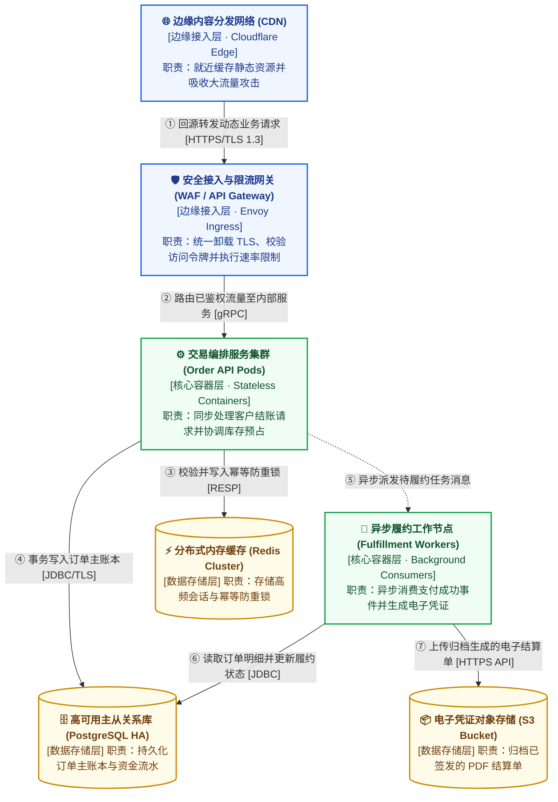
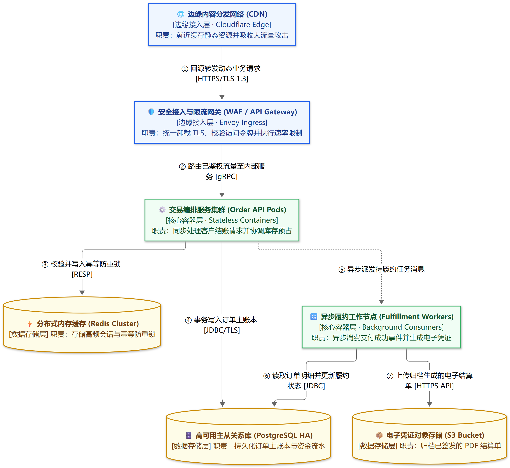

# Cloud & Deployment Topology (`flowchart TB` Deployment View)

> **Unified Rules**: See [SKILL.md](../SKILL.md) for C4/arc42 deployment seams, Tufte semantic layering, and unidirectional verb + `[协议]` edge contracts.

## Canonical Example: Edge-to-Database Cloud Deployment Topology

Use `flowchart TB` with semantic color palettes (`edge` / `app` / `data`) and role badges (`[边缘接入层]` / `[核心容器层]` / `[数据存储层]`) so every network hop carries an explicit action verb and transport protocol without outer box clutter:

