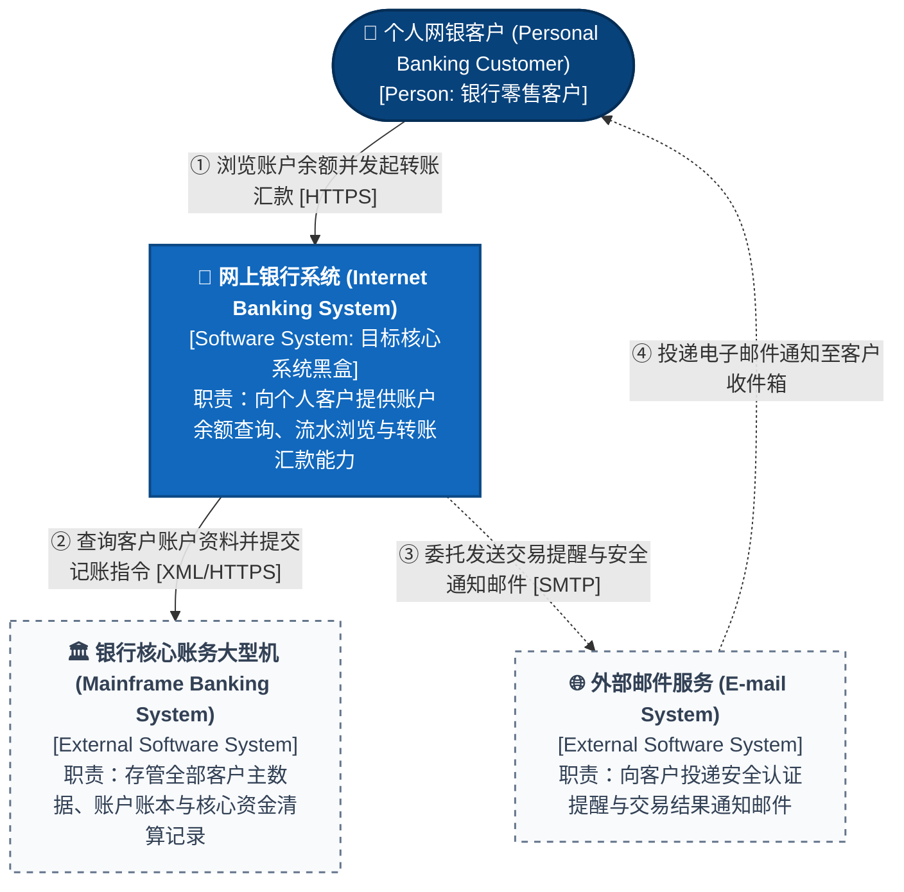
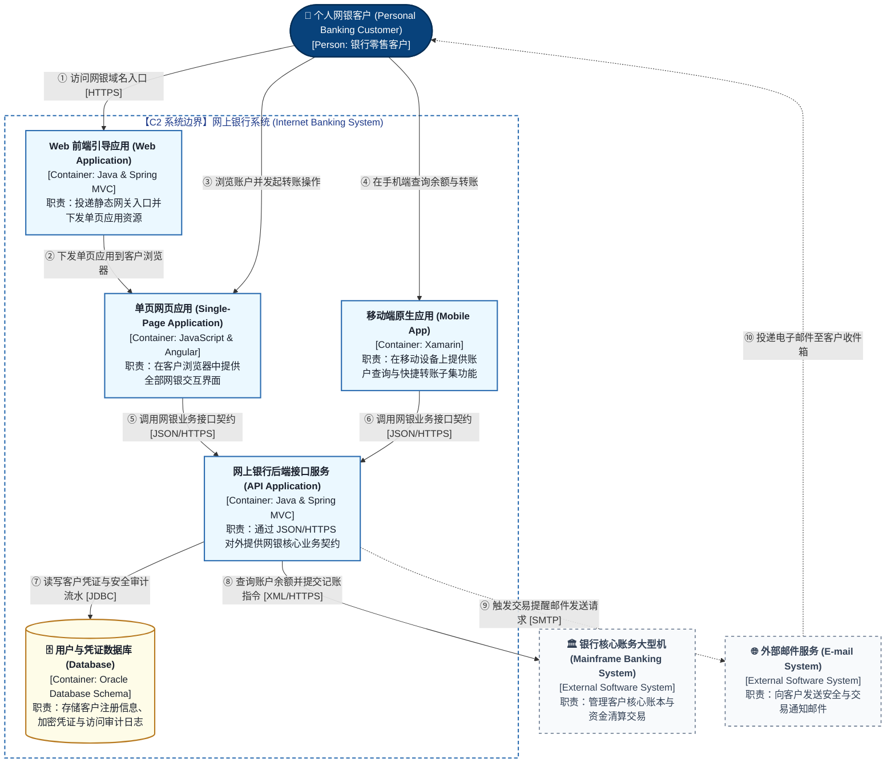

# C4 Architecture Diagrams (C1 System Context, C2 Container, C3 Component)

> **Unified Rules**: See [SKILL.md](../SKILL.md) for C4 zoom discipline (`C1`–`C3` stop at deep modules), arc42 blackbox/whitebox boundaries (`Whitebox contains Blackboxes`), and **Template 1 (C4 Level 3 Component / Deep Module View)**.

---

## 1. Canonical C4 Level 1: System Context View (Simon Brown's *Big Bank plc*)

Lock the target software system inside **1 central blackbox** and show only external human roles (`[Person]`) and external software systems (`[External Software System]`), with unidirectional active-verb contracts on every edge:

---

## 2. Canonical C4 Level 2: Container View (Simon Brown's *Big Bank plc*)

Open the target system as **1 single system boundary (`subgraph`)** to reveal its independently deployable runtime containers (Web UI, Mobile App, Backend API, Database), keeping each container's internal code hidden as a blackbox:

