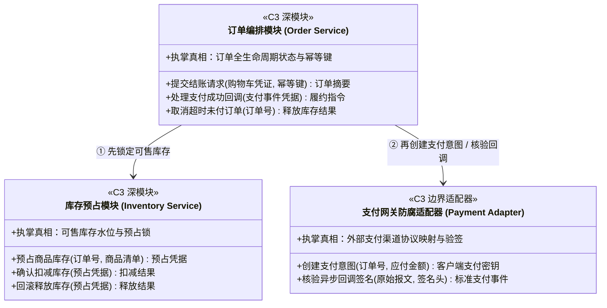
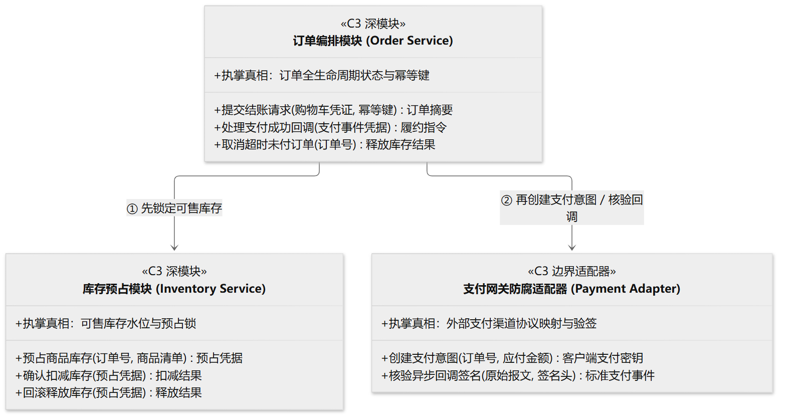

# Domain Model & Deep Module Contracts (`classDiagram`)

> **Unified Rules**: See [SKILL.md](../SKILL.md) (§2.2) for scale discipline (`5–15` core nodes) and **Template 1 (C4 Level 3 Component View)**.

When using `classDiagram` for non-technical or cross-functional readers, represent **Domain Concepts and C3 Deep Module Interface Contracts** (in plain business language) rather than low-level data types (`uint64`, `varchar`) or private helper methods. Use ASCII identifiers with Chinese display labels (`class OrderService["订单编排模块"]`) for full parser compatibility.

## Canonical Example: E-Commerce Order & Payment Domain Contracts

---

**Return to Caller**: Return with the selected `classDiagram` contract template to [SKILL.md](../SKILL.md) (§2 & §5) to complete single-track artifact delivery, then resume the calling host workflow.
