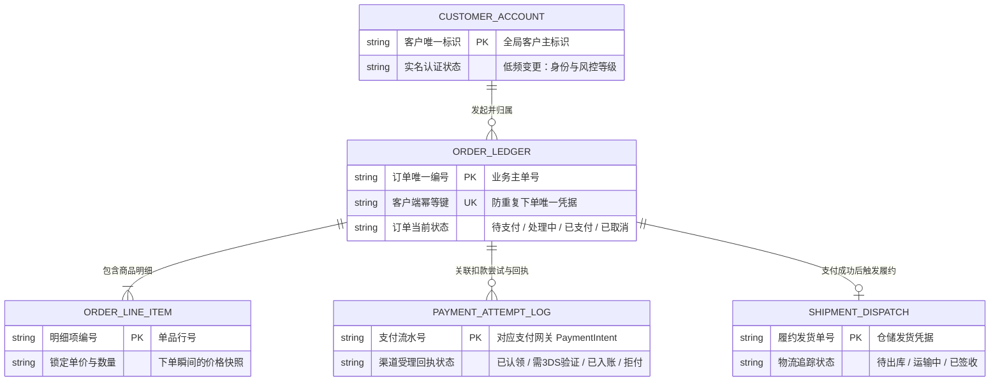
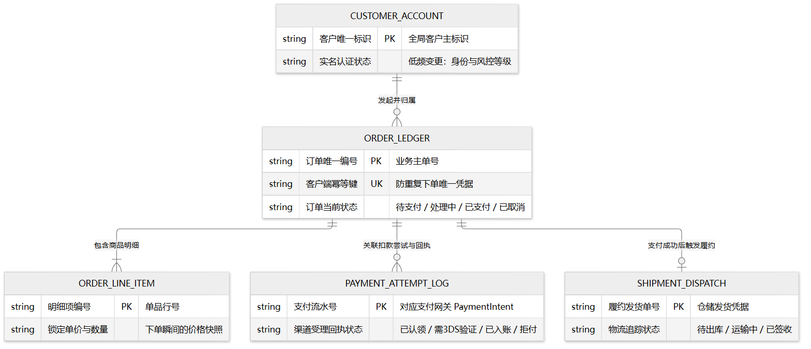

# Data Ledger & Entity Relationships (`erDiagram`)

> **Unified Rules**: See [SKILL.md](../SKILL.md) (§2.2) for node scale (`5–15` core nodes) and single-track delivery.

Use `erDiagram` when explaining **which persistent ledgers exist, what truth each ledger owns, and how their cardinality contracts relate** (`||--||` exact one, `||--o{` zero-or-many, `||--|{` one-or-many, `||--o|` zero-or-one), using clear domain terms rather than raw physical column types (`varchar_64`, `bytea`).

## Canonical Example: Multi-Frequency Order & Audit Ledgers

---

**Return to Caller**: Return with the selected `erDiagram` ledger schema to [SKILL.md](../SKILL.md) (§2 & §5) to complete single-track artifact delivery, then resume the calling host workflow.
