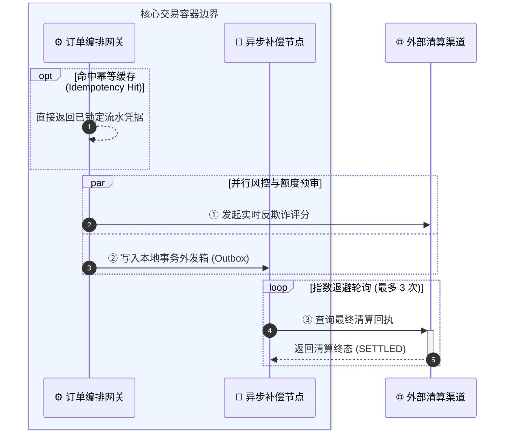
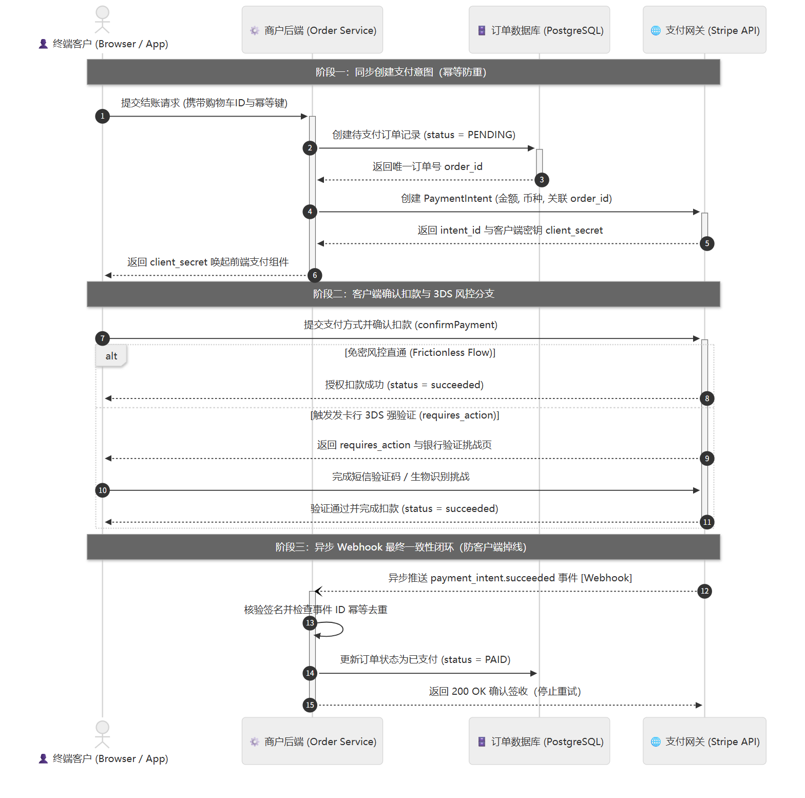

# Sequence Diagrams (`sequenceDiagram`)

> **Unified Rules**: See [SKILL.md](../SKILL.md) (§2.2) for scale discipline (`3–5` swimlanes) and **Template 2 (Stripe PaymentIntent & Webhook Sequence)** for the full end-to-end runtime exemplar.

Use `sequenceDiagram` for **arc42 Section 6 (Runtime View)** and **Stripe-style Cross-Actor Interaction Flows** where chronological request/response order, asynchronous callbacks (Webhooks), and conditional fallback branches (`alt / else`) across 3–5 participants matter.

## 1. Core Syntax & Industry Conventions

| Element | Syntax | Industry Best Practice (Stripe / arc42) |
|---|---|---|
| **Auto-numbering** | `autonumber` | Always enable `autonumber` so step numbers (`①②③`) match the prose walkthrough. |
| **Participants** | `actor` / `participant ID as 角色名` | Limit to 3–5 core swimlanes (e.g., Customer, Client UI, Backend Service, Database, External Gateway). |
| **Sync Request** | `A->>+B: 动词 + 业务契约载荷` | Solid arrow with activation bar (`+`/`-`) for synchronous calls. |
| **Sync Return** | `B-->>-A: 返回结果或凭据` | Dashed arrow for responses. |
| **Async Webhook / Event** | `B--)A: 异步推送事件通知` | Open arrow for non-blocking webhooks or message queue events. |
| **Branching & Fallback** | `alt 正常直通 ... else 异常降级 ... end` | Explicitly show both the Happy Path and the timeout/error recovery path. |

## 2. Advanced Control Flow Patterns (`box`, `loop`, `opt`, `par`)

Combine container grouping (`box`), retry loops (`loop`), optional cache hits (`opt`), and parallel fan-out (`par`) when extending [SKILL.md Template 2](../SKILL.md):

---

**Return to Caller**: Return with the selected `sequenceDiagram` pattern to [SKILL.md](../SKILL.md) (§2 & §5) to complete single-track artifact delivery, then resume the calling host workflow.
