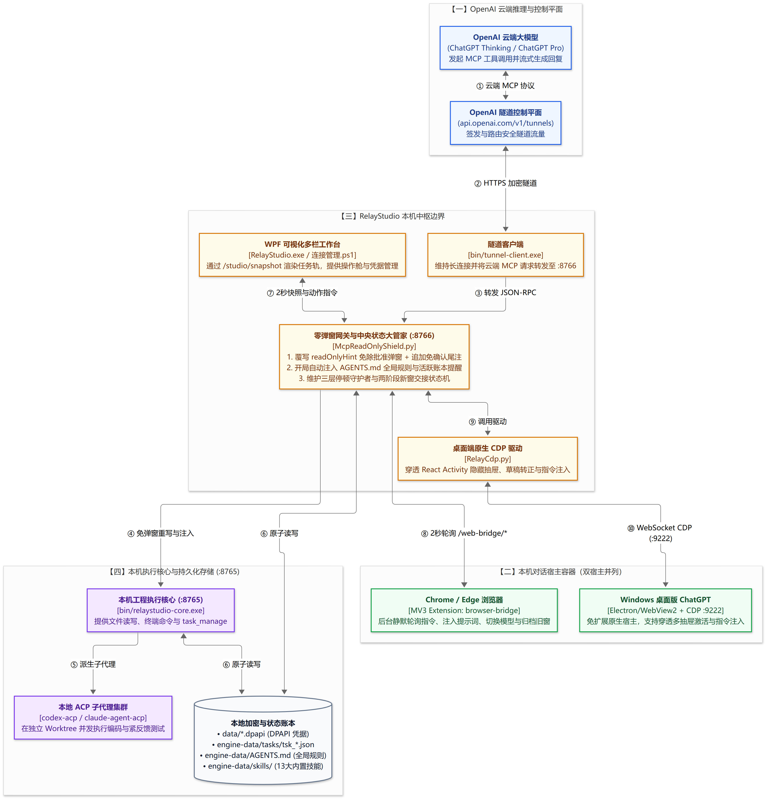
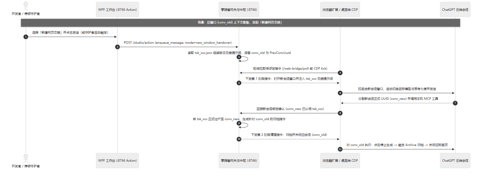

# RelayStudio 系统架构与模块接口契约

> **架构概览**：RelayStudio 采用**云端模型推理、本机回环网关管账、本机执行内核落地、双宿主网桥续推**的四层解耦结构。所有跨进程运行状态统一收敛至监听于 `127.0.0.1:8766` 的桥接中枢与本地 JSON 账本，通过 `/studio/events` SSE 增量推送与内存态宿主桥驱动 **Edge WebView2 多栏工作台**低延迟局部重绘（并保留 `--legacy` 回退至 WPF 脚本），同时确保桌面客户端或浏览器标签页在断流、换窗或重启后仍能依托本地账本无缝续接。

---

## 一、容器边界拓扑（C4 Level 2）

下图展示了运行期五个独立进程容器之间的单向调用关系与端口边界：

  

---

## 二、跨窗口账本交接时序（Sequence）

当长会话上下文接近饱和、连续唤醒未获真实进展或用户主动切换新窗时，系统按以下两阶段回执确认时序完成**进度摘要组装、新会话认领 `tsk_xxx`、模型与思考档位快照还原以及旧会话停稳归档**：

  

---

## 三、核心深模块职责与契约对照

| 模块与入口文件 | 维护的核心状态（State） | 对外接口契约（Inputs / Outputs） | 边界守卫与退路（Guards） |
| :--- | :--- | :--- | :--- |
| **回环桥接中枢、原生账本与 OAuth 2.1 网关** [`McpReadOnlyShield.py`](../McpReadOnlyShield.py) | `engine-data/tasks/tsk_*.json`、`data/logs/web-bridge-state.json`、`shield-activity.json`、内存态在途计数与分平台模型目录 | 仅绑定 `127.0.0.1:8766`：对隧道暴露 `/mcp`（内置零配置 OAuth 2.1 + PKCE + DCR 自动授权端点以兼容 Claude / Gemini / ChatGPT 连接器）并原生处理单步 `task_manage`（7 类动作与一步自动结单）；对本地 UI 提供 `/studio/events`（SSE 实时推送）、`/studio/snapshot` 与 `/studio/action`；对网桥提供 `/web-bridge/*` | **公网与控制面硬隔离 + 严格进度门禁**：严禁携带隧道转发头或非回环 `Host` 访问 `/studio/*` 与 `/web-bridge/*`（直接 `403` 拦截），并支持 `studio-local.token` 校验；全工具在途或宿主输出时冻结停顿计时 |
| **桌面端 CDP 桥接驱动** [`RelayCdp.py`](../RelayCdp.py) | `127.0.0.1:9222` WebSocket 连接与多抽屉文件柜映射表 | 发现官方桌面客户端会话、穿透 `<Activity>` 隐藏容器扫描草稿号并转正为 36 位 `conv_uuid`、按需还原模型/思考强度并投递消息 | 绝不强杀运行中的带调试端口 `ChatGPT.exe`；在默认 `inherit` 原窗唤醒下跳过 `onModelChange` 防止篡改用户手调档位 |
| **多平台浏览器 MV3 扩展网桥** [`browser-bridge/`](../browser-bridge/) | `chrome.storage.local` 实例标识与三平台（ChatGPT / Gemini / Claude）标签页鲜活状态表 | `background.js` 每 2 秒聚合轮询 `/web-bridge/poll` 并管理后台标签页；`bridge-content.js` 探测各平台流式状态、动态模型档位、执行填词并返回 `ack-deliver` 两阶段回执 | 严格按 `browser_profile` 与平台隔离队列；不劫持空白新建聊天页，交接时自动保留平台入口 URL 与项目夹前缀 |
| **双隧道与内核管理模块** [`ConnectionManager.psm1`](../ConnectionManager.psm1) & [`HostBridge.ps1`](../HostBridge.ps1) | `data/settings.json`、`data/credential-profiles.json`、`data/*.dpapi`、`data/studio-local.token` | 管理 OpenAI Cloudflare 隧道与 Tailscale Funnel 双公网隧道进程（含 DoH 公网边缘真实连通探活与防抖退避自愈）、核心进程（`:8765`）与 `:8766` 中枢启停，挂载 `engine-data/AGENTS.md` 与 `engine-data/skills`，通过内存态 PowerShell Runspace 向 WebView2 提供高权限 RPC（自动剥离明文密钥） | 后台进程统一在交互式桌面会话无黑框拉起；凭据与进程操作仅经内存 `WebMessageReceived` 通道执行，零网络端口暴露 |
| **Edge WebView2 多栏工作台与主题引擎** [`RelayStudio.exe`](../scripts/build-launcher.ps1) · [`ui-src/`](../ui-src/) → [`ui/`](../ui/)（含 [`连接管理.ps1`](../连接管理.ps1) `--legacy` 兼容层） | `data/window-layout.json`、`data/webview2-cache/`、三态主题配置、1～4 动态分栏视图与 2.5s 乐观交互锁 | 基于系统内置 Edge WebView2 虚拟域名 `https://studio.relaystudio.local` 承载 Preact + TypeScript 工作台：渲染无边框顶栏分段呼吸胶囊、可折叠任务轨、最多 4 分栏工作区、每栏 6 控件操作舱及原生 `<dialog>` 弹窗 | `requestAnimationFrame` 帧合并更新消除局部重绘抖动；最小化至托盘时自动断开 SSE 并挂起渲染进程（`TrySuspendAsync`）实现后台零 GPU 占用，支持 `--legacy` 参数一键回退传统 WPF 界面 |

---

## 四、本地扩展与软路由配置（`data/settings.json`）

仓库跟踪文件不包含任何个人硬编码路径。用户可在 Git 忽略的 `data/settings.json` 中按需声明以下字段，在版本升级或切换分支时持久生效：

| 字段名称 | 类型 | 未配置时的默认行为 | 用途与示例 |
| :--- | :--- | :--- | :--- |
| `theme_mode` | `string` | `"system"`（跟随系统） | 持久化三态外观主题：`"system"`、`"light"` 或 `"dark"`（可通过界面 `☀/🌙`、`Ctrl+Shift+D` 或配置面板直接切换） |
| `default_browser_profile` | `string` | `"Desktop:ChatGPT"` | 新建任务未显式指定宿主时的默认目标（如 `"Chrome:Profile 1"`） |
| `preferred_browser_profiles` | `string[]` | 按名称字典序排列 | 宿主下拉菜单中优先置顶显示的 Profile 列表 |
| `workspace_roots` | `string[]` | 从工具调用路径自动推导 | 额外工作区根目录列表（如 `["D:\\Projects"]`），用于关联代码仓最近 Git 提交记录 |
| `skills_junction_target` | `string` | 自动同步内置 [`builtin-skills/skills`](../builtin-skills/skills) | 外部技能库软路由目标（如 `"D:\\Notes\\Obsidian Vault\\Skills"`）；配置后启动时自动将 `engine-data\skills` 建为 NTFS Junction，与本地 Codex / Claude 共享同一套技能 |
| `agents_md_target` | `string` | 自动同步内置 [`builtin-skills/AGENTS.md`](../builtin-skills/AGENTS.md) | 外部全局规则路径；配置后自动链接至 `engine-data\AGENTS.md`，在会话开局获取工作区上下文时自动注入 |
| `python_path` | `string` | 自动探测 `PATH` 与标准安装目录 | 自定义 Python 3.11+ 解释器绝对路径（如 `"D:\\Python311\\python.exe"`） |
| `extra_bin_dirs` | `string[]` | 自动探测 `PATH` 与 `%APPDATA%\npm` | 额外可执行文件目录，用于定位 `codex-acp.cmd` 与 `claude-agent-acp.cmd` 等全局命令 |
