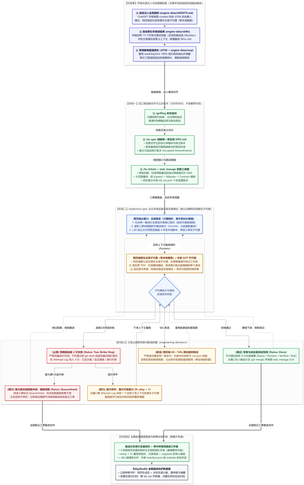

# 长程无人值守开发工作流指南

在跨数小时的软件开发、重构或回归排障中，单靠长提示词很难维持稳定产出：写操作权限弹窗与回合结束时的礼貌性追问会打断自动化执行；单一会话窗口随轮次增加积累大量报错输出后容易遗忘前置约束；局部难题上的反复盲目试错会破坏已有代码；而慢速测试一旦超过网页端 60～120 秒流式等待窗口，又极易引发重复提交踩踏。

RelayStudio 将 **开局自动注入的全局规则（`engine-data/AGENTS.md`）、13 个内置工程技能包（`engine-data/skills`）、`:8766` 原生单步账本引擎以及解耦式停顿守护网桥** 组合成一套可无人值守推进的工程闭环。

---

## 一、长程协同工作流全景

下图展示了底层接力网关如何配合上层规格与工单图（`implement-spec`）驱动跨窗口、多子代理协同开发：

  

---

## 二、底层三项静默支撑机制

为了让工作流在不依赖人工盯屏的前提下稳定运转，RelayStudio 在基础设施层提供了三项默认能力：

| 基础设施支柱 | 运行方式 | 解决的实际问题 |
| :--- | :--- | :--- |
| **1. 全局规则开局注入** （[`builtin-skills/AGENTS.md`](../builtin-skills/AGENTS.md)） | 启动时自动挂载至 `engine-data/AGENTS.md`（支持软路由至外部知识库）；当会话开局调用工作区上下文工具时，由 `:8766` 网关自动附带注入。 | 引导主会话默认保持高噪上下文隔离，仅持工单前沿与路径指针调度子代理，避免在主窗口直接吞吐海量源码与报错日志。 |
| **2. 薄目录按需技能库** （[`builtin-skills/skills/`](../builtin-skills/skills)） | 内置 `grilling`、`to-spec`、`to-tickets`、`implement-spec`、`implement`、`tdd`、`code-review`、`engineering-decisions` 等 13 项技能；开局仅暴露名称与简介，触发时再按需读取对应 `SKILL.md`。 | 平时零上下文冗余占用；无论是按阶段点名调用还是自然语言描述工程任务，模型都能读取统一的执行标准与止损边界。 |
| **3. 单步账本与场景隔离网关** （[`McpReadOnlyShield.py`](../McpReadOnlyShield.py)） | `127.0.0.1:8766` 统一重写 `readOnlyHint: true` 消除确认弹窗，原生托管 `task_manage` 七个动作；仅在开启自动重发的任务下追加免确认连跑尾注。 | 日间普通探讨可随时停下交互；夜间开启自动重发后模型连续推进，且所有步骤进入 `completed` 或 `quarantined` 后一步自动结单，不产生死循环催工。 |

---

## 三、标准实施四阶段

### 阶段 1：编码前规格与工单固化（`grilling` → `to-spec` → `to-tickets`）

1. **边界追问（`grilling`）**：扫描代码库现状，围绕模块职责、异常退路与模糊需求集中发问，在动工前消除歧义。
2. **单一事实源规格书（`to-spec`）**：将达成共识的方案写入仓库 `SPEC.md`，明确深模块对外接口契约、高层测试接缝以及只追加的修订账本（`Accepted Amendments`），后续实施与审查均以生效规格（`Original Spec ⊕ Accepted Amendments`）为准。
3. **垂直切片工单与本地建账（`to-tickets` + `task_manage`）**：将需求拆解为带前置阻塞关系（`Blocked by`）的垂直切片工单（大范围重构采用 `Expand → Migrate → Contract` 分步演进），并调用 `task_manage(action="create")` 建立本地 `tsk_xxx.json` 步骤账本，映射至工作台分栏进度条。

### 阶段 2：主从隔离与并发实施（`implement-spec` × `implement` × `tdd` × `code-review`）

1. **锁定共享接缝**：先在集成分支落地必要的共享接口定义，作为并发工单的共同基线。
2. **沿可推进前沿（Frontier）派发子代理**：
   - 在 ChatGPT 网页端或桌面端宿主下，主会话默认优先并发调用**宿主原生云端子代理**（不显式指定额外模型参数，直接复用当前订阅并共享同一条本地 MCP 隧道，零额外本地 API 费用），在各自独立的本地 Git Worktree 上实施工单；需要跨模型验证时也可按需调用本地 `acp_prompt`（Codex / Claude）。
   - 派发时仅传递指向 `SPEC.md`、工单文件与基准提交的路径指针，不整段拷贝长文本。
3. **子代理紧反馈闭环**：在独立工作树内按 `tdd` 编写测试并仅运行当前单测试文件；转绿后检索接口调用方运行变更波及面（Blast Radius）测试；提交快照后执行编码规范与生效规格双轴 `code-review`，最终仅向主会话返回四行摘要（`Status / Pointers / Verified / ResidualRisk`），由主会话合入并调用 `task_manage(action="checkpoint")` 更新进度。

### 阶段 3：两轮止损回滚与 `quarantined` 隔离绕行

为防止局部环境异常或疑难缺陷把代码库改坏，每个步骤均受三级止损规则约束：

| 防线阶段 | 触发判据 | 执行动作 |
| :--- | :--- | :--- |
| **同因两次停手** （`Two-Strike-Stop`） | 针对同一根因连续 2 次修改仍未减少失败测试（已排除网关流式超时假失败） | 立即执行 `git reset` 回退至最近一次绿灯提交，在工单 `Attempt Log` 记录已试方案、反证报错与后续禁行约束，交回主会话 |
| **限次升级接力** | 该工单首次触发两轮停手 | 主会话携带 `Attempt Log` 指针派发一个干净上下文的升级子代理，避开已证伪路径重新求解 |
| **隔离待解并一步结单** （`quarantined`） | 升级接力仍未解决，或触及用户验收规格冲突、缺失外部凭据 | 通过 `task_manage` 将该步骤标记为 `quarantined`，仅冻结其直接下游依赖，主会话继续推进其余未阻塞前沿；当所有步骤均处于 `completed` 或 `quarantined` 时，任务一步自动结单并停止催工，集中输出待人工拍板项 |

### 阶段 4：分层测试节奏与慢测防踩踏（`engineering-decisions`）

1. **三层测试粒度**：修改期仅跑单测试文件；单工单收尾跑变更波及面测试；全部未阻塞工单合入集成分支后仅执行 1 次全量回归。
2. **流式断连收据核验（`run.json`）**：当本地长测试耗时超过网页端 60～120 秒等待窗口导致连接断开时，禁止盲目重发相同命令；先检查本机在途进程与持久化终态收据（`run.json`），进程仍在运行则等待收据落盘，已有同版本收据则直接复用。
3. **零冲突慢测提速手段**：全量回归默认按历史真实耗时从长到短排序并交由 4 进程并发执行；对单次初始化 `setup > 1s` 的重型夹具采用只读母版配合 `copytree` 秒级复制（浏览器测试复用同进程实例并新建 `newContext()`）；对耗时 `> 60s` 的超大单测文件通过外部 `manifest.json` 节点清单分包并行，不拆碎源码文件。

---

## 四、解耦式停顿守护与跨窗口交接

在工作台每个任务分栏底部，可独立启用自动重发守护并分别配置**停顿阈值**（`停顿 30 秒 (测试)` / `停顿 3 分钟` / `停顿 5 分钟`，默认 `3 分钟`）与**重试上限**（`重试 1 次` / `2 次` / `3 次`，默认 `1 次`）：

- **全工具在途防误触**：只要宿主处于流式生成态，或本机有任何在途工具调用（包括不带 `task_id` 的 `exec_command`、`read_file`、`file_edit` 等），卡片保持活跃锁定，计时器归零且绝不插话。
- **基于真实进展的熔断计数**：发送原窗唤醒后，唯有检测到步骤状态推进、新 Git 提交、新增本机工具调用或模型完成整轮无错回复时，才清零重试计数；若连续唤醒达上限仍无进展或页面报错，则自动按配置触发熔断或升级为跨窗口账本交接。
- **跨窗模型与档位快照继承**：触发「新建网页交接」时，系统自动读取本地 `tsk_xxx.json` 进度摘要开启干净会话；在默认 `inherit` 设置下，原窗唤醒绝不改动当前模型与思考强度，而换窗交接时会自动提取原会话睡前的模型与思考强度并在新窗口还原，随后停止并归档旧会话。
