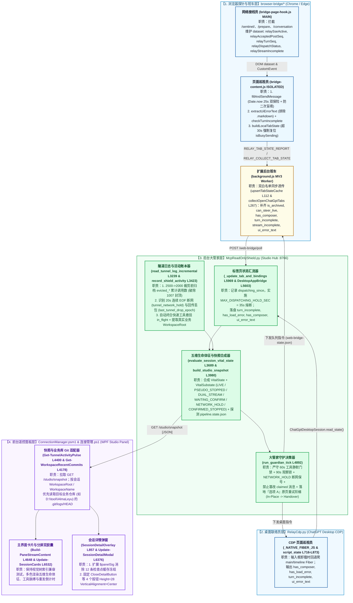
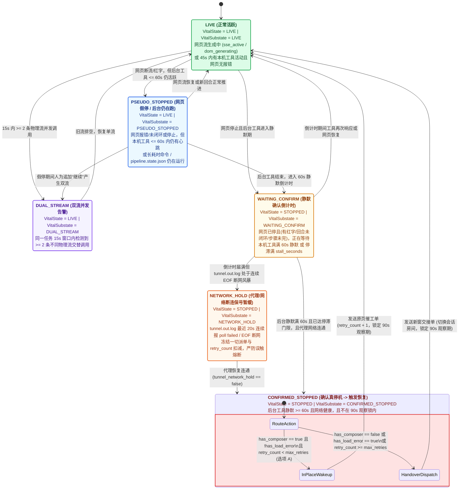

# RelayStudio v4.7 规格说明：通用断流闭环检测、五维生命体征防重与详情弹窗全链路校准

> **版本**：v4.7（全模块源码审查增强版 — 达成共识前不改动任何业务源码）
> **基线规格**：承接 `docs/specs/2026-11-02-native-task-manage-and-guardian-isolation-spec.md`（v4.6）与历史移交分析 `handoff-false-stop-and-dual-stream-detection.md`
> **领域词汇准则**：严格遵循 [GLOSSARY.md](file:///d:/tool/RelayStudio/GLOSSARY.md) 标准术语（**前台遥控面板（Studio Panel）**、**任务卡片（Task Card）**、**后台大管家（Studio Hub）**、**会话房间（Conversation Room）**、**原页催工单（In-Place Wakeup）**、**新窗交接单（Handover Dispatch）**、**网页探针（Web Probe）**、**网络接线员（Stream Hook）**、**页面巡视员（DOM Inspector）**、**桌面联络员（Desktop Bridge Agent）**）。

---

## Problem Statement（痛点与问题全景）

在长程无人值守开发（如云端模型配合子代理执行 1000+ 次本机工具调用与全量门禁验收）中，现有 v4.6 体系暴露出**“网页假死误判、红字漏检、后台节流死锁、断网盲发、前台详情卡死”**五类连锁问题：

1. **红字报错与 Cloudflare/网络断流无法通用识别，且扩展班车存在双层白名单丢字段漏洞**：
   - 网页端或桌面端常因 SSE 长连接超时、代理 `EOF` 断开、Cloudflare 拦截（403/429/502/524）、或刚打开网页首次发消息失败而出现各种提示（如 `传输超时，请重试`、`未收到 ChatGPT 的回复，请检查网络连接。`、`Error in message stream` 等）。
   - 现有检测依赖少量写死的词库（[bridge-content.js:272-293](file:///d:/tool/RelayStudio/browser-bridge/bridge-content.js#L272-L293)），未核查“一问一答是否完整闭环”，且当 Sentinel PoW（`/backend-api/sentinel/`）或准备阶段（`/conversation/prepare`）因断网失败时，[bridge-page-hook.js:505-511](file:///d:/tool/RelayStudio/browser-bridge/bridge-page-hook.js#L505-L511) 根本未把 `relayDispatchStatus` 置为 `"failed"`。
   - **跨层透传丢包漏洞**：[background.js](file:///d:/tool/RelayStudio/browser-bridge/background.js) 的 `upsertTabStateCache`（[L102-L133](file:///d:/tool/RelayStudio/browser-bridge/background.js#L102-L133)）与 `collectOpenChatGptTabs`（[L267-L288](file:///d:/tool/RelayStudio/browser-bridge/background.js#L267-L288)）采用硬编码字段白名单，连现有的 `is_archived` 与 `can_steer_live` 都被半路丢弃，新增探针字段若不同步声明在这两处白名单中将无法到达大管家。
   - 桌面端当遭遇“无法加载此 ChatGPT 对话”导致底部输入框卸载（`showComposer: false`）时，[RelayCdp.py:716-773](file:///d:/tool/RelayStudio/RelayCdp.py#L716-L773) 虽在 Fiber 中扫到了 `hasLoadError` 与 `errorMessage`，却在 `script_state()`（[L855-L871](file:///d:/tool/RelayStudio/RelayCdp.py#L855-L871)）中未单独透传 `has_load_error`、`turn_incomplete` 与 `ui_error_text`。

2. **Chrome 后台标签页节流引发“3 小时 `is_dispatching` 假在线死锁”与“二次盲填双份草稿”**：
   - 当 Chrome 标签页在后台静置（或最小化/被全屏窗口遮挡）超过 5 分钟后，Chrome 深度节流（Intensive Wake Up Throttling）将 `setTimeout` 限制为每分钟最多唤醒 1 次。
   - [bridge-content.js:731-742](file:///d:/tool/RelayStudio/browser-bridge/bridge-content.js#L731-L742) 的 `waitForDispatchAcceptance` 纯靠 `209` 次 `await sleep(120)` 计数而未校验真实物理时钟 `Date.now()`，导致一次断网未获确认的投递在后台卡死近 **3 小时（04:01 至 06:59）**；期间 `isBusySending` 一直锁在 `true`，持续上报 `is_dispatching: true`，而大管家（[McpReadOnlyShield.py:6007](file:///d:/tool/RelayStudio/McpReadOnlyShield.py#L6007) & [L3783](file:///d:/tool/RelayStudio/McpReadOnlyShield.py#L3783)）无条件将 `is_dispatching: true` 视为 `LIVE` 并不断刷新 `last_live_at`，导致整整 3 小时不重发。
   - 同时，[bridge-content.js:969-984](file:///d:/tool/RelayStudio/browser-bridge/bridge-content.js#L969-L984) 在寻找发送按钮的第 `i === 5` 轮循环时未检查输入框是否已有文本就盲目重填，且在发送失败退出时（[L1023-L1028](file:///d:/tool/RelayStudio/browser-bridge/bridge-content.js#L1023-L1028)）未清理残留的机器注入草稿，造成“上方已发出黑底气泡报错、下方输入框还躺着一模一样的第二份草稿”。

3. **网页“假停机（Pseudo-Stopped）”、大管家越权篡改导致“双流并发”，以及代理断网期间“顶风盲发”**：
   - 云端模型在后台执行长耗时工具期间网页流常先断开，若仅看网页停流/红字就重发，会引发双流并发读写同一工作区。
   - [McpReadOnlyShield.py:5058-5151](file:///d:/tool/RelayStudio/McpReadOnlyShield.py#L5058-L5151) 的 `run_guardian_tick` 一旦看到 `has_error == True`，会直接把已被浏览器认领（`claimed`）的 `in_place_wakeup` 篡改为 `new_window_handover`、跳过 90 秒观察锁（`L5120`, `L5129`）、且无视用户配置的原页重试次数（`max_retries`）直接跨窗换新会话。
   - 本机浏览器与 `tunnel-client.exe` 共用代理 `127.0.0.1:7897`。当代理发生长时段 `EOF` 完全断网（如凌晨 `03:58~04:03` 及 `04:32~06:24`）时，大管家在断网期盲目派单会直接白白耗尽重试配额并触发“连续 2 个死窗口永久熔断（Tripped）”。

4. **快照遥测数据失真（调用计数卡在 ~1007 次、空检查点覆盖战报、Git 提交读错仓库、7 位 SHA 被删与叠字）**：
   - **调用计数封顶 ~1007 次**：[McpReadOnlyShield.py:3271-3282](file:///d:/tool/RelayStudio/McpReadOnlyShield.py#L3271-L3282) 在 `tunnel.out.log` 超过 2500 行时直接裁剪保留最后 2000 行，而 `build_studio_snapshot`（[L4054-L4192](file:///d:/tool/RelayStudio/McpReadOnlyShield.py#L4054-L4192)）每次仅遍历这 2000 行重新计数，丢弃了被裁剪的历史累加基数。
   - **空检查点覆盖真实战报**：[McpReadOnlyShield.py:2977-2980](file:///d:/tool/RelayStudio/McpReadOnlyShield.py#L2977-L2980) 在 `task_manage(action="checkpoint")` 未传 `summary` 时将 `doc["summary"]` 覆写为 `"记录检查点"`，冲掉了上一条真实阶段战报。
   - **Git 提交列表永远显示 RelayStudio 自身仓库**：[ConnectionManager.psm1:4178-4225](file:///d:/tool/RelayStudio/ConnectionManager.psm1#L4178-L4225) 的 `Get-WorkspaceRecentCommits` 将 `Join-Path $PSScriptRoot '.git\logs\HEAD'` 放在 `$candidates[0]` 并立即 `return`，且 [L4409-L4418](file:///d:/tool/RelayStudio/ConnectionManager.psm1#L4409-L4418) 全局只调一次赋给所有会话，完全忽略了任务真实的业务工作区（如 `D:\tool\AlmaLeyu`）。
   - **7 位 Git SHA 被误删与三叠字**：[McpReadOnlyShield.py:3623](file:///d:/tool/RelayStudio/McpReadOnlyShield.py#L3623) 的正则 `(?<![A-Za-z0-9_])(?:SHA)?[0-9a-f]{7,40}(?![A-Za-z0-9_])` 因 `(?:SHA)?` 可选而误删所有 7~11 位 Git 短哈希；[L4648](file:///d:/tool/RelayStudio/McpReadOnlyShield.py#L4648) 在 `ago_text == "刚刚"` 时拼出 `“刚刚刚调用过本机工具”`。

5. **前台遥控面板详情弹窗（`SessionDetailOverlay`）签名冻结与 `× 关闭详情` 按钮纵向拉伸**：
   - [连接管理.ps1:6401](file:///d:/tool/RelayStudio/%E8%BF%9E%E6%8E%A5%E7%AE%A1%E7%90%86.ps1#L6401) 的 `$panelSig` 仅包含 `$(@($ckpts).Count)`（在 `McpReadOnlyShield.py:4463` 被截断为上限 12），一旦检查点超过 12 条且完成步数未变，详情弹窗的阶段列表与检查点列表彻底停止刷新。
   - [连接管理.ps1:286-308](file:///d:/tool/RelayStudio/%E8%BF%9E%E6%8E%A5%E7%AE%A1%E7%90%86.ps1#L286-L308) 的全局 `Button` 样式未设 `VerticalAlignment="Center"`，导致 `CloseDetailButton`（[L875](file:///d:/tool/RelayStudio/%E8%BF%9E%E6%8E%A5%E7%AE%A1%E7%90%86.ps1#L875)）及归档/历史抽屉顶部按钮（[L813](file:///d:/tool/RelayStudio/%E8%BF%9E%E6%8E%A5%E7%AE%A1%E7%90%86.ps1#L813), [L814](file:///d:/tool/RelayStudio/%E8%BF%9E%E6%8E%A5%E7%AE%A1%E7%90%86.ps1#L814), [L843](file:///d:/tool/RelayStudio/%E8%BF%9E%E6%8E%A5%E7%AE%A1%E7%90%86.ps1#L843)）在左侧长文本折行时被 WPF 默认 `Stretch` 纵向拉扯成巨型方框。

---

## Solution（核心解决思路）

通过**五道递进防线**闭环解决全部根因，同时 100% 保持现有离线/微任务单元测试契约向后兼容：

1. **一问一答正向闭环契约 + 正文隔离 + 四级白名单全量透传**：
   - 网络层（`bridge-page-hook.js`）拦截 `/sentinel/`、`/prepare` 与 `/conversation`，核对 HTTP 状态码与真实 SSE 流是否收到 `data: [DONE]` / `message_stream_complete`；页面层（`bridge-content.js` & `RelayCdp.py`）核查最后一条消息是否孤立停留在用户提问或未完成回合，并在剔除 `.markdown, pre, code, [data-user-message-bubble="true"]` 后提取外围异常文案 `ui_error_text`。
   - 打通 `bridge-content.js` $\rightarrow$ `background.js`（双白名单函数）$\rightarrow$ `McpReadOnlyShield.py`（`_update_tab_and_bindings` & `DesktopAppBridge`）全链路字段透传。
2. **物理时钟双保险防节流死锁 + 安全草稿清理**：
   - `waitForDispatchAcceptance` 与 `waitForSteerAcceptance` 采用 **`attempt < 209` 循环上限 + `Date.now() < deadline`（25s / 6.5s）物理时钟**双保险；`buildLocalTabState` 对超过 30 秒的 `isBusySending` 自动复位；`i === 5` 仅在输入框为空时补填，发送未确认时精准清空机器注入的残留草稿（绝不触碰用户手写草稿）。
   - 大管家对标签页 `is_dispatching` 施加 **35 秒硬上限（`MAX_DISPATCHING_HOLD_SEC = 35`）**。
3. **五维生命体征合成 + 60 秒工具静默门禁 + 网络断连保号（`NETWORK_HOLD`）+ 选项 A 原页重试阶梯**：
   - 保持顶层 `VitalState`（`LIVE` / `STOPPED` / `UNKNOWN`）向后兼容，新增细粒度 `VitalSubstate`（`LIVE` / `PSEUDO_STOPPED` / `DUAL_STREAM` / `WAITING_CONFIRM` / `NETWORK_HOLD` / `CONFIRMED_STOPPED`）。
   - 当 `tunnel.out.log` 最近 20 秒处于连续 `EOF` 断网风暴时进入 `NETWORK_HOLD`，冻结派单与重试计数扣减；待后台工具静默满 60 秒且网络连通后，严格按**选项 A**优先执行 `max_retries` 次**原页催工单（In-Place Wakeup）**（只要 `has_composer == True` 且 `!has_load_error`），耗尽后才升级为**新窗交接单（Handover Dispatch）**。
4. **跨截断累加计数、真实业务仓库 Git 归因与战报清洗校准**：
   - `_LOG_READERS` 在 2500$\rightarrow$2000 行裁剪前归档累加淘汰行计数；`extract_mcp_call_telemetry` 提取真实业务 `WorkspaceRoot`（如 `D:\tool\AlmaLeyu`），`Get-WorkspaceRecentCommits` 按会话优先读取业务仓库 `.git\logs\HEAD`；保护非空检查点摘要、保留 7~12 位 Git SHA、消除 `“刚刚刚”` 叠字。
5. **前台遥控面板双层生命体征可视化、`$panelSig` 实时刷新与弹窗按钮整型**：
   - 修复 4 个弹窗/抽屉头部按钮的 `VerticalAlignment="Center" Height="28"` 及 `DetailModalGoal` 两行省略 + `ToolTip`；扩展 `$panelSig` 消除 12 条检查点冻结；在分屏状态胶囊、左侧任务卡片与详情弹窗同步呈现五维生命体征、本机工具脉搏与重发倒计时。

---

##Implementation Decisions（实施决策与全链路架构契约）

### AI-Readable Architecture Diagram（跨模块全链路数据流与四级透传白名单架构图）

> **架构图说明**：下图按 C4 组件级（Level 3）白盒视图，完整标出**网页探针层**、**桌面联络员层**、**后台大管家层**与**前台遥控面板层**之间的精确函数调用、Dataset/JSON 透传字段与落盘文件契约。



---

### AI-Readable State Machine（六态生命体征、网络断连保号与“选项 A”重试阶梯状态机）



---

## 全模块修改契约与精确行号清单（Module-by-Module Implementation Specs）

### 模块一：网页探针、扩展班车与桌面联络员（`browser-bridge/*` + `RelayCdp.py`）

#### 1.1 [bridge-page-hook.js](file:///d:/tool/RelayStudio/browser-bridge/bridge-page-hook.js)（MAIN World 网络接线员）
1. **覆盖 `/sentinel/` 与 `/prepare` 阶段失败（[L504-L515](file:///d:/tool/RelayStudio/browser-bridge/bridge-page-hook.js#L504-L515), [L615-L629](file:///d:/tool/RelayStudio/browser-bridge/bridge-page-hook.js#L615-L629), [L691-L693](file:///d:/tool/RelayStudio/browser-bridge/bridge-page-hook.js#L691-L693)）**：
   - 新增 `const isSentinel = /\/backend-api\/(?:f\/)?sentinel\//i.test(url);`，令 `const activeDispatchId = (isConversationPost || isSentinel) ? safeGetDataset("relayDispatchId") : "";`。
   - 当 `isSentinel || isPrepare` 请求在 `origFetch` 抛出网络异常或返回 `!response || !response.ok` 时，若 `activeDispatchId && safeGetDataset("relayDispatchId") === activeDispatchId`，立即设置 `safeSetDataset("relayDispatchStatus", "failed")` 与 `safeSetDataset("relayTurnIncomplete", "1")`，防止 `waitForDispatchAcceptance` 空等。
2. **追踪 SSE 流正向闭环（[L630-L678](file:///d:/tool/RelayStudio/browser-bridge/bridge-page-hook.js#L630-L678)）**：
   - 在 `markUserTurnAccepted()`（[L631](file:///d:/tool/RelayStudio/browser-bridge/bridge-page-hook.js#L631)）清空旧标记：`safeSetDataset("relayStreamIncomplete", "")`、`safeSetDataset("relayTurnIncomplete", "")`。
   - 在流读取闭包（[L640-L669](file:///d:/tool/RelayStudio/browser-bridge/bridge-page-hook.js#L640-L669)）内维护：
     - `sawRealSseFrame`：匹配 `/\b(?:event:\s*\w+|data:\s*\{)/`；
     - `sawSseDone`：匹配 `/data:\s*\[DONE\]|"message_stream_complete"|"status"\s*:\s*"finished_successfully"/`；
     - `sawSseErrorEvent`：匹配 `/^event:\s*error\b|"error"\s*:\s*\{[^}]*"message"/m`。
   - 在 `finally`（[L666-L668](file:///d:/tool/RelayStudio/browser-bridge/bridge-page-hook.js#L666-L668)）计算 `const incomplete = Boolean(streamErrored || sawSseErrorEvent || (sawRealSseFrame && !sawSseDone));`，写入 `safeSetDataset("relayStreamIncomplete", incomplete ? "1" : "")` 与 `safeSetDataset("relayTurnIncomplete", incomplete ? "1" : "")`，并调用 `markSseStreamCompleted(!incomplete)`（注：仅在 `sawRealSseFrame` 为真时要求 `sawSseDone`，确保 [tests/test_dispatch_receipt.cjs:411-427](file:///d:/tool/RelayStudio/tests/test_dispatch_receipt.cjs#L411-L427) 的 4 字节合成流 `[100, 97, 116, 97]` 继续 100% 通过 `relayTurnSeq == '1'` 断言）。
3. **支持清空 ProseMirror 残留系统草稿（[L790-L847](file:///d:/tool/RelayStudio/browser-bridge/bridge-page-hook.js#L790-L847)）**：
   - 在 `relaystudio:fill-composer` 事件处理器中，若 `detail.clear === true`（或 `detail.text === ""` 且显式要求清空），通过 `pmView.state.tr.delete(0, pmView.state.doc.content.size)` 清空编辑器。

#### 1.2 [bridge-content.js](file:///d:/tool/RelayStudio/browser-bridge/bridge-content.js)（ISOLATED World 页面巡视员）
1. **外围报错提取与一问一答正向闭环核查（替换 [L272-L293](file:///d:/tool/RelayStudio/browser-bridge/bridge-content.js#L272-L293) `hasErrorState`）**：
   - `extractUiErrorText()`：遍历 `[data-testid*="conversation-error"], [data-testid*="error"], div[role="alert"], [role="status"], button[data-testid*="regenerate"], main [class*="error" i]`。**硬性剔除正文与用户气泡**：凡节点自身或祖先匹配 `.markdown, pre, code, [data-user-message-bubble="true"], [data-message-author-role="user"], textarea, #prompt-textarea` 一律跳过；克隆容器提取文本时先移除内部 `.markdown, pre, code` 子节点，提取非空外围异常文案（截断至 240 字符）。
   - `checkTurnIncomplete()`：当 `!isSseActive() && !isGeneratingState() && !isBusySending` 时：
     - 若 `dataset.relayStreamIncomplete === "1"` 或 `dataset.relayTurnIncomplete === "1"` 或 `Number(dataset.relayAcceptedPostSeq || 0) > Number(dataset.relayTurnSeq || 0)` $\rightarrow$ 返回 `true`；
     - 查询 `document.querySelectorAll('[data-message-author-role]')`：若节点数 `> 0` 且最后一个可见消息节点的 `data-message-author-role === "user"`（只有用户提问气泡、下方无助手回复） $\rightarrow$ 返回 `true`（当节点数为 `0` 时返回 `false`，兼容离线最小 DOM 测试桩）。
   - `hasErrorState()` 返回 `Boolean(extractUiErrorText() || checkTurnIncomplete())`。
2. **双保险防 Chrome 后台节流死锁（[L69-L70](file:///d:/tool/RelayStudio/browser-bridge/bridge-content.js#L69-L70), [L731-L760](file:///d:/tool/RelayStudio/browser-bridge/bridge-content.js#L731-L760), [L1078-L1115](file:///d:/tool/RelayStudio/browser-bridge/bridge-content.js#L1078-L1115)）**：
   - 新增 `let busySendStartedAtMs = 0;`，在 `isBusySending = true`（[L892](file:///d:/tool/RelayStudio/browser-bridge/bridge-content.js#L892)）时记录 `busySendStartedAtMs = Date.now()`，`finally`（[L1056](file:///d:/tool/RelayStudio/browser-bridge/bridge-content.js#L1056)）置 `0`。
   - 在 `waitForDispatchAcceptance`（[L731-L742](file:///d:/tool/RelayStudio/browser-bridge/bridge-content.js#L731-L742)）同时检查 `attempt < 209` 与 `Date.now() < deadline`（`const deadline = Date.now() + 25000`）；在 `waitForSteerAcceptance`（[L746-L760](file:///d:/tool/RelayStudio/browser-bridge/bridge-content.js#L746-L760)）同时检查 `i < 50` 与 `Date.now() < deadline`（`const deadline = Date.now() + 6500`）——既防止真实后台标签页被 60s/次节流卡死 3 小时，又保证 `queueMicrotask` 离线测试在 `<1ms` 内跑完 209 次循环。
   - 在 `buildLocalTabState()`（[L1078](file:///d:/tool/RelayStudio/browser-bridge/bridge-content.js#L1078)）入口检查：若 `isBusySending && busySendStartedAtMs > 0 && (Date.now() - busySendStartedAtMs > 30000)`，立即强制复位 `isBusySending = false; busySendStartedAtMs = 0;`。
3. **禁止 `i === 5` 向非空输入框二次塞草稿 & 失败自动清理机器残留草稿（[L969-L984](file:///d:/tool/RelayStudio/browser-bridge/bridge-content.js#L969-L984), [L1023-L1028](file:///d:/tool/RelayStudio/browser-bridge/bridge-content.js#L1023-L1028)）**：
   - 在 [L969](file:///d:/tool/RelayStudio/browser-bridge/bridge-content.js#L969) 将 `if (i === 5)` 改为 `if (i === 5 && !sentAttempted && readComposerCleanText().length === 0)`。
   - 在 [L1023](file:///d:/tool/RelayStudio/browser-bridge/bridge-content.js#L1023) `if (acceptanceOutcome !== "accepted")` 分支内：读取 `const residual = readComposerCleanText();`，**仅当 `residual && lastInjectedText && residual === lastInjectedText` 时**（严格等于本次机器注入文本，绝不误删用户手写草稿），清空输入框并置 `lastInjectedText = ""`。
4. **扩展 `buildLocalTabState()` 输出字段（[L1092-L1114](file:///d:/tool/RelayStudio/browser-bridge/bridge-content.js#L1092-L1114)）**：
   - 新增输出：`has_composer: Boolean(findComposerElement())`, `turn_incomplete: Boolean(checkTurnIncomplete())`, `stream_incomplete: Boolean(ds && ds.relayStreamIncomplete === "1")`, `ui_error_text: String(extractUiErrorText() || "")`。

#### 1.3 [background.js](file:///d:/tool/RelayStudio/browser-bridge/background.js)（MV3 班车双层白名单补齐）
- 在 `upsertTabStateCache`（[L112-L130](file:///d:/tool/RelayStudio/browser-bridge/background.js#L112-L130)）与 `collectOpenChatGptTabs`（[L267-L288](file:///d:/tool/RelayStudio/browser-bridge/background.js#L267-L288)）两个对象字面量中，同步补齐透传：
  - 此前漏传的现有字段：`is_archived: Boolean(s.is_archived)`、`can_steer_live: Boolean(s.can_steer_live)`；
  - 本次新增字段：`has_composer: s.has_composer !== false`、`turn_incomplete: Boolean(s.turn_incomplete)`、`stream_incomplete: Boolean(s.stream_incomplete)`、`has_load_error: Boolean(s.has_load_error)`、`ui_error_text: String(s.ui_error_text || "")`。

#### 1.4 [RelayCdp.py](file:///d:/tool/RelayStudio/RelayCdp.py)（桌面端 CDP 巡视员）
- 在 `_NATIVE_FIBER_JS`（[L716-L773](file:///d:/tool/RelayStudio/RelayCdp.py#L716-L773)）中：
  - 当 `form[data-chatgpt-composer]` 未挂载时，新增回退选择器 `[data-chatgpt-conversation-selection-target], [data-app-action-timeline-scroll], main ol, main` 向上爬 React Fiber，确保在“无法加载此对话”（`showComposer: false`）时仍能拿到 `hasLoadError` 与 `errorMessage`。
  - 检查 `ctx.entries` 最后一个 turn：若不处于生成态（`!isSubmitting && !isStreaming && !isTurnActive`），且末尾 turn 的 `status` 存在且 `!== "complete"`，或末尾 turn 仅有 user 消息无 assistant 回复，标记 `turnIncomplete = true`。
- 在 `script_state()`（[L855-L872](file:///d:/tool/RelayStudio/RelayCdp.py#L855-L872)）返回字典中新增：
  - `"has_load_error": Boolean(ctx && ctx.hasLoadError)`
  - `"turn_incomplete": Boolean(turnIncomplete)`
  - `"ui_error_text": String((ctx && ctx.errorMessage) || domErrText || "").slice(0, 240)`

---

### 模块二：后台大管家与五维生命体征引擎（`McpReadOnlyShield.py`）

#### 2.1 隧道日志跨截断累加计数与网络健康/丢包探针（[McpReadOnlyShield.py:3239-3284](file:///d:/tool/RelayStudio/McpReadOnlyShield.py#L3239-L3284) & [L4054-L4192](file:///d:/tool/RelayStudio/McpReadOnlyShield.py#L4054-L4192)）
1. **破除 ~1007 次调用计数封顶**：
   - 在 `_LOG_READERS[abs_path]` 的 `state` 字典中维护归档累加器：`evicted_valid_tool_count: int = 0`、`evicted_wfr_counts: dict[str, int] = {}`、`evicted_slash_counts: dict[str, int] = {}`、`evicted_subagent_count: int = 0`。
   - 在 `read_tunnel_log_incremental`（[L3271](file:///d:/tool/RelayStudio/McpReadOnlyShield.py#L3271)）当 `len(state["lines"]) > 2500` 裁剪保留 `kept = state["lines"][-2000:]` 前，先扫描被淘汰的前 `len - 2000` 行，将其中的有效工具调用次数累加进 `evicted_*`；在 `build_studio_snapshot`（[L4059-L4191](file:///d:/tool/RelayStudio/McpReadOnlyShield.py#L4059-L4191)）中以 `evicted_*` 作为初始基数叠加当前窗口计数。
2. **识别代理断网风暴（`tunnel_network_hold`）与回传丢包（`last_tunnel_drop_epoch`）**：
   - 扫描 `tunnel.out.log` 尾部记录：若最近 20 秒内（`now_epoch - line_epoch <= 20.0`）出现 $\ge 2$ 条含 `"poll failed"` / `"EOF"` / `"context deadline exceeded"` / `"tunnel metadata fetch failed"` 的错误日志，且最后一条错误之后无新的成功 `"dispatcher forwarded command to MCP server"`，置 `tunnel_network_hold = True`。
   - 当日志行出现 `"failed to post response to control plane"`（含 `"EOF"`）或 `"command response deadline reached"` 时，持久记录 `state["last_tunnel_drop_epoch"] = max(state.get("last_tunnel_drop_epoch", 0.0), line_epoch)`。

#### 2.2 幽灵 `in_flight` 清理、双流并发检测与真实 `WorkspaceRoot` 提取（[L3286-L3543](file:///d:/tool/RelayStudio/McpReadOnlyShield.py#L3286-L3543), [L3993-L4356](file:///d:/tool/RelayStudio/McpReadOnlyShield.py#L3993-L4356)）
1. **区分长耗时工具与快速工具，自动清理幽灵 `in_flight`**：
   - 定义 `LONG_RUNNING_TOOLS = {"exec_command", "shell_exec", "run_command", "run_process", "desktop-commander:start_process", "desktop-commander:interact_with_process", "acp_dispatch"}`。
   - 在 `record_shield_activity`（[L3423](file:///d:/tool/RelayStudio/McpReadOnlyShield.py#L3423)）中，当新请求到达时，自动将同一 `task_id` 下已存在的**非长耗时工具（`tool not in LONG_RUNNING_TOOLS`）**的旧 `in_flight: True` 记录闭合为 `False`；在读取侧（[L717](file:///d:/tool/RelayStudio/McpReadOnlyShield.py#L717), [L4020](file:///d:/tool/RelayStudio/McpReadOnlyShield.py#L4020), [L4131](file:///d:/tool/RelayStudio/McpReadOnlyShield.py#L4131), [L4308](file:///d:/tool/RelayStudio/McpReadOnlyShield.py#L4308)），普通快速工具的 `in_flight` 有效窗口从 `900s` 收紧至 `45s`（长耗时工具保持原有窗口并兼容 [test_spec_v42.py:774-817](file:///d:/tool/RelayStudio/tests/test_spec_v42.py#L774-L817) `test_t18c` 的同毫秒双 `exec_command` 并发断言）。
2. **15 秒双流并发（`DUAL_STREAM`）检测**：
   - 在 `build_studio_snapshot`（[L4238-L4291](file:///d:/tool/RelayStudio/McpReadOnlyShield.py#L4238-L4291)）聚合映射到同一 `target_key` 的不同物理流时，若存在 $\ge 2$ 条不同 `WfrId`/`conv_uuid` 的流在最近 15 秒内（`now_epoch - s["LastEpoch"] <= 15.0`）同时活跃，则标记 `dual_stream_active = True`。
3. **提取真实业务 `WorkspaceRoot` 与探测 `pipeline.state.json`**：
   - 新增 `_extract_workspace_root(raw_text: str) -> str`（位于 [L434-L464](file:///d:/tool/RelayStudio/McpReadOnlyShield.py#L434-L464) 旁）：从工具调用参数（`workdir`, `cwd`, `path`, `file_path`, `cmd`）中提取完整盘符路径（如 `D:\tool\AlmaLeyu\...` 或 `D:\AlmaLeyu\...`），向上回溯定位包含 `.git`、`.scratch`、`pyproject.toml` 或 `package.json` 的真实业务工程根目录，写入 telemetry 的 `"workspace_root"`，并在 `build_studio_snapshot`（[L4637-L4675](file:///d:/tool/RelayStudio/McpReadOnlyShield.py#L4637-L4675)）作为会话卡片的 `"WorkspaceRoot"` 输出。
   - 同时探测 `<WorkspaceRoot>/engine-data/tmp/**/pipeline.state.json` 或 `<WorkspaceRoot>/.scratch/pipeline.state.json` 的最新 `mtime`，若 `now_epoch - mtime <= 60.0` 则视为本地测试流水线活跃。

#### 2.3 标签页 `is_dispatching` 35 秒熔断与五维生命体征合成（[L3689-L3815](file:///d:/tool/RelayStudio/McpReadOnlyShield.py#L3689-L3815), [L5603-L5631](file:///d:/tool/RelayStudio/McpReadOnlyShield.py#L5603-L5631), [L5969-L6060](file:///d:/tool/RelayStudio/McpReadOnlyShield.py#L5969-L6060)）
1. **`MAX_DISPATCHING_HOLD_SEC = 35` 秒硬上限**：
   - 在 `_update_tab_and_bindings`（[L5999-L6058](file:///d:/tool/RelayStudio/McpReadOnlyShield.py#L5999-L6058)）中为每个 tab 维护 `dispatching_since`：当 `raw_dispatching == True` 且 `not sse_active and not is_generating` 时记录起始时间；一旦持续超过 35 秒，强制令 `is_dispatching = False`（不再刷新 `last_live_at`），并在 `evaluate_session_vital_state`（[L3776](file:///d:/tool/RelayStudio/McpReadOnlyShield.py#L3776)）同步校验。
   - 在 `_update_tab_and_bindings`（[L5982-L6058](file:///d:/tool/RelayStudio/McpReadOnlyShield.py#L5982-L6058)）与 `DesktopAppBridge`（[L5603-L5631](file:///d:/tool/RelayStudio/McpReadOnlyShield.py#L5603-L5631)）同步接收并持久化 `has_composer`, `turn_incomplete`, `stream_incomplete`, `has_load_error`, `ui_error_text`。
2. **`evaluate_session_vital_state`（[L3689-L3815](file:///d:/tool/RelayStudio/McpReadOnlyShield.py#L3689-L3815)）输出结构**：
   - 保持顶层 `VitalState` 为 `"LIVE"` / `"STOPPED"` / `"UNKNOWN"`（100% 兼容现有 Python 与 PowerShell 测试对 `VitalState` 的断言），同时引入 45 秒工具宽限窗（`TOOL_ACTIVITY_GRACE_SEC = 45`）：当本机工具或测试流水线在 45 秒内有活动时，`VitalState` 保持 `"LIVE"`（若此时网页已停流或报错，则标记 `VitalSubstate = "PSEUDO_STOPPED"`）。
   - 新增会话卡片字段：`VitalSubstate`（`LIVE` / `PSEUDO_STOPPED` / `DUAL_STREAM` / `WAITING_CONFIRM` / `NETWORK_HOLD` / `CONFIRMED_STOPPED`）、`LastToolAgeSec`、`SilenceCountdownSec`、`DetectedUiError`、`NetworkHold`、`HasComposer`、`HasLoadError`。

#### 2.4 `run_guardian_tick` 守护状态机与“选项 A”原页重试阶梯（[L4950-L5276](file:///d:/tool/RelayStudio/McpReadOnlyShield.py#L4950-L5276)）
1. **保护已认领（`claimed`）消息与严守 90 秒派单观察锁**：
   - 在 [L5058-L5112](file:///d:/tool/RelayStudio/McpReadOnlyShield.py#L5058-L5112) 中，**严禁篡改 `status == "claimed"` 的在途消息**（仅当消息仍处于 `status == "pending"` 未被任何标签页认领，且当前会话已满足换窗条件时才允许就地升级）。
   - 在 [L5120](file:///d:/tool/RelayStudio/McpReadOnlyShield.py#L5120) 与 [L5129](file:///d:/tool/RelayStudio/McpReadOnlyShield.py#L5129) 中，恢复 90 秒观察锁对普通报错的保护：仅当页面彻底失去输入框（`has_composer == False` 或 `has_load_error == True`）时才允许提前穿透观察锁。
2. **接入 60 秒本机工具静默门禁（`AUTO_RESEND_TOOL_COOLDOWN_SEC = 60`）与 `NETWORK_HOLD` 断网保号**：
   - 在触发任何自动唤醒或换窗前，若该会话最近一次本机工具调用或测试流水线心跳距今 `< 60` 秒（`last_tool_age_sec < 60`），一律静默等待（不触发重发）。
   - 若当前 `tunnel_network_hold == True`（本机 `127.0.0.1:7897` 代理正处于连续 `EOF` 断网风暴），将 `brk["last_message"]` 更新为 `"检测到本机代理/隧道断网，暂缓派单并保留重试配额"`，直接 `continue`（不发消息、不扣减 `retry_count`、不递增 `consecutive_dead_handovers`）。
3. **落地“选项 A”原页重试阶梯（修改 [L5145-L5151](file:///d:/tool/RelayStudio/McpReadOnlyShield.py#L5145-L5151) `need_handover`）**：
   - 将原 `need_handover = (has_error or ...)` 修正为：
     ```python
     page_unusable = (not has_composer) or has_load_error
     need_handover = (
         page_unusable
         or brk.get("stage") == "HandoverSent"
         or int(brk.get("retry_count") or 0) >= task_max_retries
         or binding.get("target_mode") == "new_window"
         or (not bound_uuid and bool(binding.get("retired_uuids")))
     )
     ```
   - 效果：当网页出现普通红字（如 `传输超时`、`未收到 ChatGPT 的回复`）或一问一答未闭环（`has_error == True`），只要底部输入框完好（`has_composer == True` 且 `not has_load_error`）且 `retry_count < task_max_retries`，在后台工具静默满 60 秒后，**优先在原页面发送 `in_place_wakeup`（原页催工单）**；仅当原页重试达到 `task_max_retries` 次仍未恢复，或页面崩溃卸载了输入框（`page_unusable == True`），才升级发送 `new_window_handover`（新窗交接单）。

#### 2.5 快照摘要与文案三处修复（[L2977-L2980](file:///d:/tool/RelayStudio/McpReadOnlyShield.py#L2977-L2980), [L3623](file:///d:/tool/RelayStudio/McpReadOnlyShield.py#L3623), [L4490](file:///d:/tool/RelayStudio/McpReadOnlyShield.py#L4490), [L4648](file:///d:/tool/RelayStudio/McpReadOnlyShield.py#L4648)）
1. **消除 `“刚刚刚调用过本机工具”` 叠字（[L4648](file:///d:/tool/RelayStudio/McpReadOnlyShield.py#L4648)）**：当 `ago_text == "刚刚"` 时拼接 `f"{ago_text}调用过本机工具"`，否则拼接 `f"{ago_text}刚调用过本机工具"`。
2. **保护非空 `LatestSummary` 不被 `"记录检查点"` 覆盖（[L2977-L2980](file:///d:/tool/RelayStudio/McpReadOnlyShield.py#L2977-L2980) & [L4490](file:///d:/tool/RelayStudio/McpReadOnlyShield.py#L4490)）**：
   - 在 `handle_native_task_manage`（[L2980](file:///d:/tool/RelayStudio/McpReadOnlyShield.py#L2980)）中，仅当传入的 `args.get("summary")` 非空且不等于 `"记录检查点"` 时才覆写 `doc["summary"]`。
   - 在 `build_studio_snapshot`（[L4490](file:///d:/tool/RelayStudio/McpReadOnlyShield.py#L4490)）中，若 `t_obj.get("summary")` 为空或等于 `"记录检查点"`，自动从后往前遍历 `t_obj.get("events")` 取最近一条非 `"记录检查点"` 的有效检查点 `summary`；若均无，则回退展示当前进行中步骤的标题。
3. **保留 7~12 位 Git commit 短哈希（[L3623](file:///d:/tool/RelayStudio/McpReadOnlyShield.py#L3623)）**：
   - 将 `format_readable_milestone` 中的正则改为 `r"(?<![A-Za-z0-9_])(?:SHA[0-9a-fA-F]{7,40}|[0-9a-f]{40})(?![A-Za-z0-9_])"`，仅剥离带显式 `SHA` 前缀的技术标记或 40 位完整哈希，完整保留战报正文中的 7~12 位 Git 短哈希（同时 100% 兼容 [test_shield_hub.py:621-629](file:///d:/tool/RelayStudio/tests/test_shield_hub.py#L621-L629) 对 `SHA5e6e40b8522e78d` 的剥离断言）。

---

### 模块三：前台遥控面板与 PowerShell 模块（`ConnectionManager.psm1` + `连接管理.ps1`）

#### 3.1 `Get-WorkspaceRecentCommits` 按会话归因真实业务仓库（[ConnectionManager.psm1:4178-4225](file:///d:/tool/RelayStudio/ConnectionManager.psm1#L4178-L4225), [L4405-L4418](file:///d:/tool/RelayStudio/ConnectionManager.psm1#L4405-L4418), [L4836](file:///d:/tool/RelayStudio/ConnectionManager.psm1#L4836)）
- 将函数签名扩展为 `function Get-WorkspaceRecentCommits { param($Context, [string]$WorkspaceRoot = '', [string]$WorkspaceName = '') ... }`。
- 构造 `$candidates` 候选 `.git\logs\HEAD` 列表时，按以下严格优先级排序：
  1. 若 `$WorkspaceRoot` 非空：检查 `Join-Path $WorkspaceRoot '.git\logs\HEAD'`（及向上一层父目录）；
  2. 若 `$WorkspaceName` 非空且不等于 `'General'` / `'RelayStudio'`：在 `(Split-Path $PSScriptRoot -Parent)`（即 `D:\tool`）和 `settings.json -> workspace_roots`（如 `D:\docmonts`）下查找 `Join-Path $root "$WorkspaceName\.git\logs\HEAD"`；
  3. 仅当上述业务仓库均未命中时，才回退检查 `Join-Path $PSScriptRoot '.git\logs\HEAD'`。
- 在 `Get-TunnelActivityPulse`（[L4405-L4418](file:///d:/tool/RelayStudio/ConnectionManager.psm1#L4405-L4418)）中，按每个会话 `$hs` 的 `WorkspaceRoot` 和 `WorkspaceName` 独立缓存并填充 `$hs.RecentCommits`。

#### 3.2 XAML 弹窗/抽屉关闭按钮防拉伸与目标折叠（[连接管理.ps1:813-875](file:///d:/tool/RelayStudio/%E8%BF%9E%E6%8E%A5%E7%AE%A1%E7%90%86.ps1#L813-L875), [L6386](file:///d:/tool/RelayStudio/%E8%BF%9E%E6%8E%A5%E7%AE%A1%E7%90%86.ps1#L6386)）
- 为以下 4 个位于 `Grid` 头部列中的按钮显式补充 `VerticalAlignment="Center" Height="28"`：
  1. `ClearAllArchivedButton`（[L813](file:///d:/tool/RelayStudio/%E8%BF%9E%E6%8E%A5%E7%AE%A1%E7%90%86.ps1#L813)）
  2. `CloseArchiveDrawerButton`（[L814](file:///d:/tool/RelayStudio/%E8%BF%9E%E6%8E%A5%E7%AE%A1%E7%90%86.ps1#L814)）
  3. `CloseSentHistoryButton`（[L843](file:///d:/tool/RelayStudio/%E8%BF%9E%E6%8E%A5%E7%AE%A1%E7%90%86.ps1#L843)）
  4. `CloseDetailButton`（[L875](file:///d:/tool/RelayStudio/%E8%BF%9E%E6%8E%A5%E7%AE%A1%E7%90%86.ps1#L875)）
- 为 `DetailModalGoal`（[L870](file:///d:/tool/RelayStudio/%E8%BF%9E%E6%8E%A5%E7%AE%A1%E7%90%86.ps1#L870)）增加 `MaxHeight="36" TextTrimming="CharacterEllipsis"`，并在 `Update-SessionDetailModal`（[L6386](file:///d:/tool/RelayStudio/%E8%BF%9E%E6%8E%A5%E7%AE%A1%E7%90%86.ps1#L6386)）将多行换行符压平为空格展示，同时将完整多行目标文本挂载到 `$script:controls.DetailModalGoal.ToolTip`。

#### 3.3 详情弹窗 `$panelSig` 全量动态指纹刷新（[连接管理.ps1:6397-6405](file:///d:/tool/RelayStudio/%E8%BF%9E%E6%8E%A5%E7%AE%A1%E7%90%86.ps1#L6397-L6405)）
- 在 `Update-SessionDetailModal` 中，将 `$panelSig` 扩展为：
  ```powershell
  $stepsSig = (@($steps) | ForEach-Object { "$($_.Id):$($_.Status):$($_.UpdatedText)" }) -join ','
  $lastCkpt = if (@($ckpts).Count -gt 0) { "$($ckpts[0].TimeText)|$($ckpts[0].Summary)" } else { '' }
  $panelSig = "$($target.SessionKey)|$($target.VitalState)|$($target.VitalSubstate)|$($target.CommandCount)|$($target.ProgressText)|$stepsSig|$firstSha|$(@($ckpts).Count)|$lastCkpt"
  ```
- 彻底解决检查点满 12 条或单步状态变更为 `in_progress` 时详情弹窗列表不刷新的冻结缺陷。

#### 3.4 分屏状态胶囊、任务卡片与详情弹窗的五维生命体征渲染（[连接管理.ps1:4699-4762](file:///d:/tool/RelayStudio/%E8%BF%9E%E6%8E%A5%E7%AE%A1%E7%90%86.ps1#L4699-L4762), [L6532-L6703](file:///d:/tool/RelayStudio/%E8%BF%9E%E6%8E%A5%E7%AE%A1%E7%90%86.ps1#L6532-L6703)）
- 在 `Build-PaneStreamContent`（[L4699-L4762](file:///d:/tool/RelayStudio/%E8%BF%9E%E6%8E%A5%E7%AE%A1%E7%90%86.ps1#L4699-L4762)）中，**严格保持 `$statusPill` 位于 `$subRow.Children[1]`、状态文本位于 `$sInner.Children[1]` 的视觉树层级与 `>X分钟静默触发` / `>30秒静默触发` 尾缀**（确保 [Test-ConnectionManager.ps1:1252-1255](file:///d:/tool/RelayStudio/tests/Test-ConnectionManager.ps1#L1252-L1255) & [L1343-1345](file:///d:/tool/RelayStudio/tests/Test-ConnectionManager.ps1#L1343-L1345) 100% 通过），并根据 `$SessionObj.VitalSubstate` 渲染对应语义色彩与文案：
  - `PSEUDO_STOPPED`：蓝底 `#EFF6FF` / 蓝字 `#1D4ED8`，显示网页断流但本机工具活跃保护中；
  - `WAITING_CONFIRM`：琥珀底 `#FFFBEB` / 橙字 `#B45309`，显示疑似中断及自动催工倒计时；
  - `NETWORK_HOLD`：橙底 `#FFF7ED` / 橙红字 `#C2410C`，显示代理/网络断连保号等待恢复中；
  - `DUAL_STREAM`：紫底 `#F5F3FF` / 紫字 `#6D28D9`，显示双流并发告警。
- 在 `Update-SessionCards`（[L6695-L6702](file:///d:/tool/RelayStudio/%E8%BF%9E%E6%8E%A5%E7%AE%A1%E7%90%86.ps1#L6695-L6702)）中，使卡片右侧状态标签支持展示 `$s.StatusBadge` 细粒度状态与颜色。

---

## Testing Decisions & Backward Compatibility Matrix（测试门禁与现有测试兼容矩阵）

### 现有测试套件影响核对表

| 测试文件与用例 | 现有断言内容 | v4.7 兼容与演进策略 |
| :--- | :--- | :--- |
| [test_bridge_contract.cjs](file:///d:/tool/RelayStudio/tests/test_bridge_contract.cjs#L119) (`falseAck` L179, `notTaken` L228) | 将 `setTimeout(cb, 120)` 劫持为 `queueMicrotask(cb)`，断言无 POST 时 `waitForDispatchAcceptance` 返回 `ok: false`。 | **零改动直接通过**：采用 `attempt < 209 && Date.now() < deadline` 双条件，微任务下 209 步在 `<1ms` 完成，真实后台节流下 25 秒准时跳出。 |
| [test_dispatch_receipt.cjs](file:///d:/tool/RelayStudio/tests/test_dispatch_receipt.cjs#L411-L546) | `makeStreamBody()` 仅输出 4 字节 `[100, 97, 116, 97]`（`"data"`），断言 `dataset.relayTurnSeq == '1'`。 | **零改动直接通过**：仅当流中解码出真实 SSE 帧（`data: {` 或 `event:`）但缺失 `[DONE]`/`message_stream_complete`、或 `reader.read()` 抛错时才判 `streamIncomplete`。 |
| [test_spec_v42.py](file:///d:/tool/RelayStudio/tests/test_spec_v42.py#L774-L817) (`test_t18c`) | 同毫秒连续 2 次 `record_shield_activity`（均为 `exec_command`），闭合第 1 条后断言第 2 条仍 `in_flight`。 | **零改动直接通过**：仅自动闭合普通快速工具（`tool not in LONG_RUNNING_TOOLS`）的旧 `in_flight` 记录，保留并发 `exec_command` 的独立 `in_flight` 状态。 |
| [test_shield_hub.py](file:///d:/tool/RelayStudio/tests/test_shield_hub.py#L621-L629) | 断言清洗 `"完成核心模块重构并通过验证 \|\| step=s2 files=3 \|\| SHA5e6e40b8522e78d"` 中的 `SHA...`。 | **零改动直接通过**：正则 `r"(?<![A-Za-z0-9_])(?:SHA[0-9a-fA-F]{7,40}\|[0-9a-f]{40})(?![A-Za-z0-9_])"` 剥离 `SHA5e6e...` 同时保留无 `SHA` 前缀的 7~12 位 Git 短哈希。 |
| [test_shield_hub.py](file:///d:/tool/RelayStudio/tests/test_shield_hub.py#L543-L581) & [test_spec_v46.py](file:///d:/tool/RelayStudio/tests/test_spec_v46.py#L641-L669) | 旧测试模拟 `has_error: True` 时跳过原页重试直接升级为 `new_window_handover`。 | **按用户拍板的“选项 A”同步更新测试预期**：当 `has_composer=True` 且 `retry_count < max_retries` 时先走 `in_place_wakeup`；当 `retry_count >= max_retries` 或 `has_composer=False` / `has_load_error=True` 时升级 `new_window_handover` 并验证继承 `reasoning_effort` 与 `target_model`。 |
| [Test-ConnectionManager.ps1](file:///d:/tool/RelayStudio/tests/Test-ConnectionManager.ps1#L635-L650) & [L1252-L1411](file:///d:/tool/RelayStudio/tests/Test-ConnectionManager.ps1#L1252-L1411) | 校验 `SessionDetailOverlay` 控件绑定，以及按固定视觉树路径索引 `$statusPillTxtObj.Text` 匹配 `>5分钟静默触发` / `>30秒静默触发`。 | **零破坏直接通过 + 新增专项断言**：保持视觉树层级索引与静默触发尾缀不变；新增针对 `Get-WorkspaceRecentCommits -WorkspaceRoot`、`CloseDetailButton.Height == 28` 及 `$panelSig` 动态刷新的单元测试。 |

---

## Out of Scope（不在本次变更范围内）

- **不强行杀死云端已发起的旧生成流**：当检测到 `DUAL_STREAM` 时，系统负责实时告警并冻结大管家自动追加派单，不通过刷新网页去中断云端（因刷新网页无法终止云端已在运行的后台容器）。
- **不侵入被测业务代码库**：本地测试流水线探针与业务仓库 Git 提交读取均以纯只读方式访问目标工作区。

---

## Accepted Amendments & Internal Adaptations

> 模块一实施（分支 `v47/m1`）登记。未修改任何现有测试断言；以下均为内部实现适配，不改变面向用户的行为。

| # | 位置 | 规格原文 | 实施适配 | 理由 |
| :--- | :--- | :--- | :--- | :--- |
| M1-A1 | §1.2 `checkTurnIncomplete()` | `Number(relayAcceptedPostSeq) > Number(relayTurnSeq)` 判未闭环 | 不采用该计数比较，仅用 `relayStreamIncomplete` / `relayTurnIncomplete` 标记与末条可见消息角色 | `relayTurnSeq` 只计“干净闭环”的回合，一次断流或用户手动停止后两计数永久错位，会让每个后续回合都被误判未闭环；而 SSE 进行中已由 `!isSseActive()` 排除，该比较在其余时刻只会产生假阳性。最新回合的断流已由 hook 的两个标记精确覆盖。 |
| M1-A2 | §1.2 `extractUiErrorText()` | 遍历选择器并剔除正文/用户气泡 | 额外跳过不可见节点（复用 `isVisibleDomElement`） | 防止隐藏的错误模板 / 屏幕阅读器残留节点误报。 |
| M1-A3 | §1.2 `isBusySending` 30s 复位 | `finally` 置 `busySendStartedAtMs = 0` | `finally` 仅当计时戳仍属于本次投递（或已被看门狗清零）时才复位 | 看门狗强制复位后若新投递已开始，旧投递的 `finally` 不得清掉新投递的忙碌标记。 |
| M1-A4 | §1.4 Fiber 回退 | 在 `findCloudCtx` 场景中新增回退选择器 | 新增独立只读函数 `findFallbackCtx()`（不含 `form` / `composerController`），仅在 `script_state()` 中 `ctx` 为空时使用 | 避免 fill/send/stop 等共享 `findCloudCtx()` 的脚本在无输入框时误把回退上下文当作可操作的输入框；`has_composer` 语义保持不变。 |
| M1-A5 | §1.4 `turnIncomplete` | 末尾 turn `status !== "complete"` | 视 `complete/completed/finished_successfully/finished/done/success` 为已完成；角色读取兼容 `role` / `author.role` / `message.author.role` / `type`，以及 `messages[]` 全为 user 的 turn | 桌面端 entries 结构未有一手样本，放宽完成态词表避免已完成回合被误判；未知结构一律返回 `false`（保守）。 |
